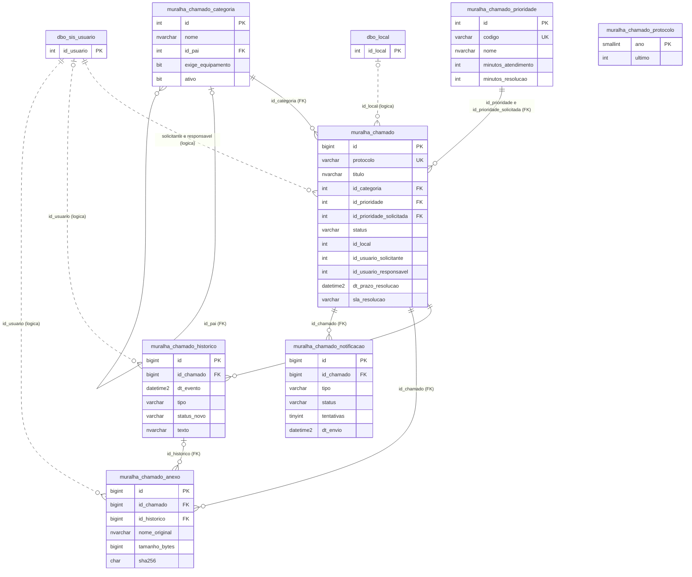

# Banco de Dados — GTW_MURALHA_DEV

> Catálogo gerado em **2026-10-15** a partir do ambiente DEV, em modo somente leitura. **A senha não está documentada**: ela vem de `confGTW.xml` local (ou variável `GTW_DB_PASSWORD` para o script de extração).

## 1. Identificação

| Item | Valor |
|---|---|
| Servidor | `10.0.0.200` (SQL Server 2016 SP2, 64-bit, Standard Edition, Windows Server 2012 R2) |
| Banco | `GTW_MURALHA_DEV` · collation `Latin1_General_CI_AS` · compatibilidade 110 (SQL Server 2012) · recuperação `SIMPLE` |
| Usuário da aplicação | `consilux` (config `armazenamento/servidor_sql`) |
| Tamanho dos dados | ≈ 722 GB (arquivo de dados) |
| Driver | `mssql-jdbc 9.2.1.jre8`; URL `jdbc:sqlserver://10.0.0.200` + catálogo; `packetSize=16384` |
| Acesso manual | `sqlcmd -S 10.0.0.200 -U consilux -d GTW_MURALHA_DEV -C` (senha em `SQLCMDPASSWORD`) |

> ⚠️ **Compatibilidade 110**: algumas construções do SQL Server 2016 que dependem de nível 130 (ex.: `STRING_SPLIT`) podem não funcionar. Teste antes de usar.

## 2. Inventário

| Schema | Tabelas | Linhas (≈) | Variação desde 2026-10-08 | Papel |
|---|---|---|---|---|
| `dbo` | 436 | 24,2 M | +3 tabelas | GTW clássico (infração, processo, remessa, cadastros, configuração de equipamentos) + tabelas de sistema (`sis_*`, incluindo `sis_log_auditoria`, `sis_senha_config`, `sis_usuario_complemento`) + Quartz (`qrtz_*`) + logs |
| `muralha` | 148 | 19,3 M | +24 tabelas | Muralha Digital (alertas, ocorrências, atendimento, blitz, registro de fato, boletim, veículo em tempo real, configurações) + tabelas complementares da PoC (`vtr_*`, `lote_*`, `alerta_sla*`, `kpi_config`…) + Sistema de Chamados (`chamado*`) |
| `mobilidade` | 183 | 4,1 M | sem mudança | Mobilidade urbana/Waze (congestionamentos, incidentes, radares, eventos). **Não usado pelo Java deste projeto** |
| `ia` | 6 | 8,2 M | sem mudança | Características do veículo por IA (`veiculo_caracteristica`, `cad_cor`, `cad_marca`, `cad_modelo`) |
| `dash` | 15 | 372 | novo (2026-10-13) | Construtor de Dashboards: catálogo de dados, datasets, dashboards, widgets, compartilhamento e observabilidade (ver §5A) |
| **Total** | **788** | | +42 (eram 746) | + 126 views · 390 procedures · 302 funções · 8 triggers · 666 chaves estrangeiras |

Variação de objetos programáveis desde 2026-10-08: views 123 → 126, procedures 388 → 390, chaves estrangeiras 636 → 666, funções e triggers sem mudança.

Objetos programáveis: `dbo` = 110 views, 283 procedures, 193 funções inline + 55 escalares + 8 tabela, 5 triggers; `muralha` = 16 views, 107 procedures, 33 inline + 5 escalares + 8 tabela, 3 triggers. O schema `dash` não tem views, procedures nem funções (a lógica está no Java).

Observações de higiene: ~156 tabelas com sufixo `_test*`, `bkp`, `backup`, `_ant` (principalmente em `mobilidade` e backups em `dbo`); `veiculo_tempo_real_imagem_copiar_dev` (4,4 M) é cópia para DEV.

### Maiores tabelas
| Tabela | Linhas |
|---|---|
| `muralha.veiculo_tempo_real_imagem` | 10.913.304 |
| `muralha.veiculo_tempo_real` | 8.188.803 |
| `ia.veiculo_caracteristica` | 8.185.846 |
| `dbo.veiculo_tempo_real_imagem_copiar_dev` | 4.429.155 |
| `dbo.veiculo_sumarizado` | 4.151.334 |
| `dbo.veiculo_estatistica` | 3.264.495 |
| `dbo.veiculo_sumarizado_faixa_velocidade` | 2.412.990 |
| `mobilidade.congestionamentos_coordenadas_test` | 1.627.640 |
| `dbo.veiculo_pesagem_controle` / `veiculo_pesagem` | 1.482.156 / 1.345.178 |
| `dbo.log_processos` | 1.356.339 |
| `dbo.bkp_veiculo_pesagem` | 1.332.362 |

## 3. Navegação

| Arquivo / pasta | Conteúdo |
|---|---|
| [`tabelas/<schema>/<grupo>.md`](tabelas/) | 65 arquivos agrupados pelo prefixo do nome: colunas (tipo, null, identity, default), PK/índices, FKs de saída e "referenciada por", contagem de linhas. Prefixos com < 4 tabelas vão em `outros.md` |
| [`objetos-programaveis.md`](objetos-programaveis.md) | Catálogo das views/procedures/funções/triggers: parâmetros, **objetos referenciados**, datas de criação/alteração |
| [`codigo-sql/`](codigo-sql/) | **Código-fonte** de cada objeto (826 arquivos em `views/ procedures/ funcoes/ triggers/` — `<schema>.<nome>.sql`) |
| [`dominios.md`](dominios.md) | Valores de 43 tabelas de domínio pequenas (tipos, status, motivos…) |
| [`scripts/extrair-catalogo.ps1`](scripts/extrair-catalogo.ps1) | Regenera `tabelas/` e `codigo-sql/` (somente SELECT em `sys.*`) |
| [`../referencia/menus-e-permissoes.md`](../referencia/menus-e-permissoes.md) | Conteúdo de `sis_grupo`, `sis_menu*` (menus e direitos) |
| [`migracoes/`](migracoes/) | Scripts DDL/DML versionados (`AAAAMMDD_descricao.sql`, idempotentes, com rollback comentado) das Planos Salvador, do Construtor de Dashboards e do Sistema de Chamados; o [README da pasta](migracoes/README.md) lista cada script, sua situação no DEV e a ordem de execução. Regras gerais em [`../requisitos/10-guia-de-implementacao.md`](../requisitos/10-guia-de-implementacao.md) §6 |

## 4. Mapa dos grupos de tabelas (dbo)

| Prefixo / grupo | Tabelas | O que contém |
|---|---|---|
| `configuracao_equipamento*` (44) | `configuracao_equipamento` (470) + satélites (pista, câmera, controlador, aferição, regra_infracao, servidor, painel, rodovia, rodízio…) | Cadastro técnico de cada equipamento/PCL |
| `local*`, `grupo_equipamento`, `faixa_velocidade` | `local` (470), `local_municipio_regiao`, `local_pista_croqui` | Locais e agrupamentos |
| `cad_*` (31) | `cad_veiculo`, `cad_marca/modelo/cor/especie/tipo`, `cad_isento`, `cad_municipio`, `cad_localidade`, `cad_inibicao_infracao`, `cad_evento_manual` | Cadastros de apoio |
| `veiculo*` (35) | `veiculo` (74 mil), `veiculo_imagem`, `veiculo_estatistica` (3,3 M), `veiculo_sumarizado*`, `veiculo_pesagem*`, `veiculo_importacao*`, `veiculo_video` | Passagens do GTW clássico e sumarizações |
| `infracao*` (26), `processo*`, `remessa*`, `inconsistencia*` | `infracao` (73 mil), `infracao_processo` (100 mil), `infracao_imagem`, `infracao_contestacao*`, `remessa*`, `processo_*` | Fluxo de fiscalização |
| `sis_*` (29) | `sis_usuario` (≈ 42), `sis_grupo` (≈ 30), `sis_usuario_grupo`, `sis_menu*`, `sis_menu_direitos`, `sis_log*`, `sis_log_auditoria`, `sis_senha_config`, `sis_usuario_complemento`, `sis_usuario_token`, `sis_usuario_recupera_senha`, `sis_localizacao` | Segurança e sistema |
| `qrtz_*` (12) | Tabelas do Quartz (JDBC store **não** habilitado) | — |
| `ppv_*` (31) | Pátio/peso/veículo (praticamente vazias) | Legado |
| `log*`, `eventos*`, `integracao*`, `bkp*`, `temp*` | Logs, eventos CSX, integrações, backups | — |

## 5. Mapa dos grupos (muralha)
`alerta*` · `alerta_veiculo` · `anotacao_contributiva` · `atendimento*` (10) · `blitz*` (13) · `boletim*` · `cad_veiculo_monitorado*` (7) · `config*` (17) · `correlacionamento_automatico*` · `guarnicao*` · `ocorrencia*` · `registro_fato*` (17) · `veiculo_tempo_real*` (3) · `ponto_interesse*` · `area_monitorada` · `agente_localizacao_*` · `motivo_*` · `status_*` · `tipo_*` — detalhes e colunas em `tabelas/muralha/*.md`.

Grupos criados a partir de 2026-10-08 (Planos Salvador, Construtor de Dashboards e Sistema de Chamados):

| Prefixo / tabelas | Arquivo em `tabelas/muralha/` | O que contém |
|---|---|---|
| `chamado*` (7: `chamado`, `chamado_anexo`, `chamado_categoria`, `chamado_historico`, `chamado_notificacao`, `chamado_prioridade`, `chamado_protocolo`) | `chamado.md` | Sistema de Gerenciamento de Chamados (Plano 22), com SLA, histórico, anexos e fila de e-mails — diagrama na §6A |
| `vtr_*` (4: `vtr_complemento`, `vtr_imagem_complemento`, `vtr_imagem_obliterada`, `vtr_status_analise`) | `vtr.md` | Complementos de `veiculo_tempo_real` e de suas imagens (status de análise, SHA-256, obliteração), em tabelas separadas para não alterar a tabela legada — diagrama na §6C |
| `lote_infracao`, `lote_infracao_item` | `outros.md` | Lotes de infrações (Plano 14) |
| `alerta_sla`, `alerta_sla_preproc` | `alerta.md` | Medições de SLA de latência (Plano 07) e de pré-processamento 72 h (Plano 10) |
| `kpi_config` | `outros.md` | KPIs configuráveis (Plano 15) |
| `equipamento_disponibilidade`, `incidente_externo` | `outros.md` | Disponibilidade de equipamentos (Plano 18) e incidentes externos/Waze (Plano 19) |
| `expurgo_log` | `outros.md` | Registro da política de retenção/expurgo (Plano 12) |
| `infracao_analise`, `infracao_imagem_obliteracao` | `outros.md` | Dupla análise de infrações (Plano 05) e obliteração de imagens (Plano 06) |
| `dashboard_dataset`, `dashboard_painel`, `dashboard_widget` | `outros.md` | Primeira versão do Dashboard Builder (Plano 20, migração `20261010_dashboard_builder.sql`), anterior ao schema `dash` |

No schema `dbo`, os Planos Salvador acrescentaram `sis_log_auditoria` (Plano 01), `sis_senha_config` (Plano 03) e `sis_usuario_complemento` (Planos 03/04/09), em `tabelas/dbo/sis.md`. A visão por plano está em [`../planos-salvador/00b-tabelas-complementares.md`](../planos-salvador/00b-tabelas-complementares.md).

## 5A. Schema `dash` (Construtor de Dashboards)

Criado em 2026-10-13 pelos Planos 20/21 (migrações `20261013_*` e dados de demonstração `20261014_*`). São 15 tabelas, ≈ 372 linhas, documentadas em `tabelas/dash/dataset.md` (família `dataset*`) e `tabelas/dash/outros.md` (demais).

| Grupo | Tabelas | Função |
|---|---|---|
| Catálogo de dados | `catalogo_tabela`, `catalogo_coluna`, `catalogo_relacao` | Lista de tabelas/colunas liberadas para análise (com marcação de colunas sensíveis) e relacionamentos permitidos |
| Datasets | `dataset`, `dataset_tabela`, `dataset_campo`, `dataset_relacao`, `dataset_filtro_fixo`, `dataset_modelador` | Modelo de dados do usuário: tabelas, campos/medidas, junções, filtros fixos e layout do modelador visual |
| Painéis | `dashboard`, `widget` | Painéis e seus gráficos, com posição na grade e consulta em JSON |
| Governança e observabilidade | `compartilhamento`, `historico_versao`, `consulta_log`, `dataset_estatistica` | Permissões de acesso, versões, log de consultas e estatísticas de desempenho |

FKs declaradas para fora do schema: `dataset.id_usuario` e `dashboard.id_usuario` → `dbo.sis_usuario.id_usuario`. As tabelas de governança (`compartilhamento`, `historico_versao`, `consulta_log`) referenciam recursos por id, sem FK. Diagrama na §6B.

## 6. Relacionamentos centrais (resumo)
```
local ─< configuracao_equipamento ─< configuracao_equipamento_pista (faixas)
muralha.veiculo_tempo_real ─< veiculo_tempo_real_imagem
muralha.cad_veiculo_monitorado ─< _equipamento | _grupo | _periodo | _historico
muralha.alerta ─< alerta_veiculo >─ veiculo_tempo_real      (passagem que gerou o alerta)
muralha.alerta ─ status_alerta, tipo_alerta_ocorrencia, motivo_descarte, anotacao_contributiva
muralha.ocorrencia_notificacao ─ ocorrencia_notificacao_historico
muralha.atendimento ─< atendimento_guarnicao >─ guarnicao ─< guarnicao_integrante >─ sis_usuario
muralha.registro_fato ─< _individuo | _veiculo | _objeto | _endereco | _documento | _historico | _link | _passagem_veic
muralha.blitz_digital ─< blitz_abordagem ─< blitz_pessoa_envolvida | blitz_documento | blitz_abordagem_imagem
sis_usuario >─< sis_grupo (sis_usuario_grupo) ; sis_menu >─ sis_menu_direitos ─> sis_grupo / sis_usuario
infracao ─< infracao_imagem ; infracao ─< infracao_processo ─< infracao_processo_concluido ; remessa ─< infracao_remessa
muralha.chamado_categoria ─< chamado >─ chamado_prioridade ; chamado ─< chamado_historico | chamado_anexo | chamado_notificacao
muralha.chamado ··· dbo.sis_usuario (solicitante/responsável) | dbo.local (equipamento)         (··· = relação lógica, sem FK)
dash.catalogo_tabela ─< catalogo_coluna ; dash.dataset ─< dataset_tabela | dataset_campo | dataset_relacao | dataset_filtro_fixo
dash.dashboard ─< widget >─ dataset ; dash.dataset >─ dbo.sis_usuario (autor)
muralha.veiculo_tempo_real ··· vtr_complemento | vtr_imagem_complemento | vtr_imagem_obliterada | vtr_status_analise   (mesmo id, sem FK)
muralha.lote_infracao ─< lote_infracao_item ; muralha.dashboard_painel ─< dashboard_widget >─ dashboard_dataset
```
Use `tabelas/<schema>/<grupo>.md` para as FKs reais (666 chaves estrangeiras no banco; muitas relações de `muralha.*` são lógicas, sem FK declarada — validar no código).

### 6A. Diagrama — Sistema de Chamados (Plano 22)

Convenção dos diagramas desta seção: o Mermaid não aceita ponto no nome da entidade, então `schema.tabela` aparece como `schema_tabela` (ex.: `muralha_chamado` = `muralha.chamado`). Linha contínua = FK declarada no banco; linha tracejada = relação lógica, sem FK (validar no código).



`chamado_protocolo` é o contador anual da numeração (uma linha por ano; `chamado.protocolo` é gerado a partir dele, sem FK). Os jobs `ChamadoSlaJob` (5 min) e `ChamadoEmailJob` (1 min, consome `chamado_notificacao`) e os servlets `/MuralhaDigital/Chamado`, `ChamadoRelatorio` e `ChamadoConfig` operam sobre essas tabelas; a configuração fica em `muralha.config_chave_valor` (chaves `chamado_*`). `dbo.local` tem PK composta (`id_local`, `sequencia_local`); o diagrama mostra só `id_local`, que é a coluna usada em `chamado.id_local`.

### 6B. Diagrama — Construtor de Dashboards (schema `dash`)

```mermaid
erDiagram
    dash_catalogo_tabela ||--o{ dash_catalogo_coluna : "id_tabela (FK)"
    dash_catalogo_tabela ||--o{ dash_catalogo_relacao : "origem e destino (FK)"
    dash_catalogo_tabela ||--o{ dash_dataset : "id_tabela_base (FK)"
    dash_dataset ||--o{ dash_dataset_tabela : "id_dataset (FK)"
    dash_catalogo_tabela ||--o{ dash_dataset_tabela : "id_tabela (FK)"
    dash_dataset ||--o{ dash_dataset_campo : "id_dataset (FK)"
    dash_catalogo_coluna |o--o{ dash_dataset_campo : "id_coluna (FK)"
    dash_dataset ||--o{ dash_dataset_relacao : "id_dataset (FK)"
    dash_dataset ||--o{ dash_dataset_filtro_fixo : "id_dataset (FK)"
    dash_dataset ||--o| dash_dataset_modelador : "id_dataset (FK)"
    dash_dataset ||--o| dash_dataset_estatistica : "dataset_id (FK)"
    dash_dashboard ||--o{ dash_widget : "id_dashboard (FK)"
    dash_dataset ||--o{ dash_widget : "id_dataset (FK)"
    dbo_sis_usuario ||--o{ dash_dataset : "id_usuario (FK)"
    dbo_sis_usuario ||--o{ dash_dashboard : "id_usuario (FK)"
    dash_dataset ||..o{ dash_consulta_log : "dataset_id (logica)"
    dash_dashboard ||..o{ dash_compartilhamento : "id_recurso (logica)"
    dash_dashboard ||..o{ dash_historico_versao : "id_recurso (logica)"

    dash_catalogo_tabela {
        int id PK
        varchar nome_fisico
        varchar schema_fisico
        nvarchar rotulo
        bit sensivel
        bit ativo
    }
    dash_catalogo_coluna {
        int id PK
        int id_tabela FK
        varchar nome_fisico
        nvarchar rotulo
        varchar tipo
        bit sensivel
    }
    dash_catalogo_relacao {
        int id PK
        int id_tabela_origem FK
        int id_tabela_destino FK
        varchar cardinalidade
        varchar coluna_origem
    }
    dash_dataset {
        int id PK
        nvarchar nome
        int id_tabela_base FK
        int id_usuario FK
        varchar visibilidade
        varchar status
    }
    dash_dataset_tabela {
        int id PK
        int id_dataset FK
        int id_tabela FK
        varchar alias
        varchar tipo
    }
    dash_dataset_campo {
        int id PK
        int id_dataset FK
        int id_coluna FK
        varchar nome_alias
        varchar agregacao
        varchar tipo_campo
    }
    dash_dataset_relacao {
        int id PK
        int id_dataset FK
        int id_tabela_origem FK
        int id_tabela_destino FK
        varchar cardinalidade
    }
    dash_dataset_filtro_fixo {
        int id PK
        int id_dataset FK
        varchar coluna
        varchar operador
        nvarchar valor
    }
    dash_dataset_modelador {
        int id_dataset PK
        nvarchar layout_json
    }
    dash_dataset_estatistica {
        int id PK
        int dataset_id FK
        bigint total_consultas
        int tempo_medio_ms
        bigint consultas_lentas
    }
    dash_dashboard {
        int id PK
        nvarchar nome
        int id_usuario FK
        int refresh_seg
        int versao
        bit ativo
    }
    dash_widget {
        int id PK
        int id_dashboard FK
        int id_dataset FK
        nvarchar titulo
        varchar tipo
        nvarchar consulta_json
    }
    dash_compartilhamento {
        int id PK
        varchar tipo_recurso
        int id_recurso
        int id_usuario
        varchar nivel
    }
    dash_historico_versao {
        bigint id PK
        varchar tipo_recurso
        int id_recurso
        int versao
        int id_autor
    }
    dash_consulta_log {
        bigint id PK
        int usuario_id
        int dataset_id
        int tempo_ms
        bit cache_hit
        bit lenta
    }
    dbo_sis_usuario {
        int id_usuario PK
    }
```



### 6C. Diagrama — Tabelas complementares da Muralha (Planos Salvador)

Os complementos usam o mesmo `id` da tabela legada como chave (sem FK, para não alterar `veiculo_tempo_real`). `infracao_analise.id_infracao` e `lote_infracao_item.id_infracao` são `uniqueidentifier`, o mesmo tipo de `veiculo_tempo_real.id` (a passagem), e não o `int` de `dbo.infracao.id_infracao`; por isso a ligação é desenhada com a passagem e marcada como lógica (inferida pelo tipo; confirmar no código Java). Origem de cada tabela em [`../planos-salvador/00b-tabelas-complementares.md`](../planos-salvador/00b-tabelas-complementares.md).

```mermaid
erDiagram
    muralha_veiculo_tempo_real ||--o{ muralha_veiculo_tempo_real_imagem : "id_veiculo_tempo_real (FK)"
    muralha_veiculo_tempo_real ||..o| muralha_vtr_complemento : "id_vtr (logica)"
    muralha_veiculo_tempo_real ||..o| muralha_vtr_status_analise : "id_veiculo_tempo_real (logica)"
    muralha_veiculo_tempo_real ||..o{ muralha_vtr_imagem_obliterada : "id_veiculo_tempo_real (logica)"
    muralha_veiculo_tempo_real_imagem ||..o| muralha_vtr_imagem_complemento : "id_imagem (logica)"
    muralha_veiculo_tempo_real_imagem ||..o{ muralha_infracao_imagem_obliteracao : "id_imagem_original (logica)"
    muralha_veiculo_tempo_real ||..o{ muralha_infracao_analise : "id_infracao (logica)"
    muralha_veiculo_tempo_real ||..o{ muralha_lote_infracao_item : "id_infracao (logica)"
    muralha_lote_infracao ||--o{ muralha_lote_infracao_item : "id_lote (FK)"
    dbo_sis_usuario ||..o{ muralha_infracao_analise : "id_usuario (logica)"
    dbo_sis_usuario ||..o{ muralha_lote_infracao : "id_usuario_criou (logica)"
    dbo_local ||..o{ muralha_equipamento_disponibilidade : "id_local (logica)"

    muralha_veiculo_tempo_real {
        uniqueidentifier id PK
        char placa
        datetime data
        int id_local
        tinyint id_pista
    }
    muralha_veiculo_tempo_real_imagem {
        uniqueidentifier id PK
        uniqueidentifier id_veiculo_tempo_real FK
        tinyint indice_imagem
    }
    muralha_vtr_complemento {
        uniqueidentifier id_vtr PK
        varchar status_analise
        int latencia_ms
        datetime2 dt_preclass
    }
    muralha_vtr_status_analise {
        uniqueidentifier id_veiculo_tempo_real PK
        varchar status_analise
    }
    muralha_vtr_imagem_complemento {
        uniqueidentifier id_imagem PK
        char sha256
        varchar status_integridade
        bit obliterada
        uniqueidentifier id_original
    }
    muralha_vtr_imagem_obliterada {
        uniqueidentifier id PK
        uniqueidentifier id_imagem_original
        uniqueidentifier id_veiculo_tempo_real
        datetime2 dt_criacao
    }
    muralha_infracao_imagem_obliteracao {
        bigint id PK
        uniqueidentifier id_imagem_original
        uniqueidentifier id_imagem_obliterada
        char tipo
        int id_usuario_aplicou
        bit revertida
    }
    muralha_infracao_analise {
        bigint id PK
        uniqueidentifier id_infracao
        int id_usuario
        tinyint sequencia
        varchar classificacao
        datetime2 dt_analise
    }
    muralha_lote_infracao {
        bigint id PK
        varchar codigo
        varchar status
        datetime2 dt_criacao
        datetime2 dt_envio
        int id_usuario_criou
    }
    muralha_lote_infracao_item {
        bigint id PK
        bigint id_lote FK
        uniqueidentifier id_infracao
        datetime2 dt_inclusao
    }
    muralha_equipamento_disponibilidade {
        bigint id PK
        int id_local
        bit disponivel
        int minutos_offline
        datetime2 dt_verificacao
    }
    dbo_sis_usuario {
        int id_usuario PK
    }
    dbo_local {
        int id_local PK
    }
```



Tabelas complementares sem relação com outras (consultadas por agregação): `alerta_sla` (`percentil95_ms`, `threshold_ms`, `violacao`), `alerta_sla_preproc` (aging 24/48/72 h), `kpi_config` (consulta SQL e limites de cada KPI), `incidente_externo` (Waze), `expurgo_log` (resultado da retenção). As tabelas `vtr_complemento` (vazia) e `vtr_imagem_complemento` (≈ 141,6 mil linhas) vêm de `20261008_tabelas_complementares.sql`, hoje marcado como obsoleto, mas continuam existindo no DEV (ver [`migracoes/README.md`](migracoes/README.md)).

## 7. Procedures e funções mais importantes (Muralha)
| Objeto | Função |
|---|---|
| `muralha.spu_ObterNovosAlertas` | Polling de novos alertas (thread `Alertas`, 2 s) |
| `muralha.spu_ObterDadosAlertaOcorrencia`, `fcn_ObterDadosAlertaOcorrencia` | Dados completos de um alerta/ocorrência |
| `muralha.spu_gerar_ocorrencia`, `spu_encerrar_atendimento`, `spu_obtem_ocorrencias` | Fluxo de ocorrência/atendimento |
| `muralha.spu_ObterVeiculosTempoReal(Historico)`, `spu_ObterVeiculosPorFiltros`, `spu_ObterVeiculosGtwPorFiltros`, `spu_ObterVeiculosBlitzEletronica/WebSocket` | Consulta/stream de passagens |
| `muralha.fcn_ObterAlertas(Alt)`, `fcn_ObterOcorrencias(Alt)` | Listagens de alerta/ocorrência |
| `muralha.fcn_perfil_comportamental_*` | Perfil comportamental de veículo |
| `muralha.spu_correlacionamento_placas`, `fcn_ObterInfo*` | Correlacionamento e dados cruzados |
| `muralha.spu_Relatorio*`, `spu_Get*` (≈ 40) | Relatórios/gráficos/dashboards |
| `dbo.fcn_VerificaAcesso(acao, id_usuario)` | Autorização por URL |
| `dbo.spu_ppv_sis_usuario_token_*` | Token de acesso de usuário |
| `muralha.spu_ImportarBase` | Importação CSV de base (JuncaoBase) |

## 8. Regras para agentes e desenvolvedores
1. **Somente leitura por padrão.** Não executar INSERT/UPDATE/DELETE/DDL/EXEC de procedures com efeito colateral sem autorização explícita, nem em DEV.
2. Consultar tabelas gigantes **sempre** com filtro de data/equipamento e `TOP`.
3. Reutilizar procedures/funções existentes; ver "Referencia" em `objetos-programaveis.md` antes de alterar uma (impacto em cascata).
4. Mudanças estruturais = script em `migracoes/` + aprovação + atualização deste catálogo.
5. Nunca copiar dados reais (placas, CPF, imagens, coordenadas de agentes) para docs, testes ou commits.
6. Para regenerar o catálogo: `$env:GTW_DB_PASSWORD='…'; .\scripts\extrair-catalogo.ps1` (não commitar a senha).
