# Estrutura de dados por tela — Análise de Dados, Dashboards (KPIs) e Gestão de Lotes

> Levantamento de 2026-10-19 no código do repositório e no banco `GTW_MURALHA_DEV` (somente consultas `SELECT` em `sys.columns`, `sys.partitions`, `sys.sql_expression_dependencies` e nos dados). As quantidades de linhas são aproximadas e valem para a base de desenvolvimento nessa data.
>
> **Atualização de 2026-10-20:** revisado depois das correções das fases 1 e 2 ([Plano 35](../planos-salvador/35-correcoes-seguranca-funcionais.md), [entrega 35](../entregas/35-correcoes-seguranca-funcionais.md)) — permissões, escape de HTML, Tipos de Alerta, Relatórios Gerenciais, Análises, KPIs e Gestão de Lotes. Os trechos alterados estão marcados com **Atualização (2026-10-19)** ou citam a data; as demais quantidades continuam as de 2026-10-19.

## Escopo

Telas dos cards ativos em `dbo.sis_menu_infos` nos três módulos pedidos:

| Módulo | Telas incluídas | Fora do escopo |
|---|---|---|
| **Análise de Dados** (card 15) | 1 a 12 | Perfil Comportamental (315) e Análise de Correlacionamentos (309) |
| **Dashboards** (card 1) | 13 Indicadores de Performance (KPIs) e 14 Configuração de KPIs (aberta pelo botão da tela 13) | Painel Informativo (325) e Dashboards (324) |
| **Cadastro e Configuração** (card 16) | 15 Gestão de Lotes de Processamento | Catálogo de Datasets, Ponto de Interesse e Configuração de Monitoramento |

Cada tela traz: menu e arquivos, fluxo de dados (elemento da tela → endpoint → fonte no banco), estrutura das tabelas e views usadas, origem/alimentação dos dados, dois diagramas Mermaid (`erDiagram` das entidades e `flowchart` do fluxo) e pontos de atenção verificados.

## Índice

**Módulo Análise de Dados**
1. [SLA de Latência](#1-sla-de-latência)
2. [Assertividade](#2-assertividade)
3. [SLA Pré-processamento](#3-sla-pré-processamento)
4. [Time-lapse](#4-time-lapse)
5. [Disponibilidade](#5-disponibilidade)
6. [Log de Auditoria](#6-log-de-auditoria)
7. [Integridade das Imagens](#7-integridade-das-imagens)
8. [Logs Técnicos](#8-logs-técnicos)
9. [Tipos de Alerta](#9-tipos-de-alerta)
10. [Relatórios Gerenciais](#10-relatórios-gerenciais)
11. [Pré-Processamento](#11-pré-processamento)
12. [Análises (plataforma Superset embutida)](#12-análises-plataforma-superset-embutida)

**Módulo Dashboards**

13. [Indicadores de Performance (KPIs)](#13-indicadores-de-performance-kpis)
14. [Configuração de KPIs](#14-configuração-de-kpis)

**Módulo Cadastro e Configuração**

15. [Gestão de Lotes de Processamento](#15-gestão-de-lotes-de-processamento)

## Visão geral

Todas as telas seguem o padrão do Muralha Digital: JSP + JavaScript (`fetch`) → servlet `/MuralhaDigital/<Entidade>?acao=…` (JSON/Gson, JDBC via `Conexao.getConexao()`) → tabelas dos schemas `muralha` e `dbo`. Boa parte dos dados é produzida por jobs Quartz agendados em `Agendador` a partir da tabela de passagens `muralha.veiculo_tempo_real`.

Acesso (desde 2026-10-19): os servlets destas telas usam `ControleAcesso` (`muralha.digital.acessos`), que exige sessão e direito **estrito** em `dbo.fcn_VerificaAcesso` para o caminho do servlet (ou para a ação de menu indicada) e responde 401/403 em JSON; uma ação não cadastrada em `sis_menu` é negada, ao contrário do `Acesso.verificaAcesso` legado (*fail-open*). Os servlets que encaminham para JSP usam `exigirTela` (redireciona ao login ou à tela principal). Os servlets e JSPs que não tinham registro ganharam entradas sem card em `sis_menu` (ids 397–438, [`20261019_registro_modulos_novos.sql`](migracoes/20261019_registro_modulos_novos.sql)); os grupos de cada id estão em [menus e permissões](../referencia/menus-e-permissoes.md). Exceção: `SsoAnaliseServlet` ainda abre a tela com `Acesso.verificaAcesso` (ver seção 12).

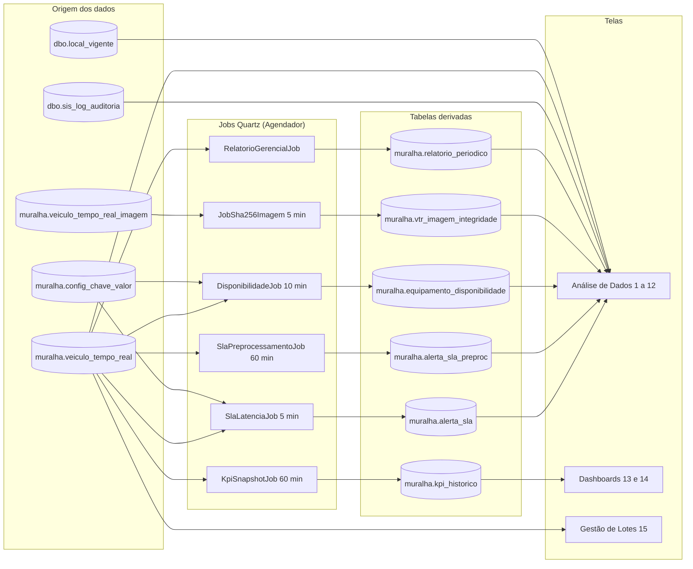

Documentos relacionados: [README do banco](README.md), [tabelas](tabelas/), [migrações](migracoes/), [camada de dados da plataforma de Análises](../analise/camada-dados-views-datasets.md) e [menus e permissões](../referencia/menus-e-permissoes.md).

## Módulo Análise de Dados

### 1. SLA de Latência
- **Menu:** Análise de Dados › SLA de Latência (sis_menu 367) · **URL:** `/muralha-digital/pages/monitoramento/sla-latencia/index.jsp`
- **Arquivos:** [index.jsp](../../src/main/webapp/muralha-digital/pages/monitoramento/sla-latencia/index.jsp) (JS inline, Chart.js via CDN), [SlaLatenciaServlet.java](../../src/main/java/muralha/digital/sla/SlaLatenciaServlet.java), [SlaLatenciaJob.java](../../src/main/java/muralha/digital/sla/SlaLatenciaJob.java), agendamento em [Agendador.java](../../src/main/java/com/consilux/servlet/ferramentas/Agendador.java) (`reajustaJobSlaLatencia`). Plano: [07-sla-latencia.md](../planos-salvador/07-sla-latencia.md); entrega: [07-sla-latencia.md](../entregas/07-sla-latencia.md); migração: [20261008_sla_latencia.sql](migracoes/20261008_sla_latencia.sql).
- **Finalidade:** Acompanhar a latência entre a captura da passagem (`data`) e a importação (`data_importado`), comparando o P95 das janelas de 5 min com o limite configurado (4000 ms).

#### Fluxo de dados
| Elemento da tela | Endpoint (`acao`) | Fonte no banco | Observação |
|---|---|---|---|
| Cards "Latência Média", "Latência Máxima", "Passagens (5 min)" e "Status SLA" | `/MuralhaDigital/SlaLatencia?acao=atual` (a cada 30 s) | `muralha.veiculo_tempo_real` | `COUNT(*)`, `AVG` e `MAX` de `DATEDIFF(MILLISECOND, data, data_importado)` com `data_importado` nos últimos 5 min e latência entre 0 e 600000 ms. O status é calculado no JS: média ≤ 4000 (constante `THRESHOLD` fixa no JS) = OK. |
| Gráfico "Histórico P95 (últimas 24h)" | `?acao=historico` | `muralha.alerta_sla` | `TOP 288` por `dt_alerta DESC` (288 × 5 min = 24 h). Linha de threshold desenhada com o `threshold_ms` fixo do JS. |
| Tabela "Violações recentes" | `?acao=historico` (mesma resposta) | `muralha.alerta_sla` | Filtro no JS: `violacao = true`, até 20 linhas. A coluna "Top locais" vem de `locais_top` (JSON em texto, lido com `JSON.parse`). |

#### Estrutura de dados
**`muralha.veiculo_tempo_real`** (tabela, ≈8,19 mi linhas): passagens de veículos. Colunas usadas aqui:

| Coluna | Tipo | Descrição | PK/FK |
|---|---|---|---|
| id | uniqueidentifier | Identificador da passagem | PK |
| data | datetime | Data/hora da captura | |
| data_importado | datetime (null) | Data/hora da importação; default `getdate()` | |
| id_local | int | Equipamento/local (agrupamento do "top locais") | lógica para `dbo.local_vigente.id_local` (sem FK) |

**`muralha.alerta_sla`** (tabela, ≈2.176 linhas): histórico das medições de 5 min.

| Coluna | Tipo | Descrição | PK/FK |
|---|---|---|---|
| id | bigint | Identificador | PK |
| dt_alerta | datetime2 | Momento da medição; default `sysdatetime()` | |
| janela_inicio / janela_fim | datetime2 | Janela medida (5 min) | |
| total_passagens | int | Passagens na janela | |
| percentil95_ms | int | P95 da latência | |
| threshold_ms | int | Limite vigente na medição | |
| violacao | bit | `p95 > threshold` | |
| locais_top | varchar(500) | JSON `[{"local":id,"avg":ms}]` dos 3 locais de maior latência média | |

**`muralha.config_chave_valor`** (tabela, 74 linhas; usada só pelo job): chave `sla_latencia_threshold_ms` = `4000`. Colunas `chave` varchar(100) PK e `valor` varchar(255).

#### Origem / alimentação dos dados
- `muralha.alerta_sla`: gravada pelo `SlaLatenciaJob` (Quartz, grupo Monitoramento), a cada 5 minutos. Calcula o P95 com `PERCENTILE_CONT(0.95)` sobre `veiculo_tempo_real` (janela de 5 min) e lê o threshold em `config_chave_valor` (padrão 4000 ms se a chave não existir).
- `muralha.veiculo_tempo_real`: carga de passagens por integração externa/OCR (não faz parte desta tela). Em `docs/banco-de-dados/codigo-sql/procedures/` existem `dbo.spu_insert_veiculo_tempo_real` e `dbo.spu_veiculo_tempo_real`, mas a leitura delas não confirmou quem preenche `data_importado` (hoje é o default `getdate()`); origem exata do processo: não identificado.

#### Diagrama
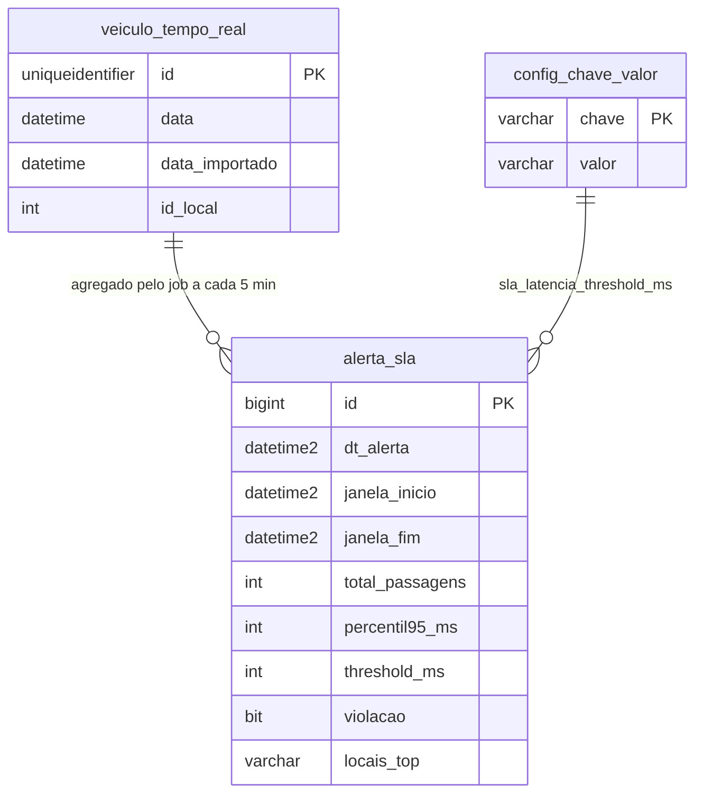
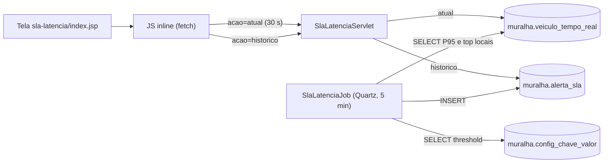

#### Pontos de atenção
- Em DEV a última passagem em `veiculo_tempo_real` é de 2026-10-01 e não há passagens nas últimas 24 h; por isso os cards "atual" mostram total 0 e o job grava medições com `total_passagens = 0` (última em 2026-10-19 13:14).
- O threshold exibido/usado no front (`THRESHOLD = 4000`) é constante no JS e a decisão OK/Violado dos cards usa a média, enquanto o job usa o P95 com o valor de `config_chave_valor`; mudar a chave no banco não altera os cards.
- O JS chama `/MuralhaDigital/...` sem `request.getContextPath()` (diferente das outras telas); só funciona com a aplicação na raiz do contexto.

---

### 2. Assertividade
- **Menu:** Análise de Dados › Painel de Assertividade (sis_menu 368) · **URL:** `/muralha-digital/pages/monitoramento/assertividade/index.jsp`
- **Arquivos:** [index.jsp](../../src/main/webapp/muralha-digital/pages/monitoramento/assertividade/index.jsp) (JS inline, Chart.js + chartjs-plugin-annotation via CDN), [AssertividadeServlet.java](../../src/main/java/muralha/digital/assertividade/AssertividadeServlet.java), gravação da análise em [InfracaoAnaliseDAO.java](../../src/main/java/muralha/digital/processamento/InfracaoAnaliseDAO.java). Plano: [08-painel-assertividade.md](../planos-salvador/08-painel-assertividade.md); entrega: [08-painel-assertividade.md](../entregas/08-painel-assertividade.md).
- **Finalidade:** Medir a concordância da dupla análise de infrações (meta mínima de 80%), o volume processado e o desempenho por analista em um período.

#### Fluxo de dados
Todos os elementos são abastecidos por uma única chamada `GET /MuralhaDigital/Assertividade?dtInicio=AAAA-MM-DD&dtFim=AAAA-MM-DD` (sem `acao`; padrão: últimos 7 dias; o seletor de período do JS envia hoje/7/30 dias ou datas customizadas). Atualização automática a cada 30 s.

| Elemento da tela | Chave do JSON | Fonte no banco | Observação |
|---|---|---|---|
| Cards "Pré-aprovadas", "Desempates", "Reprovadas", "Primeira Análise" e gráfico "Distribuição por status" | `totais` | `muralha.vtr_status_analise` + `EXISTS` em `muralha.infracao_analise` | `COUNT(*)` por `status_analise` (`PRE_APROVADA`, `DESEMPATE`, `REPROVADA`, `PRIMEIRA_ANALISE`) das infrações com análise (`dt_analise`) no período. |
| Card "Taxa de Concordância" e alerta "Aderência abaixo de 80%" | `taxaConcordancia`, `alertaAbaixo80` | derivado de `totais` | Calculado no servlet: PRE_APROVADA ÷ (PRE_APROVADA + DESEMPATE + REPROVADA) × 100; alerta se 0 < taxa < 80. |
| Cards "Volume Processado", "Divergências", "Revisão Manual" | `volumeProcessado` | `muralha.veiculo_tempo_real` LEFT JOIN `muralha.vtr_status_analise` | `recebidos` = passagens com `data` no período; `processados` = com status; `divergencias` = `DESEMPATE`; `revisaoManual` = status `PRIMEIRA_ANALISE`/`AGUARDANDO_ANALISE` ou sem status. |
| Tabela "Ranking de analistas" e botão CSV | `ranking` | `muralha.infracao_analise` JOIN `dbo.sis_usuario` LEFT JOIN `muralha.vtr_status_analise` | Agrupa por `su.nome`: total (`COUNT DISTINCT id_infracao`) e concordantes (status `PRE_APROVADA`); taxa calculada no servlet. CSV gerado no navegador. |
| Gráfico "Evolução diária da taxa de concordância (%)" | `evolucao` | `muralha.infracao_analise` LEFT JOIN `muralha.vtr_status_analise` | Agrupa por `CAST(dt_analise AS DATE)`; linha de meta 80% desenhada no JS. |

#### Estrutura de dados
**`muralha.infracao_analise`** (tabela, ≈60 linhas): uma linha por análise feita por um operador (a "dupla análise" gera sequências 1, 2, ...).

| Coluna | Tipo | Descrição | PK/FK |
|---|---|---|---|
| id | bigint | Identificador | PK |
| id_infracao | uniqueidentifier | Passagem analisada (= `veiculo_tempo_real.id`) | lógica para `muralha.veiculo_tempo_real.id` (sem FK declarada) |
| id_usuario | int | Operador que analisou | lógica para `dbo.sis_usuario.id_usuario` |
| sequencia | tinyint | Ordem da análise (1ª, 2ª, desempate) | |
| classificacao | varchar(20) | Resultado dado pelo operador | |
| justificativa | varchar(500) | Texto livre | |
| dt_analise | datetime2 | Momento da análise (filtro de período) | |

**`muralha.vtr_status_analise`** (tabela, ≈30 linhas; índice `ix_vsa_status`): status consolidado da análise por passagem. Em DEV: PRE_APROVADA 20, DESEMPATE 6, REPROVADA 4.

| Coluna | Tipo | Descrição | PK/FK |
|---|---|---|---|
| id_veiculo_tempo_real | uniqueidentifier | Passagem | PK (lógica para `veiculo_tempo_real.id`, sem FK) |
| status_analise | varchar(25) | `PRIMEIRA_ANALISE`, `AGUARDANDO_ANALISE`, `PRE_APROVADA`, `DESEMPATE`, `REPROVADA` | |

**`muralha.veiculo_tempo_real`** (tabela, ≈8,19 mi linhas): passagens. Colunas usadas: `id` (uniqueidentifier, PK) e `data` (datetime, filtro de período do volume). Demais colunas: ver seção 1.

**`dbo.sis_usuario`** (tabela, 42 linhas): colunas usadas `id_usuario` (int, PK) e `nome` (char(60)).

#### Origem / alimentação dos dados
- `infracao_analise` e `vtr_status_analise` são gravadas na mesma transação por `InfracaoAnaliseDAO` (tela de análise de infrações): insere a análise do operador, calcula o novo status (`determinarNovoStatus`) e faz `MERGE` em `vtr_status_analise`. Não há job; a frequência é a da atuação dos operadores.
- `veiculo_tempo_real`: carga externa de passagens (ver seção 1).

#### Diagrama
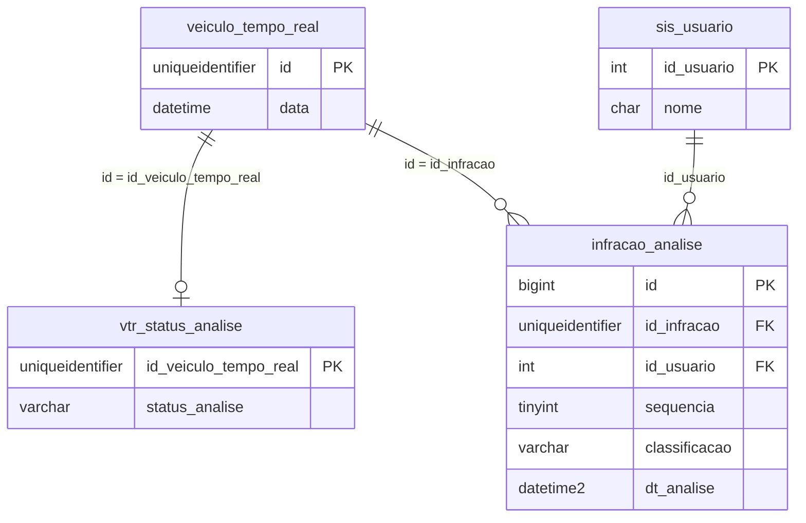
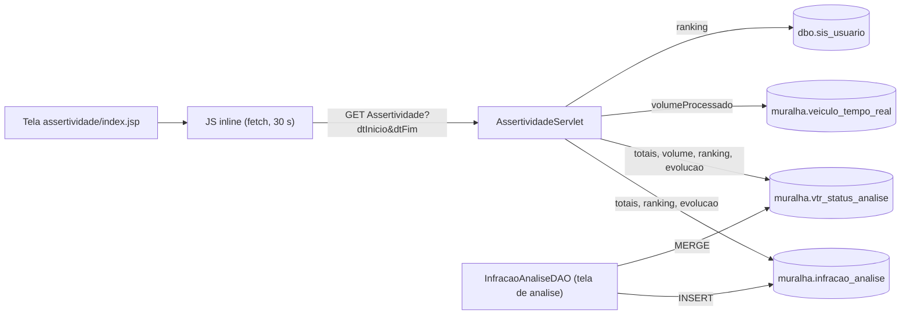

#### Pontos de atenção
- O status `PRIMEIRA_ANALISE` aparece nos filtros e no card, mas não existe nos dados de DEV (só PRE_APROVADA, DESEMPATE, REPROVADA).
- "Revisão Manual" conta também as passagens sem registro em `vtr_status_analise` (status nulo), portanto inclui todas as passagens do período ainda não analisadas.
- Sem FK declarada entre `infracao_analise`/`vtr_status_analise` e `veiculo_tempo_real`.
- O texto do alerta cita "TR §5.2.2.3" (texto do JSP); a existência desse TR no repositório não foi verificada.

---

### 3. SLA Pré-processamento
- **Menu:** Análise de Dados › SLA de Pré-processamento 72h (sis_menu 369) · **URL:** `/muralha-digital/pages/monitoramento/sla-preproc/index.jsp`
- **Arquivos:** [index.jsp](../../src/main/webapp/muralha-digital/pages/monitoramento/sla-preproc/index.jsp) (JS inline, Chart.js via CDN), [SlaPreprocessamentoServlet.java](../../src/main/java/muralha/digital/sla/SlaPreprocessamentoServlet.java), [SlaPreprocessamentoJob.java](../../src/main/java/muralha/digital/sla/SlaPreprocessamentoJob.java), agendamento em [Agendador.java](../../src/main/java/com/consilux/servlet/ferramentas/Agendador.java) (`reajustaJobSlaPreprocessamento`). Plano: [10-sla-preprocessamento.md](../planos-salvador/10-sla-preprocessamento.md); entrega: [10-sla-preprocessamento.md](../entregas/10-sla-preprocessamento.md); migração: [20261008_sla_preproc.sql](migracoes/20261008_sla_preproc.sql).
- **Finalidade:** Acompanhar o envelhecimento (aging) das passagens ainda aguardando análise, em faixas de 24/48/72 h, e o histórico horário dessa fila.

#### Fluxo de dados
| Elemento da tela | Endpoint (`acao`) | Fonte no banco | Observação |
|---|---|---|---|
| Cards "Total Pendentes", "Acima de 72h", "Entre 48h e 72h", "Entre 24h e 48h" e gráfico de rosca (inclui "< 24h") | `/MuralhaDigital/SlaPreprocessamento` (sem `acao`; a cada 60 s) | `muralha.veiculo_tempo_real` LEFT JOIN `muralha.vtr_status_analise` | Pendente = `COALESCE(status_analise,'AGUARDANDO_ANALISE') = 'AGUARDANDO_ANALISE'` e `data` não nula. Faixas por `DATEDIFF(HOUR, data, SYSDATETIME())`. |
| Tabela "Fila pendente por local/equipamento" | mesma chamada (`fila`) | mesmas tabelas | `GROUP BY id_local` com contagem e aging máximo em horas; badge Violado (>72), Atenção (>48), OK. Mostra apenas o ID do local (sem join com nome). |
| Gráfico de linha "histórico" (> 72h, > 48h, > 24h) | `?acao=historico` | `muralha.alerta_sla_preproc` | `TOP 168` por `dt_alerta DESC` (168 × 1 h = 7 dias). |

#### Estrutura de dados
**`muralha.alerta_sla_preproc`** (tabela, ≈227 linhas): snapshot horário da fila pendente.

| Coluna | Tipo | Descrição | PK/FK |
|---|---|---|---|
| id | bigint | Identificador | PK |
| dt_alerta | datetime2 | Momento do snapshot; default `sysdatetime()` | |
| total_pendentes | int | Passagens aguardando análise | |
| acima_72h | int | Pendentes com mais de 72 h | |
| acima_48h | int | Pendentes com mais de 48 h (cumulativo) | |
| acima_24h | int | Pendentes com mais de 24 h (cumulativo) | |

**`muralha.veiculo_tempo_real`** (≈8,19 mi linhas): `id` (PK), `data` (datetime, base do aging), `id_local` (int, agrupamento da fila).

**`muralha.vtr_status_analise`** (≈30 linhas): `id_veiculo_tempo_real` (uniqueidentifier, PK) e `status_analise` (varchar(25)); ver seção 2.

#### Origem / alimentação dos dados
- `alerta_sla_preproc`: `SlaPreprocessamentoJob` (Quartz, grupo Monitoramento), a cada 60 minutos (`INSERT` com os totais acima de 72/48/24 h).
- `vtr_status_analise`: gravada pela análise de infrações (`InfracaoAnaliseDAO`, seção 2). `veiculo_tempo_real`: carga externa (seção 1).

#### Diagrama
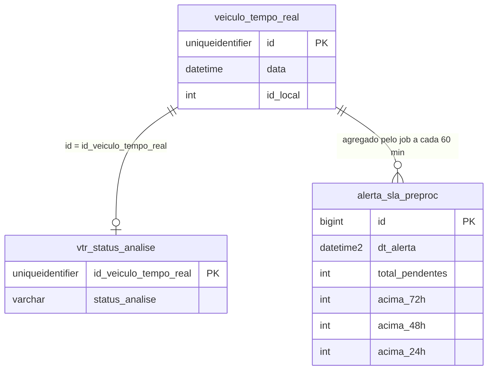
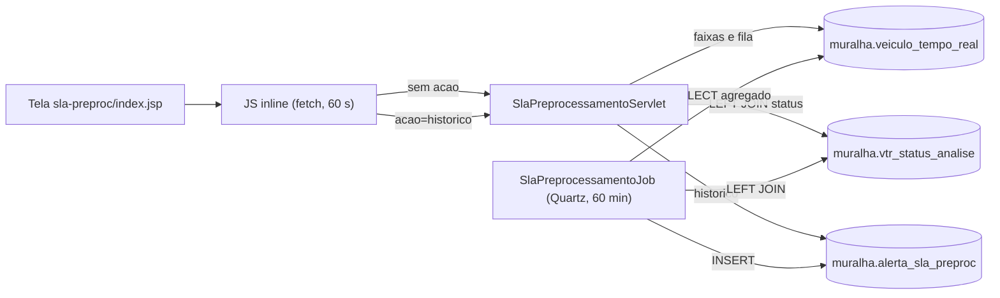

#### Pontos de atenção
- O servlet trata qualquer `acao` diferente de `historico` como consulta "atual".
- O card "< 24h" não existe: a faixa `ate24h` só aparece na rosca.
- Faixas do tempo real são exclusivas (>72, 49–72, 25–48, ≤24), mas o histórico guarda valores cumulativos (>72, >48, >24).
- A tela exibe o `id_local` sem o nome do equipamento.

---

### 4. Time-lapse
- **Menu:** Análise de Dados › Time-lapse de Passagens (sis_menu 373) · **URL:** `/muralha-digital/pages/monitoramento/timelapse/index.jsp`
- **Arquivos:** [index.jsp](../../src/main/webapp/muralha-digital/pages/monitoramento/timelapse/index.jsp) (JS inline), [TimelapseServlet.java](../../src/main/java/muralha/digital/timelapse/TimelapseServlet.java), [JobTimelapseDescarte.java](../../src/main/java/muralha/digital/timelapse/JobTimelapseDescarte.java), imagens por [ImgVeiculoTempoReal.java](../../src/main/java/muralha/digital/veiculo/imagem/ImgVeiculoTempoReal.java) (`/MuralhaDigital/Veiculo/Imagem`), agendamento em [Agendador.java](../../src/main/java/com/consilux/servlet/ferramentas/Agendador.java) (`reajustaJobTimelapseDescarte`). Planos: [17-timelapse.md](../planos-salvador/17-timelapse.md) e [33-timelapse-descarte.md](../planos-salvador/33-timelapse-descarte.md); entregas: [17-timelapse.md](../entregas/17-timelapse.md) e [33-timelapse-descarte.md](../entregas/33-timelapse-descarte.md); migração: [20261016_timelapse_descarte.sql](migracoes/20261016_timelapse_descarte.sql).
- **Finalidade:** Reproduzir como sequência de quadros (player com FPS ajustável) as imagens das passagens de um equipamento em um intervalo de tempo.

#### Fluxo de dados
| Elemento da tela | Endpoint (`acao`) | Fonte no banco | Observação |
|---|---|---|---|
| Filtro "Equipamento" | `/MuralhaDigital/Timelapse?acao=equipamentos` | `dbo.local_vigente` | `id_local`, `nome` com `desativado = 0`, ordenado por nome (32 ativos em DEV). |
| Botão buscar (lista de quadros) e slider/contador "n/total" | `?acao=frames&idLocal&dtInicio&dtFim` | `muralha.veiculo_tempo_real` INNER JOIN `muralha.veiculo_tempo_real_imagem` | `TOP 200` (`MAX_FRAMES`) por `data` crescente, filtrado por `id_local` e período opcional. Devolve `id`, `idImagem`, `dtCaptura`, `placa`. |
| Imagem do quadro | `/MuralhaDigital/Veiculo/Imagem?id=<idImagem>` | `muralha.veiculo_tempo_real_imagem` (coluna `imagem`) | Servlet de imagem existente (carrega por UUID da imagem). |
| Painel "Informações do frame" (data/hora, placa) | dados de `frames` | `veiculo_tempo_real` | Sem consulta adicional. |
| (sem elemento visual) registro de uso | `frames` com resultado > 0 | `muralha.timelapse_cache` | `INSERT` com equipamento, período, total de quadros e usuário da sessão; falha é ignorada. |

#### Estrutura de dados
**`muralha.veiculo_tempo_real_imagem`** (tabela, ≈10,9 mi linhas): imagens (blob) das passagens.

| Coluna | Tipo | Descrição | PK/FK |
|---|---|---|---|
| id | uniqueidentifier | Identificador da imagem (usado em `Veiculo/Imagem?id=`) | PK |
| id_veiculo_tempo_real | uniqueidentifier | Passagem dona da imagem | FK para `muralha.veiculo_tempo_real.id` |
| imagem | image | Conteúdo binário | |
| indice_imagem | tinyint | Posição/tipo da imagem na passagem | |

**`muralha.veiculo_tempo_real`** (≈8,19 mi linhas): `id` (PK), `data` (datetime, ordenação e período), `placa` (char(7)), `id_local` (int, filtro).

**`dbo.local_vigente`** (view): versão vigente dos locais/equipamentos. Dependências: `dbo.local`, `dbo.configuracao_equipamento`, `dbo.configuracao_equipamento_afericao`, `dbo.local_municipio_regiao`, `dbo.sis_usuario`. Colunas usadas: `id_local` (int), `nome` (char(100)), `desativado` (int).

**`muralha.timelapse_cache`** (tabela, 1 linha): registro das consultas de time-lapse (não guarda quadros).

| Coluna | Tipo | Descrição | PK/FK |
|---|---|---|---|
| id | bigint | Identificador | PK |
| id_local | int | Equipamento consultado | |
| dt_inicio / dt_fim | datetime2 | Período consultado (padrão 1900-01-01 / 2099-12-31 quando vazio) | |
| total_frames | int | Quadros retornados | |
| dt_geracao | datetime2 | Momento do registro; default `sysdatetime()` | |
| id_usuario | int (null) | Usuário da sessão (0 se ausente) | |

#### Origem / alimentação dos dados
- `timelapse_cache`: gravada pelo próprio `TimelapseServlet` a cada busca com resultado. Limpa pelo `JobTimelapseDescarte` (Quartz, grupo Timelapse, a cada 60 min): `DELETE` de `dt_geracao` mais antigo que `TIMELAPSE_RETENCAO_HORAS` (72 h), se `TIMELAPSE_DESCARTE_HABILITADO = true`; as duas chaves existem em `muralha.config_chave_valor`.
- `veiculo_tempo_real` e `veiculo_tempo_real_imagem`: carga externa de passagens/imagens (origem exata: não identificado; procedures de referência em `docs/banco-de-dados/codigo-sql/procedures/dbo.spu_veiculo_tempo_real_imagem.sql`).

#### Diagrama
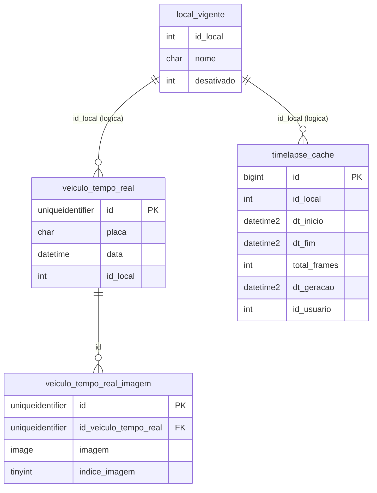
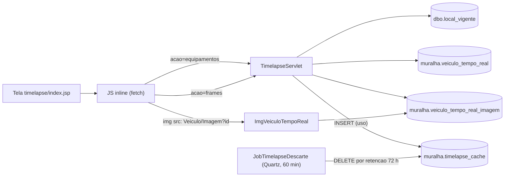

#### Pontos de atenção
- `timelapse_cache` não é lida por nenhuma consulta da tela; funciona só como log de uso (hoje 1 linha) e as imagens são sempre lidas ao vivo das tabelas de passagem.
- Limite de 200 quadros por busca; a ordenação é crescente, então períodos longos mostram apenas o início do intervalo.
- Em DEV a última passagem é de 2026-10-01, então períodos recentes retornam "Nenhum frame".

---

### 5. Disponibilidade
- **Menu:** Análise de Dados › Disponibilidade dos Equipamentos (sis_menu 374) · **URL:** `/muralha-digital/pages/monitoramento/disponibilidade/index.jsp`
- **Arquivos:** [index.jsp](../../src/main/webapp/muralha-digital/pages/monitoramento/disponibilidade/index.jsp) (JS inline, Chart.js via CDN), [DisponibilidadeServlet.java](../../src/main/java/muralha/digital/disponibilidade/DisponibilidadeServlet.java), [DisponibilidadeJob.java](../../src/main/java/muralha/digital/disponibilidade/DisponibilidadeJob.java), agendamento em [Agendador.java](../../src/main/java/com/consilux/servlet/ferramentas/Agendador.java) (`reajustaJobDisponibilidade`). Plano: [18-disponibilidade.md](../planos-salvador/18-disponibilidade.md); entrega: [18-disponibilidade.md](../entregas/18-disponibilidade.md); migração: [20261008_disponibilidade_incidentes.sql](migracoes/20261008_disponibilidade_incidentes.sql).
- **Finalidade:** Mostrar quais equipamentos estão online/offline, há quantos minutos estão sem passagem e o uptime das últimas 24 h.

#### Fluxo de dados
Uma única chamada `GET /MuralhaDigital/Disponibilidade` (sem `acao`; a cada 60 s) devolve `status` e `uptime`.

| Elemento da tela | Chave do JSON | Fonte no banco | Observação |
|---|---|---|---|
| Cards "Online agora", "Offline agora", "Total monitorados" e tabela "Status atual" | `status` | `muralha.equipamento_disponibilidade` INNER JOIN `dbo.local_vigente` | Última verificação de cada local (`MAX(dt_verificacao)` por `id_local`). Contagens feitas no JS. |
| Card "Uptime médio (24h)" e gráfico de barras "Uptime ultimas 24h" | `uptime` | `muralha.equipamento_disponibilidade` INNER JOIN `dbo.local_vigente` | Por local: `SUM(disponivel) / COUNT(*) × 100` das verificações das últimas 24 h; ordenado do menor uptime. Cores: ≥95 verde, ≥80 amarelo, abaixo vermelho (no JS). |

#### Estrutura de dados
**`muralha.equipamento_disponibilidade`** (tabela, 0 linhas em DEV): uma linha por verificação de cada equipamento.

| Coluna | Tipo | Descrição | PK/FK |
|---|---|---|---|
| id | bigint | Identificador | PK |
| dt_verificacao | datetime2 | Momento da verificação; default `sysdatetime()` | |
| id_local | int | Equipamento | lógica para `dbo.local_vigente.id_local` (sem FK) |
| disponivel | bit | 1 = recebeu passagem dentro do limite | |
| ultima_passagem | datetime2 (null) | Data da última passagem do equipamento | |
| minutos_offline | int (null) | Minutos sem passagem (só quando offline) | |

**`dbo.local_vigente`** (view): colunas usadas `id_local` (int) e `nome` (char(100)); dependências em `dbo.local`, `dbo.configuracao_equipamento`, `dbo.configuracao_equipamento_afericao`, `dbo.local_municipio_regiao`, `dbo.sis_usuario`.

**`muralha.veiculo_tempo_real`** (≈8,19 mi linhas; lida só pelo job): `id_local` e `data`. **`muralha.config_chave_valor`** (lida só pelo job): chave `disponibilidade_threshold_min` = `15`.

#### Origem / alimentação dos dados
- `equipamento_disponibilidade`: gravada pelo `DisponibilidadeJob` (Quartz, grupo Monitoramento), a cada 10 minutos. Considera os `id_local` com passagens nos últimos 7 dias em `veiculo_tempo_real`; para cada um busca `MAX(data)` e marca offline se a última passagem for mais antiga que o limite (15 min, de `config_chave_valor`; padrão 15 se ausente) ou inexistente.
- `veiculo_tempo_real`: carga externa (seção 1).

#### Diagrama
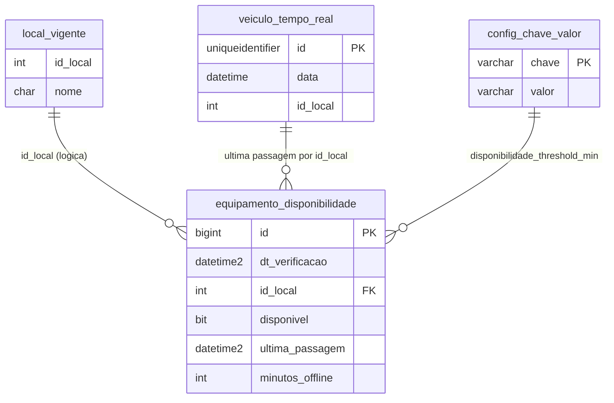
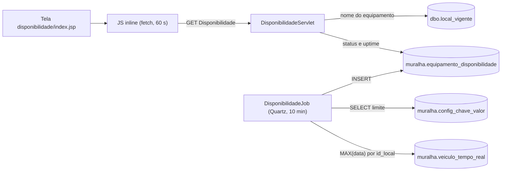

#### Pontos de atenção
- Tabela vazia em DEV: não há passagens nos últimos 7 dias em `veiculo_tempo_real` (última em 2026-10-01), logo o job não encontra nenhum `id_local` e a tela não mostra equipamentos nem uptime.
- Equipamentos sem nenhuma passagem nos últimos 7 dias nunca são verificados, portanto não aparecem como offline.
- A tabela cresce sem retenção identificada (uma linha por equipamento a cada 10 min); descarte: não identificado.
- Na migração existe também `muralha.incidente_externo`, que esta tela não usa.

---

### 6. Log de Auditoria
- **Menu:** Análise de Dados › Log de Auditoria (sis_menu 366) · **URL:** `/muralha-digital/pages/auditoria/consulta-log.jsp`
- **Arquivos:** [consulta-log.jsp](../../src/main/webapp/muralha-digital/pages/auditoria/consulta-log.jsp), [consulta-log.js](../../src/main/webapp/muralha-digital/assets/js/auditoria/consulta-log.js), [AuditoriaServlet.java](../../src/main/java/muralha/digital/auditoria/AuditoriaServlet.java) (leitura), [AuditoriaService.java](../../src/main/java/muralha/digital/auditoria/AuditoriaService.java) (gravação, chamada por vários servlets). Plano: [01-log-auditoria.md](../planos-salvador/01-log-auditoria.md); entrega: [01-log-auditoria.md](../entregas/01-log-auditoria.md); migração: [20261008_log_auditoria.sql](migracoes/20261008_log_auditoria.sql).
- **Finalidade:** Consultar o log centralizado de operações (quem fez o quê, quando e de onde), com filtros, paginação e exportação CSV/XLS/PDF.

#### Fluxo de dados
| Elemento da tela | Endpoint (`acao`) | Fonte no banco | Observação |
|---|---|---|---|
| Filtros "Login", "Funcionalidade", "Operação" | `/MuralhaDigital/Auditoria?acao=listarFiltros` | `dbo.sis_log_auditoria` | `SELECT DISTINCT` de `login`, `funcionalidade`, `operacao` (não nulos e não vazios). |
| Filtro "Perfil" | `listarFiltros` | `dbo.sis_grupo` JOIN `dbo.sis_usuario_grupo` JOIN `dbo.sis_log_auditoria` | Apenas grupos de usuários que aparecem no log. |
| Filtro "Equipamento" | `listarFiltros` | `dbo.local_vigente` | `desativado = 0`. |
| Tabela de resultados (Data/Hora, Login, IP, Funcionalidade, Operação, ID Registro, Descrição) e paginação | `?acao=consultar` + `login`, `funcionalidade`, `operacao`, `perfil` (id do grupo), `equipamento` (nome), `dtInicio`, `dtFim`, `pagina` | `dbo.sis_log_auditoria` (+ `dbo.sis_usuario_grupo`, `dbo.sis_grupo` se houver perfil; `dbo.sis_usuario` se houver equipamento) | Ordem `dt_operacao DESC`, 50 por página (`OFFSET/FETCH`); "Próxima" aparece quando a página volta 50 linhas. Filtro de equipamento = `descricao LIKE %nome%`. O filtro de perfil junta pelo usuário e restringe a `sg.id_grupo = ?`. |
| Botões CSV / XLS / PDF | nenhum | dados já carregados da página atual | Gerados no navegador (SheetJS e jsPDF + autotable); exportam só a página exibida. |

#### Estrutura de dados
**`dbo.sis_log_auditoria`** (tabela, 88 linhas em DEV): log centralizado.

| Coluna | Tipo | Descrição | PK/FK |
|---|---|---|---|
| id | bigint | Identificador | PK |
| id_usuario | int (null) | Usuário (nulo para jobs) | lógica para `dbo.sis_usuario.id_usuario` (sem FK) |
| login | varchar(50) | Login ou `sistema` | |
| dt_operacao | datetime2 | Momento; default `sysdatetime()` | |
| ip_terminal | varchar(45) | IP (usa `X-Forwarded-For` se houver) | |
| funcionalidade | varchar(100) | Módulo/funcionalidade | |
| operacao | varchar(50) | Tipo de operação | |
| id_registro | varchar(100) | Chave do registro afetado | |
| descricao | varchar(500) | Detalhe | |

**`dbo.sis_usuario_grupo`** (203 linhas): `id_usuario` e `id_grupo` (int, PK composta); FKs para `dbo.sis_usuario.id_usuario` e `dbo.sis_grupo.id_grupo`. **`dbo.sis_grupo`** (35 linhas): `id_grupo` (int, PK), `descricao` (char(50)). **`dbo.sis_usuario`** (42 linhas): `id_usuario` (int, PK); entra apenas no join do filtro de equipamento (sem colunas usadas além da chave). **`dbo.local_vigente`** (view): `id_local`, `nome`, `desativado` (ver seção 4).

#### Origem / alimentação dos dados
- `sis_log_auditoria`: gravada por `AuditoriaService.registrar(...)` (com usuário/IP da requisição) e `registrarSistema(...)` (jobs, login `sistema`), de forma assíncrona (pool de 2 threads). Chamado, entre outros, por `UsuarioServlet`, `MfaConfigServlet`, `ChamadoService`, `ChamadoConfigServlet`, `TipoAlertaConfigServlet`, `CorrecaoPlacaServlet`, `DashPainelServlet`, `DatasetServlet` e `WidgetServlet`. Última gravação em DEV: 2026-10-19 13:05.
- Dados iniciais de exemplo: [20261012_dados_log_auditoria.sql](migracoes/20261012_dados_log_auditoria.sql).

#### Diagrama
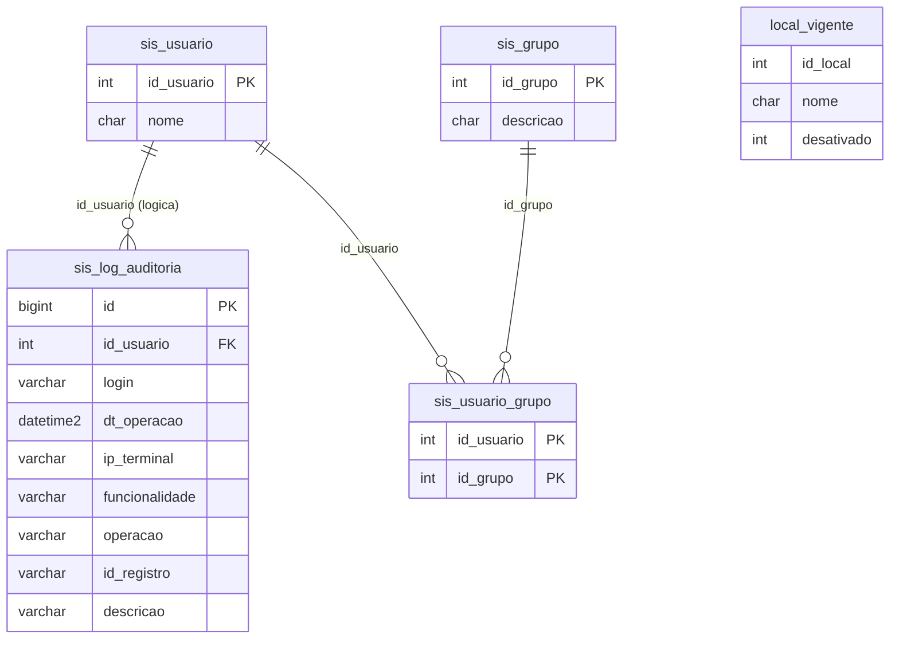
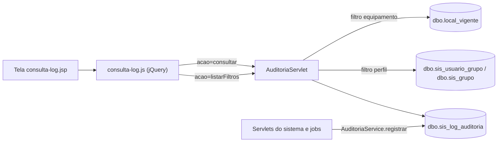

#### Pontos de atenção
- O filtro "Equipamento" não relaciona o log a um equipamento: faz `LIKE` do nome do equipamento no texto de `descricao` (e junta `sis_usuario` sem usar suas colunas).
- Não há FK entre `sis_log_auditoria.id_usuario` e `sis_usuario`.
- Os exports CSV/XLS/PDF cobrem apenas as 50 linhas da página atual.
- **Atualização (2026-10-19):** os valores do servidor (`r.descricao`, `r.login` etc.) passaram por `escaparHtml()` em `consulta-log.js` antes de entrar no HTML (SEG-05 do [Plano 35](../planos-salvador/35-correcoes-seguranca-funcionais.md)); o ponto de XSS armazenado foi fechado.
- Permissão: `AuditoriaServlet` exige o direito de `/MuralhaDigital/Auditoria` (sis_menu 431; grupos 11, 41 e 42) via `ControleAcesso`, com 401/403 em JSON.

---

### 7. Integridade das Imagens

- **Menu:** Análise de Dados › Integridade das Imagens (sis_menu 384) · **URL:** `/muralha-digital/pages/monitoramento/integridade/index.jsp`
- **Arquivos:** [index.jsp](../../src/main/webapp/muralha-digital/pages/monitoramento/integridade/index.jsp), [integridade.js](../../src/main/webapp/muralha-digital/pages/monitoramento/integridade/assets/js/integridade.js), [IntegridadeRecepcaoServlet](../../src/main/java/muralha/digital/integridade/IntegridadeRecepcaoServlet.java), [IntegridadeConfigServlet](../../src/main/java/muralha/digital/integridade/IntegridadeConfigServlet.java), [JobSha256Imagem](../../src/main/java/muralha/digital/integridade/JobSha256Imagem.java), [JdbcRepositorioIntegridade](../../src/main/java/muralha/digital/integridade/JdbcRepositorioIntegridade.java), migração [20261016_integridade_sha256_recepcao.sql](migracoes/20261016_integridade_sha256_recepcao.sql)
- **Finalidade:** mostra o resultado da conferência SHA-256 das imagens recebidas (íntegra, divergente, sem conferência, erro de leitura), por equipamento e dia e em detalhe paginado, com exportação CSV. Uma aba de configuração (visível só a quem tem permissão) define a origem do hash por equipamento.

#### Fluxo de dados

| Elemento da tela | Endpoint (`acao`) | Fonte no banco | Observação |
|---|---|---|---|
| Cards de totais (recebidos, íntegros, divergentes, erro de leitura, sem conferência) e "última verificação" | `/MuralhaDigital/IntegridadeRecepcao?acao=resumo` | `muralha.v_integridade_recepcao` + `local_vigente` (nome) | Totais somados no servlet a partir das linhas; `TOP 5000`; `limitado=true` se estourar |
| Tabela Resumo (dia × equipamento) | `acao=resumo` (mesma chamada) | idem | Filtros: `dtInicio`, `dtFim` (máx. 92 dias), `idLocais`, `status` (no resumo o status não filtra) |
| Tabela Detalhe (imagens, 50/página) | `acao=listar` (`pagina`, `tamanho`) | `muralha.vtr_imagem_integridade` + `local_vigente` | `COUNT(*)` + `OFFSET/FETCH`; ordena por `dt_captura DESC` |
| Botão CSV | `acao=exportarCsv` | `muralha.vtr_imagem_integridade` + `local_vigente` | `TOP 50000`; grava auditoria (`AuditoriaService`, funcionalidade "Integridade de imagens") e SHA-256 do próprio arquivo no rodapé |
| Aba Configuração: lista de equipamentos, origem padrão e parâmetros do job | `/MuralhaDigital/IntegridadeConfig?acao=listar` | `local_vigente` LEFT JOIN `muralha.equipamento_integridade_config`; parâmetros de `muralha.config_chave_valor` (`INTEGRIDADE_*`) | Se a chamada falha (sem permissão), a aba permanece oculta |
| Salvar origem padrão / por equipamento | `IntegridadeConfig` POST `acao=salvarPadrao` / `salvarEquipamento` | `muralha.config_chave_valor` (UPSERT via `ConfigChaveValor.gravar`); `MERGE muralha.equipamento_integridade_config`; histórico em `muralha.parametro_historico` | Também grava `dbo.sis_log_auditoria` |
| Filtro de equipamentos | `obterEquipamentosGenerico` (função global) | não verificado neste levantamento | Biblioteca comum do módulo |

Permissão: ambos os servlets usam `ControleAcesso.exigir` (desde 2026-10-19): sessão (401) e direito estrito via `dbo.fcn_VerificaAcesso` com o caminho do servlet (`/MuralhaDigital/IntegridadeRecepcao` = sis_menu 385 e `/MuralhaDigital/IntegridadeConfig` = 386, registros próprios criados pela migração); sem direito, 403 — a ação não cadastrada não é mais liberada. Direitos: 384 e 385 = grupos 11, 41 e 42; 386 = grupos 11 e 42.

#### Estrutura de dados

**`muralha.vtr_imagem_integridade`** (tabela, ≈200.000 linhas): uma linha por imagem conferida; fonte do detalhe e da view de resumo. Gravada pelo job.

| Coluna | Tipo | Descrição | PK/FK |
|---|---|---|---|
| id_imagem | uniqueidentifier | Identificador da imagem | PK |
| id_veiculo_tempo_real | uniqueidentifier | Passagem de origem (`muralha.veiculo_tempo_real.id`) | FK lógica (não verificada no banco) |
| indice_imagem | tinyint | Posição da imagem na passagem | |
| id_local | int | Equipamento (junta com `local_vigente.id_local`) | FK lógica |
| dt_captura | datetime | Data/hora da captura (filtro de período) | |
| dt_recepcao | datetime | Data/hora de recepção | |
| dt_verificacao | datetime2 | Quando o job conferiu | |
| status_integridade | varchar(20) | `INTEGRO`, `DIVERGENTE`, `SEM_CONFERENCIA`, `ERRO_LEITURA` | |
| origem_hash | varchar(120) | Origem usada (ex.: `PAYLOAD_SOAP`, `DADO_BRUTO:<campo>`, `AUSENTE`) | |
| sha256_calculado | char(64) | Hash calculado pelo GTW | |
| hash_origem | varchar(128) | Hash declarado pela origem | |
| motivo | varchar(200) | Motivo do status | |

**`muralha.v_integridade_recepcao`** (view): agrega `vtr_imagem_integridade` por `id_local` e `CAST(dt_captura AS DATE)`.

| Coluna | Tipo | Descrição | PK/FK |
|---|---|---|---|
| id_local, dia | int, date | Chave do agrupamento | |
| recebidos, integros, divergentes, sem_conferencia, erro_leitura, rejeitados | int | Contagens por status (`rejeitados` = divergentes + erro de leitura) | |
| primeira_captura, ultima_captura | datetime | Menor/maior `dt_captura` | |
| ultima_verificacao | datetime2 | Maior `dt_verificacao` | |

**`muralha.equipamento_integridade_config`** (tabela, ≈1 linha): exceção da origem do hash por equipamento.

| Coluna | Tipo | Descrição | PK/FK |
|---|---|---|---|
| id_local | int | Equipamento | PK |
| origem_hash | varchar(20) | `PAYLOAD_SOAP`, `DADO_BRUTO`, `AUSENTE` | |
| campo | varchar(100) | Caminho no dado bruto (só para `DADO_BRUTO`) | |
| ativo | bit | Exceção ativa (desativada = usa o padrão) | |
| id_usuario | int | Quem alterou | |
| data_modificacao | datetime | Última alteração | |

**`muralha.config_chave_valor`** (tabela, ≈74 linhas): chaves `INTEGRIDADE_ORIGEM_HASH` (valor atual `AUSENTE`), `INTEGRIDADE_LOTE` (200), `INTEGRIDADE_JANELA_HORAS` (24), `INTEGRIDADE_ESPERA_HASH_MIN` (10), `INTEGRIDADE_ALERTA_HABILITADO` (1).

| Coluna | Tipo | Descrição | PK/FK |
|---|---|---|---|
| chave | varchar(100) | Nome do parâmetro | PK |
| valor | varchar(255) | Valor | |

**`local_vigente`** (view, `dbo`): versão atual de cada equipamento; usada para `nome` (`RTRIM(lv.nome)`) e `serie_equipamento` (int).

Tabelas lidas só pelo job: `muralha.veiculo_tempo_real` (≈8,19 mi), `muralha.veiculo_tempo_real_imagem`, `muralha.vtr_imagem_hash_origem` (0 linhas; `sha256_origem` por imagem), `muralha.vtr_imagem_complemento` (≈351 mil; recebe `sha256` e `status_integridade`), `ia.veiculo_caracteristica.dado_bruto` e, para o alerta, `muralha.tipo_alerta_ocorrencia`, `muralha.status_alerta`, `muralha.alerta`, `muralha.alerta_veiculo`.

#### Origem / alimentação dos dados

- **Job `JobSha256Imagem`** (Quartz, registrado em `Agendador.reajustaJobSha256Imagem`, a cada 5 minutos, `@DisallowConcurrentExecution`): busca passagens recentes (janela `INTEGRIDADE_JANELA_HORAS`) sem registro em `vtr_imagem_integridade`, em lotes (`INTEGRIDADE_LOTE`), obtém o hash de origem conforme o equipamento, compara com o SHA-256 calculado e grava `vtr_imagem_integridade`, atualiza `vtr_imagem_complemento` e, em caso de divergência, cria alerta (`muralha.alerta` + `alerta_veiculo`, tipo "Integridade de imagem divergente") e auditoria. Se `vtr_imagem_integridade` não existir, o job só registra um aviso.
- **Carga inicial:** o passo 6 da migração marcou as imagens existentes; hoje todas as ≈200.000 linhas estão `SEM_CONFERENCIA` (consulta de 2026-10-19).
- **Configuração:** gravada pela própria tela (`IntegridadeConfigServlet`).

#### Diagrama

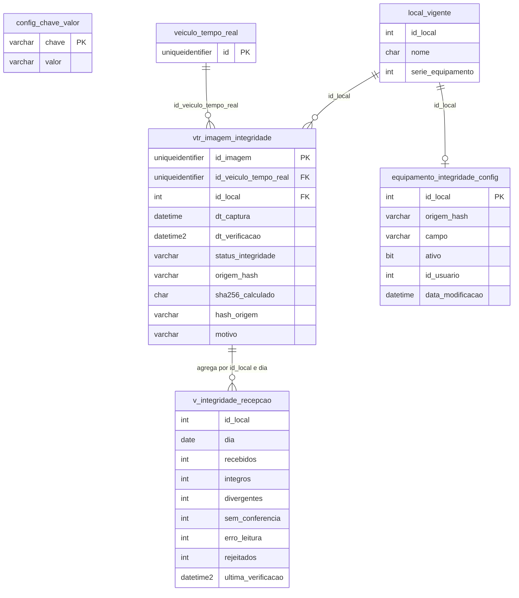

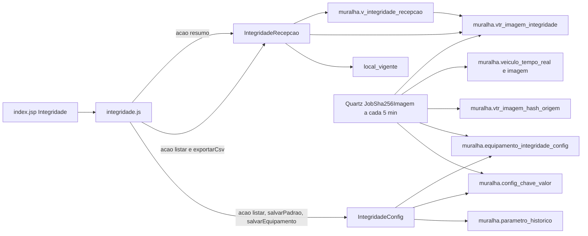

#### Pontos de atenção

- Em 2026-10-19 todas as ≈200.000 linhas de `vtr_imagem_integridade` estão `SEM_CONFERENCIA`; `vtr_imagem_hash_origem` tem 0 linhas e o padrão `INTEGRIDADE_ORIGEM_HASH` é `AUSENTE`. A tela, portanto, não exibe nenhuma imagem `INTEGRO` ou `DIVERGENTE` nesta base.
- `acao=resumo` ignora o parâmetro `status` (a view já agrega por status); o filtro só vale para `listar` e `exportarCsv`.
- O filtro `idLocais` no resumo e no detalhe usa `r.id_local`/`g.id_local` (ID do equipamento), não a série.

---

### 8. Logs Técnicos

- **Menu:** Análise de Dados › Logs Técnicos (sis_menu 387) · **URL:** `/muralha-digital/pages/monitoramento/logs-tecnicos/index.jsp`
- **Arquivos:** [logs-tecnicos.js](../../src/main/webapp/muralha-digital/pages/monitoramento/logs-tecnicos/assets/js/logs-tecnicos.js), [LogTecnicoServlet](../../src/main/java/muralha/digital/logtecnico/LogTecnicoServlet.java), [ServicoLogTecnico](../../src/main/java/muralha/digital/logtecnico/ServicoLogTecnico.java), [FontesLogTecnico](../../src/main/java/muralha/digital/logtecnico/FontesLogTecnico.java), [HistoricoParametros](../../src/main/java/muralha/digital/logtecnico/HistoricoParametros.java), [ParametrosLogTecnico](../../src/main/java/muralha/digital/logtecnico/ParametrosLogTecnico.java), migração [20261016_logs_tecnicos_parametro_historico.sql](migracoes/20261016_logs_tecnicos_parametro_historico.sql)
- **Finalidade:** repositório central de logs técnicos dos equipamentos e do sistema, unificando 12 fontes em um modelo único (data, equipamento, origem, categoria, severidade). Oferece listagem filtrada, linha do tempo, correlação por janela de tempo, relatório técnico por equipamento e histórico de parâmetros alterados.

#### Fluxo de dados

| Elemento da tela | Endpoint (`acao`, em `/MuralhaDigital/LogTecnico`) | Fonte no banco | Observação |
|---|---|---|---|
| Filtros (categorias, severidades, localidades) | `opcoes` | Enums Java (`CategoriaLog`, `SeveridadeLog`); `local_vigente` (`id_localidade`, `localidade_desc`); parâmetros `LOG_TECNICO_*` | Devolve também `fontes_ausentes` (tabelas inexistentes no banco) |
| Aba Eventos (tabela paginada) | `listar` | UNION lógico das 12 fontes (tabela abaixo) | Cada fonte é consultada separadamente, mesclada e paginada em memória (profundidade máxima `ServicoLogTecnico.MAX_PROFUNDIDADE`); período máx. `LOG_TECNICO_PERIODO_MAX_DIAS` (31) |
| Botão CSV | `exportarCsv` | mesmas fontes | Limite `LOG_TECNICO_EXPORTACAO_MAX` (50.000); grava auditoria |
| Botão "Correlacionar" (modal) | `correlacionar` (`dataHora`) | mesmas fontes, todos os equipamentos | Janela ± `LOG_TECNICO_JANELA_CORRELACAO_MIN` (10 min); máx. 500 eventos |
| Aba Linha do tempo | `linhaTempo` (`idLocal`, período) | mesmas fontes, um equipamento | Pareia eventos INICIO/FIM em intervalos (`CorrelacionadorIntervalos`); máx. 5.000 eventos |
| Aba Relatório por equipamento (+ PDF no cliente) | `relatorioEquipamento` | mesmas fontes, um equipamento | Contagem por categoria × severidade, períodos, parâmetros alterados, erros/críticos; máx. 50.000 |
| Aba Histórico de parâmetros | `historicoParametros` (`tipoRecurso`, `idRecurso`, `parametro`, paginado) | `muralha.parametro_historico` | Se a tabela não existir devolve `aviso` |
| Nomes de equipamento | (interno) | `local_vigente` | `serie_equipamento` ↔ `id_local` |

Permissão: `ControleAcesso.exigir` (desde 2026-10-19) — sessão (401) e direito estrito de `/MuralhaDigital/LogTecnico` (sis_menu 388; sem direito, 403). Direitos dos menus 387 e 388: grupos 11, 41 e 42.

#### Estrutura de dados

Fontes (cada uma consultada só se a tabela existir; contagens de 2026-10-19):

| Origem (`FonteLog`) | Tabela | Linhas (≈) | Categoria / uso | Colunas lidas |
|---|---|---|---|---|
| CAPTURA | `dbo.eventos_csx` (+ `eventos_csx_desc_proprietario`, `eventos_csx_desc_evento`) | 507.344 (44; 99) | Eventos enviados pelos equipamentos e pelo GTW; equipamento resolvido por série do proprietário | id, data_hora, id_categoria, id_evento, id_nivel, mensagem, usuario, id_proprietario |
| STATUS_CONEXAO | `dbo.status_conexao` | 11.353 | Comunicação (online/offline) | id_status_conexao, id_local, data_atualizacao, status, ip |
| STATUS_ENERGIA | `dbo.status_energia` | 467 | Energia (com/sem rede) | id_status_energia, id_local, data_atualizacao, status |
| MANUTENCAO | `dbo.manutencao` (+ `manutencao_status`, `sis_usuario`) | 0 | Intervenção técnica | id_manutencao, id_local, data_inicio/ocorrencia/cadastro, data_conclusao |
| LOG_ALERTA | `dbo.log_alerta` (+ `log_tipo`) | 83 (32) | Estados enviados pelo equipamento, classificados por `id_tipo` | id, data, id_tipo, serial |
| DISPONIBILIDADE | `muralha.equipamento_disponibilidade` | 0 | Só mudanças disponível ↔ indisponível (`LAG`) | id, id_local, dt_verificacao, disponivel, minutos_offline |
| PROCESSOS | `dbo.log_processos` | 1.378.563 | Rotinas de importação; erro = não finalizado há mais de `LOG_TECNICO_PROCESSO_ATRASO_MIN` (30 min) | id, nome, data_inicio, registros, total, data_atualizado, data_finalizado |
| SLA_LATENCIA | `muralha.alerta_sla` | 2.176 | Janelas com `violacao = 1` | dt_alerta, total_passagens, percentil95_ms, threshold_ms, locais_top |
| SLA_PREPROCESSAMENTO | `muralha.alerta_sla_preproc` | 227 | Verificações com `acima_72h > 0` | dt_alerta, total_pendentes, acima_72h |
| AUDITORIA | `dbo.sis_log_auditoria` | 88 | Ações dos usuários | id, dt_operacao, login, funcionalidade, operacao, id_registro, descricao |
| CONFIG_HIST | `muralha.config_chave_valor_hist` (+ `sis_usuario`) | 68 | Parâmetros alterados por telas antigas | id, data_atualizacao, evento, id_usuario |
| PARAMETRO_HISTORICO | `muralha.parametro_historico` | 12 | Valor anterior e novo de cada parâmetro | ver tabela abaixo |

**`muralha.parametro_historico`** (tabela, ≈12 linhas): também alimenta a aba "Histórico de parâmetros".

| Coluna | Tipo | Descrição | PK/FK |
|---|---|---|---|
| id | bigint | Identificador | PK |
| dt | datetime2 | Data/hora da alteração | |
| tipo_recurso | varchar(40) | `EQUIPAMENTO`, `CONFIG_CHAVE_VALOR`, `KPI`, `TIPO_ALERTA`, `TIPO_ALERTA_TRATAMENTO` | |
| id_recurso | varchar(100) | Identificador do recurso (para `EQUIPAMENTO` = `id_local`) | |
| parametro | varchar(200) | Nome do parâmetro | |
| valor_anterior, valor_novo | nvarchar(2000) | Valores antes/depois | |
| id_usuario, login, ip, origem | int, varchar | Quem/onde alterou | |

**`dbo.eventos_csx`** (colunas): id (int, PK lógica), id_proprietario (int, FK para `eventos_csx_desc_proprietario`), data_hora (datetime), id_categoria, id_evento (int; descrição em `eventos_csx_desc_evento`), id_prioridade, id_nivel (int → severidade), mensagem (varchar 512), usuario (varchar 25), evento_manual (bit).

**`dbo.sis_log_auditoria`** (colunas lidas): id (bigint), dt_operacao (datetime2), login, funcionalidade, operacao, id_registro, descricao. Estrutura completa em [Seção 12](#12-análises-plataforma-superset-embutida).

**Parâmetros** (`muralha.config_chave_valor`): `LOG_TECNICO_PERIODO_MAX_DIAS`=31, `LOG_TECNICO_PROCESSOS`=NAO_FINALIZADOS (NENHUM, NAO_FINALIZADOS ou TODOS), `LOG_TECNICO_PROCESSO_ATRASO_MIN`=30, `LOG_TECNICO_EXPORTACAO_MAX`=50000, `LOG_TECNICO_JANELA_CORRELACAO_MIN`=10.

#### Origem / alimentação dos dados

- `eventos_csx`, `status_conexao`, `status_energia`, `log_alerta`, `log_processos`, `manutencao`: tabelas do GTW clássico/Captura, gravadas fora desta tela (cadastro de manutenção, envio de eventos dos equipamentos, rotinas de importação). Quem grava cada uma: não verificado em detalhe.
- `muralha.equipamento_disponibilidade`: gravada por `DisponibilidadeJob` (Quartz). `muralha.alerta_sla`: `SlaLatenciaJob`. `muralha.alerta_sla_preproc`: `SlaPreprocessamentoJob`.
- `muralha.parametro_historico`: gravada por `HistoricoParametros.registrar`/`registrarSemFalhar`, chamado pelas telas que alteram parâmetros (Integridade das Imagens, Tipos de Alerta, KPIs, configuração de equipamento, config chave/valor).
- `dbo.sis_log_auditoria`: gravada por `AuditoriaService.registrar` (todas as telas novas).

#### Diagrama

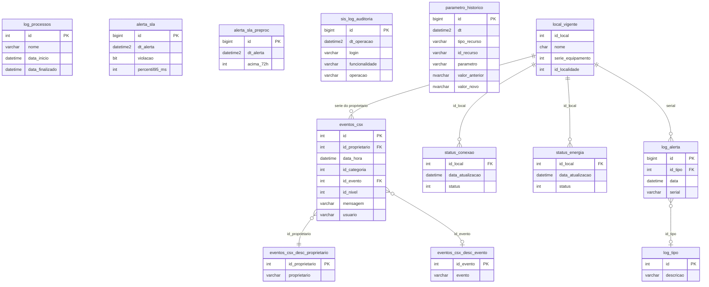

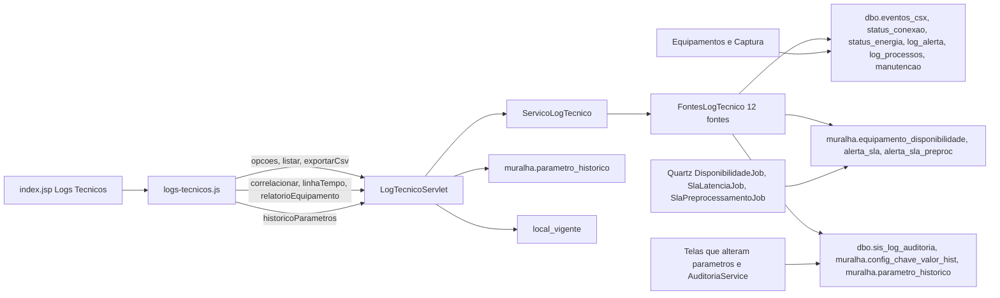

#### Pontos de atenção

- `dbo.manutencao` e `muralha.equipamento_disponibilidade` têm 0 linhas nesta base; as fontes MANUTENCAO e DISPONIBILIDADE não produzem eventos.
- A paginação mescla as fontes em memória com limite de profundidade; acima do limite a tela orienta refinar filtros ou usar o CSV.
- Se uma tabela de fonte não existir, a fonte é ignorada e listada em `fontes_ausentes` (aviso na tela), sem derrubar a consulta.

---

### 9. Tipos de Alerta

- **Menu:** Análise de Dados › Tipos de Alerta (sis_menu 392, descrição "Configuracao de Tipos de Alerta") · **URL:** `/MuralhaDigital/TipoAlertaConfig` (sem `acao`, o servlet faz `forward` para `/muralha-digital/pages/tipos-alerta/index.jsp`)
- **Arquivos:** [index.jsp](../../src/main/webapp/muralha-digital/pages/tipos-alerta/index.jsp), [tipos-alerta.js](../../src/main/webapp/muralha-digital/pages/tipos-alerta/assets/js/tipos-alerta.js), [TipoAlertaConfigServlet](../../src/main/java/muralha/digital/alerta/operacional/TipoAlertaConfigServlet.java), [ConfigTipoAlerta](../../src/main/java/muralha/digital/alerta/operacional/ConfigTipoAlerta.java), [TratamentoAlerta](../../src/main/java/muralha/digital/alerta/operacional/TratamentoAlerta.java), [JobTratamentoAutomatico](../../src/main/java/muralha/digital/alerta/operacional/JobTratamentoAutomatico.java), migrações [20261016_alertas_operacionais.sql](migracoes/20261016_alertas_operacionais.sql) e [20261018_tipo_alerta_config_definitivo.sql](migracoes/20261018_tipo_alerta_config_definitivo.sql)
- **Finalidade:** permite configurar, por tipo de alerta operacional, a criticidade, a cor, o ícone e os tratamentos (manuais ou automáticos com parâmetros JSON), e criar novos tipos.

#### Fluxo de dados

| Elemento da tela | Endpoint (`acao`, em `/MuralhaDigital/TipoAlertaConfig`) | Fonte no banco | Observação |
|---|---|---|---|
| Lista de tipos (cor, ícone, crítico, nº de tratamentos e automáticos) | `listar` (GET) | `muralha.tipo_alerta_ocorrencia` LEFT JOIN `muralha.tipo_alerta_config`; subconsultas em `muralha.tipo_alerta_tratamento` | Exige o direito da tela (desde 2026-10-19) |
| (sem elemento na tela) popup de notificação de todos os operadores | `aparencia` (GET) | mesma consulta de `listar`, reduzida a tipo, cor e ícone | Chamada por `utils/notificacao/js/notificacao.js`; exige só sessão |
| Painel de tratamentos do tipo selecionado | `tratamentos` (`idTipo`) | `muralha.tipo_alerta_tratamento` | |
| Combos de tratamento e de cores | `catalogo` | enums Java (`TratamentoAlerta`, `ConfigTipoAlerta.CORES`) | Sem acesso ao banco |
| Salvar criticidade/cor/ícone | `salvarConfig` (POST) | `MERGE muralha.tipo_alerta_config`; histórico em `muralha.parametro_historico` (recurso `TIPO_ALERTA`); auditoria | Valida cor e ícone; 404 se o tipo não existe |
| Salvar tratamento | `salvarTratamento` (POST) | `MERGE muralha.tipo_alerta_tratamento` (chave tipo + tratamento); histórico (`TIPO_ALERTA_TRATAMENTO`); auditoria | Tratamento "automático" só para os executáveis; `parametrosJson` deve ser objeto JSON de até 2000 caracteres |
| (sem botão na tela atual) novo tipo | `novoTipo` (POST) | `INSERT muralha.tipo_alerta_ocorrencia` (UUID gerado, `prioridade` = MAX + 1) | Auditoria; disponível só no servlet, `tipos-alerta.js` não chama |

Permissão (desde 2026-10-19, `ControleAcesso`): sem `acao`, `exigirTela` (sem sessão redireciona ao login; sem direito, à tela principal); `aparencia` só exige sessão (401 em JSON); todas as demais, inclusive `listar`, exigem o direito de `/MuralhaDigital/TipoAlertaConfig` (sis_menu 392; grupos 11 e 42), com 401/403 em JSON. A JSP encaminhada tem registro próprio (sis_menu 397; grupos 11 e 42).

#### Estrutura de dados

**`muralha.tipo_alerta_ocorrencia`** (tabela, ≈15 linhas): catálogo dos tipos de alerta.

| Coluna | Tipo | Descrição | PK/FK |
|---|---|---|---|
| id | uniqueidentifier | Identificador do tipo | PK |
| tipo | varchar(40) | Nome do tipo | |
| descricao | varchar(200) | Descrição | |
| prioridade | int | Ordem de exibição/prioridade | |
| tarefa_ativa | bit | Tipo ativo | |
| cor | varchar(7) | Cor legada (a cor configurada fica em `tipo_alerta_config`) | |
| nomeinterno | nchar(40) | Código interno (ex.: `INTEGRIDADE`) | |

**`muralha.tipo_alerta_config`** (tabela, ≈15 linhas): apresentação e criticidade.

| Coluna | Tipo | Descrição | PK/FK |
|---|---|---|---|
| id_tipo_alerta_ocorrencia | uniqueidentifier | Tipo configurado | PK/FK (`FK_tac_tipo` → `tipo_alerta_ocorrencia.id`) |
| critico | bit | Alerta crítico | |
| cor | varchar(30) | Código da cor (catálogo `ConfigTipoAlerta.CORES`) | |
| icone | varchar(50) | Ícone | |
| dt_atualizacao | datetime | Última alteração | |
| id_usuario | int | Quem alterou | |

**`muralha.tipo_alerta_tratamento`** (tabela, ≈6 linhas): tratamentos por tipo.

| Coluna | Tipo | Descrição | PK/FK |
|---|---|---|---|
| id | bigint | Identificador | PK |
| id_tipo_alerta_ocorrencia | uniqueidentifier | Tipo | FK (`FK_tat_tipo`) |
| tratamento | varchar(40) | Código (`TratamentoAlerta`) | |
| automatico | bit | Executado pelo job sem operador | |
| parametros_json | varchar(max) | Parâmetros do tratamento | |
| ativo | bit | Tratamento ativo | |
| dt_cadastro | datetime | Criação | |

#### Origem / alimentação dos dados

- Os registros de configuração são gravados pela própria tela; os tipos iniciais vêm das migrações de alertas (`20261016_alertas_operacionais.sql`, `20261018_tipo_alerta_config_definitivo.sql`; o tipo "Integridade de imagem divergente" vem da migração de integridade).
- `JobTratamentoAutomatico` / `ExecutorTratamento` consomem `tipo_alerta_tratamento` (tratamentos automáticos). Frequência: não verificada.
- A listagem alimenta o popup de notificação de alertas de qualquer operador.

#### Diagrama

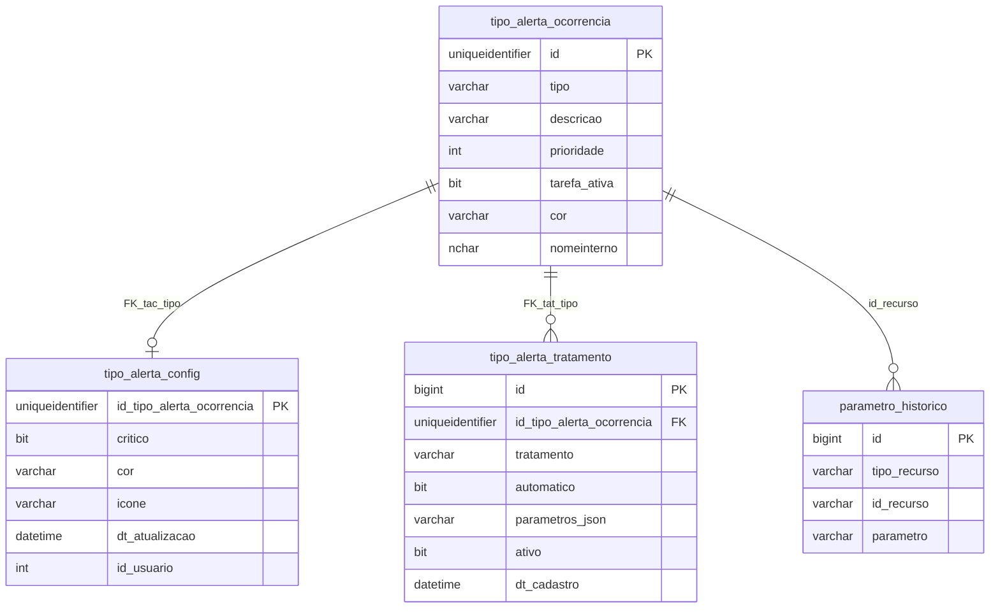

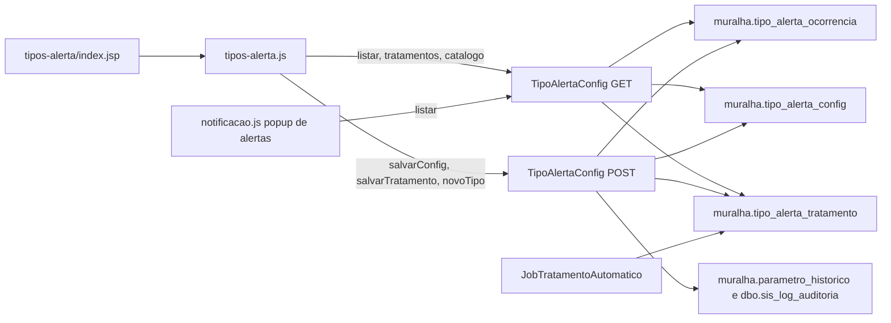

#### Pontos de atenção

- **Atualização (2026-10-19):** `listar` deixou de ser lido sem permissão — corrigido (SEG-10 do [Plano 35](../planos-salvador/35-correcoes-seguranca-funcionais.md)): o popup usa `acao=aparencia`, que devolve só tipo, cor e ícone; `listar` exige o direito da tela.
- `novoTipo` insere em `tipo_alerta_ocorrencia` apenas `id`, `tipo`, `descricao`, `tarefa_ativa`, `prioridade`; os demais campos ficam nulos.

---

### 10. Relatórios Gerenciais

- **Menu:** Análise de Dados › Relatórios Gerenciais (sis_menu 393) · **URL:** `/MuralhaDigital/RelatorioGerencial` (sem `acao`, faz `forward` para `/muralha-digital/pages/relatorios/gerencial/index.jsp`)
- **Arquivos:** [index.jsp](../../src/main/webapp/muralha-digital/pages/relatorios/gerencial/index.jsp) (JavaScript embutido), [RelatorioGerencialServlet](../../src/main/java/muralha/digital/relatorio/RelatorioGerencialServlet.java), [RelatorioGerencialJob](../../src/main/java/muralha/digital/relatorio/RelatorioGerencialJob.java), [RelatorioPreProcMensalJob](../../src/main/java/muralha/digital/relatorio/RelatorioPreProcMensalJob.java), migração [20261016_kpis_relatorio_mensal.sql](migracoes/20261016_kpis_relatorio_mensal.sql)
- **Finalidade:** lista os relatórios mensais já gerados (gerencial e de pré-processamento), mostra o detalhe em modal e exporta para CSV/XLSX. A tela só lê; os relatórios são gerados por jobs.

#### Fluxo de dados

| Elemento da tela | Endpoint (`acao`) | Fonte no banco | Observação |
|---|---|---|---|
| Tabela de relatórios (filtro por tipo) | `listar` (`tipo` opcional) | `muralha.relatorio_periodico` (sem `dados_json`) | `ORDER BY dt_geracao DESC`; retorna `{ok, relatorios}` |
| Modal de detalhe | `detalhe` (`id`) | `muralha.relatorio_periodico` (inclui `dados_json`) | O JSON é interpretado no cliente por tipo (`GERENCIAL` ou `PRE_PROCESSAMENTO`) |
| Exportar CSV / XLSX | `exportarCsv` / `exportarXlsx` (`id`) | `muralha.relatorio_periodico` | Achata `dados_json` em linhas Métrica/Valor/Unidade; usa `ExportacaoService` |

Permissão (desde 2026-10-19, `ControleAcesso`): sem `acao`, `exigirTela` (sem sessão redireciona ao login; sem direito, à tela principal); com `acao`, `exigir` (401/403 em JSON). Direito de `/MuralhaDigital/RelatorioGerencial` (sis_menu 393; grupos 11 e 42); a JSP encaminhada tem registro próprio (sis_menu 398; grupos 11 e 42).

#### Estrutura de dados

**`muralha.relatorio_periodico`** (tabela, 0 linhas em 2026-10-19):

| Coluna | Tipo | Descrição | PK/FK |
|---|---|---|---|
| id | bigint | Identificador | PK |
| tipo | varchar(40) | `GERENCIAL` ou `PRE_PROCESSAMENTO` | |
| titulo | varchar(200) | Título | |
| periodo_inicio, periodo_fim | date | Mês coberto | |
| dados_json | varchar(max) | Conteúdo do relatório | |
| dt_geracao | datetime | Geração | |
| gerado_por | varchar(60) | `SISTEMA` para os jobs | |

Conteúdo de `dados_json` (gerado pelos jobs):

- `GERENCIAL`: `resumoKpis` e `comparacaoPeriodo` (de `muralha.kpi_config` + `muralha.kpi_historico`: nome, unidade, média/mín./máx., contagens OK/WARN/CRIT), `alertasAnaliticos` (de auditoria), `volumeTrafego` e `disponibilidade` (de `dbo.veiculo_sumarizado` — colunas `data`, `id_local`, `trafego` — e `dbo.local_vigente`).
- `PRE_PROCESSAMENTO` (job reescrito em 2026-10-19 sobre os dados existentes, sem colunas novas): volumes e índice de aproveitamento (`muralha.veiculo_tempo_real` + `muralha.vtr_status_analise`, ancorados na data da passagem), tempo médio, produtividade (total analisado, operadores distintos e média por operador), divergência entre a 1ª e a 2ª análise e retrabalho (`muralha.infracao_analise`), pendentes e backlog > 72 h, SLA (`muralha.alerta_sla`, `muralha.alerta_sla_preproc`), motivos de descarte (justificativa da última análise em `infracao_analise`) e histórico de classificação.

Tabelas de apoio (principais colunas):

| Tabela | Linhas (≈) | Colunas usadas |
|---|---|---|
| `muralha.kpi_config` | 12 | id (int, PK), nome, unidade, ativo |
| `muralha.kpi_historico` | 350 | id (bigint, PK), id_kpi (FK → kpi_config.id), valor (float), status (`OK`/`WARN`/`CRIT`), dt_coleta |
| `dbo.veiculo_sumarizado` | 4.151.335 | data (date), hora, id_local, trafego (int) |
| `muralha.veiculo_tempo_real` | 8.188.803 | id (uniqueidentifier, PK), data |
| `muralha.vtr_status_analise` | 30 | id_veiculo_tempo_real, status_analise (nesta base só estas 2 colunas) |
| `muralha.infracao_analise` | 60 | id_infracao, id_usuario, sequencia, classificacao, justificativa, dt_analise (ver seção 2) |
| `muralha.alerta_sla` / `muralha.alerta_sla_preproc` | 2.176 / 227 | ver seção 8 |

#### Origem / alimentação dos dados

- **`RelatorioGerencialJob`** (Quartz, `Agendador.reajustaJobRelatorioGerencial`): no dia do mês definido em `RELATORIO_GERENCIAL_DIA` (valor atual 1) gera o relatório do mês anterior, se ainda não existir (`jaExiste`), e registra auditoria de sistema.
- **`RelatorioPreProcMensalJob`** (Quartz, `Agendador.reajustaJobRelatorioPreProc`): no dia útil `RELATORIO_PREPROC_DIA_UTIL` (valor atual 5) gera o relatório do mês anterior.
- `kpi_historico` é gravada por `KpiSnapshotJob`; `alerta_sla` por `SlaLatenciaJob`; `alerta_sla_preproc` por `SlaPreprocessamentoJob`.

#### Diagrama

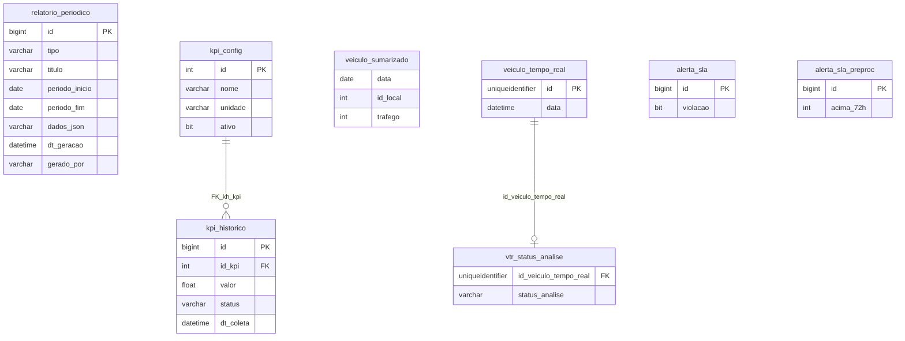

```mermaid
flowchart LR
    T["gerencial/index.jsp"] -->|"listar, detalhe"| S["RelatorioGerencial"]
    T -->|"exportarCsv, exportarXlsx"| S
    S --> R["muralha.relatorio_periodico"]
    J1["Quartz RelatorioGerencialJob dia RELATORIO_GERENCIAL_DIA"] --> R
    J2["Quartz RelatorioPreProcMensalJob dia util RELATORIO_PREPROC_DIA_UTIL"] --> R
    J1 --> K["muralha.kpi_config e kpi_historico"]
    J1 --> V["dbo.veiculo_sumarizado e local_vigente"]
    J1 --> A["auditoria de alertas analiticos"]
    J2 --> VT["muralha.veiculo_tempo_real e vtr_status_analise"]
    J2 --> SL["muralha.alerta_sla e alerta_sla_preproc"]
    J2 --> U["muralha.infracao_analise"]
    KJ["KpiSnapshotJob"] --> K
```

#### Pontos de atenção

- `muralha.relatorio_periodico` está vazia: nenhum relatório foi gerado nesta base e a tela mostra "Nenhum relatório encontrado".
- **Atualização (2026-10-19):** `RelatorioGerencialJob.alertasAnaliticos` passou a consultar `dbo.sis_log_auditoria` pela coluna `dt_operacao` (antes, `muralha.sis_log_auditoria`/`data`, inexistentes), e a disponibilidade passou a filtrar `desativado = 0` (FUN-01 do [Plano 35](../planos-salvador/35-correcoes-seguranca-funcionais.md)). As consultas foram executadas no DEV sem erro; em 2026-10-20 `relatorio_periodico` continua vazia porque o job ainda não rodou.
- **Atualização (2026-10-19):** `RelatorioPreProcMensalJob` não usa mais as colunas inexistentes de `muralha.vtr_status_analise` (`data_analise`, `resultado_ia`, `revisado`, `motivo_descarte`, `id_usuario`); foi reescrito sobre `infracao_analise` e `vtr_status_analise` (FUN-02 do Plano 35).
- `listar`/`detalhe` devolvem `e.getMessage()` ao cliente em caso de erro. **Atualização (2026-10-19):** o JS passou a escapar (`escaparHtml()`) `titulo`, `geradoPor` e os demais valores do servidor antes de montar o HTML (SEG-05).

---

### 11. Pré-Processamento

- **Menu:** Análise de Dados › Pre-Processamento (sis_menu 394, descrição "Painel de Pre-Processamento") · **URL:** `/MuralhaDigital/PreProcessamento` (sem `acao`, faz `forward` para `/muralha-digital/pages/monitoramento/pre-processamento/index.jsp`)
- **Arquivos:** [index.jsp](../../src/main/webapp/muralha-digital/pages/monitoramento/pre-processamento/index.jsp) (JavaScript embutido, Chart.js), [PreProcessamentoServlet](../../src/main/java/muralha/digital/preprocessamento/PreProcessamentoServlet.java)
- **Finalidade:** painel operacional do pré-processamento de imagens com volumes, SLA, pendentes e backlog, produtividade por operador, evolução diária e distribuição por classificação, com atualização automática a cada 60 s.

#### Fluxo de dados

| Elemento da tela | Endpoint (`acao`) | Fonte no banco | Observação |
|---|---|---|---|
| Cards Recebidos, Processados, Disponibilizados, Descartados, Aproveitamento | `/MuralhaDigital/PreProcessamento?acao=metricas` → `volumes` | `muralha.veiculo_tempo_real` LEFT JOIN `muralha.vtr_status_analise` | Processados = status não nulo e diferente de `AGUARDANDO_ANALISE`; Disponibilizados = `PRE_APROVADA` ou `APROVADA`; Descartados = `DESCARTADA`; aproveitamento = disponibilizados / recebidos |
| Card SLA (cumprimento e violações) | `metricas` → `sla` | `muralha.alerta_sla` | Cumprimento < 95% destaca o card em vermelho |
| Cards Pendentes e Backlog > 72 h | `metricas` → `pendentes` | `muralha.veiculo_tempo_real` LEFT JOIN `vtr_status_analise` | Pendente = sem status ou `AGUARDANDO_ANALISE`; sem filtro de período |
| Card/tabela Produtividade por operador | `metricas` → `produtividade` | `muralha.infracao_analise` JOIN `dbo.sis_usuario` | `COUNT(DISTINCT id_infracao)` por `u.nome` no período |
| Gráfico de barras Evolução diária | `metricas` → `evolucaoDiaria` | `veiculo_tempo_real` LEFT JOIN `vtr_status_analise`, agrupado por dia | |
| Gráfico de rosca Classificação | `metricas` → `classificacao` | `vtr_status_analise` JOIN `veiculo_tempo_real`, agrupado por `status_analise` | Cores fixas por status |
| Seletor de período | parâmetros `dtInicio`, `dtFim` | — | Padrão dos últimos 30 dias quando nulos (`COALESCE`) |

Todas as consultas usam `PreparedStatement`. Permissão (desde 2026-10-19, `ControleAcesso`): sem `acao`, `exigirTela`; com `acao`, `exigir` (401/403 em JSON). Direito de `/MuralhaDigital/PreProcessamento` (sis_menu 394; grupos 11 e 42); a JSP encaminhada tem registro próprio (sis_menu 399; grupos 11 e 42).

#### Estrutura de dados

| Objeto | Tipo / linhas (≈) | Colunas usadas |
|---|---|---|
| `muralha.veiculo_tempo_real` | tabela, 8.188.803 | id (uniqueidentifier, PK), data (datetime) |
| `muralha.vtr_status_analise` | tabela, 30 | id_veiculo_tempo_real (uniqueidentifier, FK lógica → `veiculo_tempo_real.id`), status_analise (varchar 25; valores hoje: `PRE_APROVADA` 20, `DESEMPATE` 6, `REPROVADA` 4) |
| `muralha.infracao_analise` | tabela, 60 | id (bigint, PK), id_infracao (uniqueidentifier), id_usuario (int, FK lógica → `sis_usuario`), sequencia (tinyint), classificacao (varchar 20), dt_analise (datetime2) |
| `muralha.alerta_sla` | tabela, 2.176 | id (bigint, PK), janela_inicio, janela_fim (datetime2), violacao (bit), total_passagens, percentil95_ms, threshold_ms |
| `dbo.sis_usuario` | tabela, 42 | id_usuario (int, PK), nome |

#### Origem / alimentação dos dados

- `muralha.veiculo_tempo_real`: passagens recebidas dos equipamentos (ingestão fora desta tela; não verificado em detalhe).
- `muralha.vtr_status_analise` e `muralha.infracao_analise`: gravadas pelas telas de análise/dupla análise do operador (não verificado em detalhe).
- `muralha.alerta_sla`: gravada por `SlaLatenciaJob` (Quartz).

#### Diagrama

```mermaid
erDiagram
    veiculo_tempo_real {
        uniqueidentifier id PK
        datetime data
    }
    vtr_status_analise {
        uniqueidentifier id_veiculo_tempo_real FK
        varchar status_analise
    }
    infracao_analise {
        bigint id PK
        uniqueidentifier id_infracao
        int id_usuario FK
        tinyint sequencia
        varchar classificacao
        datetime2 dt_analise
    }
    sis_usuario {
        int id_usuario PK
        char nome
    }
    alerta_sla {
        bigint id PK
        datetime2 janela_inicio
        datetime2 janela_fim
        bit violacao
    }
    veiculo_tempo_real ||--o| vtr_status_analise : "id_veiculo_tempo_real"
    sis_usuario ||--o{ infracao_analise : "id_usuario"
```

```mermaid
flowchart LR
    T["pre-processamento/index.jsp"] -->|"fetch acao metricas a cada 60 s"| S["PreProcessamentoServlet"]
    S --> V["volumes, pendentes, evolucaoDiaria, classificacao"]
    S --> P["produtividade"]
    S --> L["sla"]
    V --> VT["muralha.veiculo_tempo_real"]
    V --> VS["muralha.vtr_status_analise"]
    P --> IA["muralha.infracao_analise"]
    P --> U["dbo.sis_usuario"]
    L --> AS["muralha.alerta_sla"]
    JOB["SlaLatenciaJob"] --> AS
```

#### Pontos de atenção

- `pendentes` e `backlog72h` não respeitam o período selecionado (contam toda a base).
- `vtr_status_analise` tem 30 linhas para ≈8,19 mi de passagens: quase tudo aparece como "pendente"/sem classificação.
- A tela usa só `veiculo_tempo_real.data`, mas o `LEFT JOIN` sem filtro de data em `pendentes` percorre a tabela inteira (≈8 mi linhas) a cada atualização automática de 60 s.
- Erros do servlet devolvem `e.getMessage()` ao cliente; a tabela de operadores é montada com `insertAdjacentHTML` sem escape de `op.nome`.

---

### 12. Análises (plataforma Superset embutida)

- **Menu:** Análise de Dados › Análises (sis_menu 395) · **URL:** `/MuralhaDigital/SsoAnalise?acao=abrir`
- **Arquivos:** [SsoAnaliseServlet](../../src/main/java/muralha/digital/analise/SsoAnaliseServlet.java), [embedding.jsp](../../src/main/webapp/muralha-digital/pages/analise/embedding.jsp), [embedding.js](../../src/main/webapp/muralha-digital/pages/analise/assets/js/embedding.js), [GuestTokenServlet](../../src/main/java/muralha/digital/analise/GuestTokenServlet.java), [gtw_security.py](../../analise/superset/gtw_security.py), [nginx default.conf](../../analise/nginx/default.conf), [Guia do Administrador](../analise/guia-administrador.md), migrações [20261016_analise_fundacao.sql](migracoes/20261016_analise_fundacao.sql) e [20261019_analise_permissao_abrir_superset.sql](migracoes/20261019_analise_permissao_abrir_superset.sql)
- **Finalidade:** abre a plataforma de análises (Apache Superset) dentro do GTW, em um iframe com seletor de painéis, autenticando o usuário do GTW no Superset por SSO; quem tem o direito 396 vê também o botão "Abrir no Superset".

#### Fluxo de dados

Fluxo GTW → SSO → Superset:

1. O usuário abre `/MuralhaDigital/SsoAnalise?acao=abrir`. O servlet chama `Acesso.verificaAcesso(false)` (sessão + `fcn_VerificaAcesso` com a URI `/MuralhaDigital/SsoAnalise`, que desde 2026-10-19 é a `acao` do sis_menu 395), lê `SUPERSET_BASE_URL` de `muralha.config_chave_valor` (padrão `http://localhost:8088`; valor atual `http://localhost:8088`) e calcula `podeAbrirSuperset` (direito estrito do menu 396 via `ControleAcesso.possuiDireito`). Faz `forward` para `embedding.jsp` com `supersetBaseUrl` e `podeAbrirSuperset`.
2. `embedding.js` monta o iframe com `SUPERSET_BASE/superset/dashboard/<slug>/?standalone=2` a partir do painel escolhido no `<select>` (lista fixa no JSP: 5 painéis de demonstração e 9 operacionais).
3. A requisição ao Superset passa pelo nginx (porta 8088), que faz `auth_request` a `/MuralhaDigital/SsoAnalise?acao=validar` repassando o cookie de sessão do GTW. O servlet responde 401 sem sessão ou 204 com os cabeçalhos `X-GTW-Usuario`, `X-GTW-UserId` e `X-GTW-Grupos` (atributo de sessão `gruposUsuario`). O nginx sobrescreve esses cabeçalhos antes do `proxy_pass`.
4. No Superset, `GtwSecurityManager` (`AUTH_REMOTE_USER`) lê os cabeçalhos, cria/atualiza o usuário e sincroniza papéis conforme `GTW_GRUPOS_PAPEIS` (grupo GTW → papel Superset). O Superset lê o SQL Server somente leitura, principalmente do schema `analise`.

| Elemento da tela | Endpoint | Fonte no banco GTW | Observação |
|---|---|---|---|
| Abertura da tela | `SsoAnalise?acao=abrir` | `dbo.fcn_VerificaAcesso` (sis_menu, sis_menu_direitos, sis_usuario_grupo); `muralha.config_chave_valor` (`SUPERSET_BASE_URL`) | A URI usada na verificação é `/MuralhaDigital/SsoAnalise` (sem query), igual à `acao` do sis_menu 395 desde 2026-10-19; exige direito (grupos 11, 41 e 42) |
| Botão "Abrir no Superset" | gerado em `embedding.jsp` | `dbo.fcn_VerificaAcesso('/MuralhaDigital/SsoAnalise/abrir-superset', id_usuario)` | Nega se a funcionalidade 396 não existe ou em erro (diferente do padrão das telas) |
| Validação SSO (nginx) | `SsoAnalise?acao=validar` (também o padrão sem `acao`) | só sessão HTTP; sem consulta ao banco | Devolve usuário, id e grupos nos cabeçalhos |
| Painéis do iframe | Superset (`/superset/dashboard/<slug>/`) | Schema `analise` e tabelas `dbo`/`mobilidade` (ver resumo abaixo) | Fora do GTW |
| (não usado pela tela atual) | `AnaliseGuestToken?dashboardId=` | `SUPERSET_SECRET_KEY` (não é tabela) | Gera JWT de convidado; `embedding.js` não o chama |

#### Estrutura de dados

**Tabelas do GTW usadas no SSO e na permissão** (`dbo`):

| Tabela | Linhas (≈) | Colunas relevantes | Papel |
|---|---|---|---|
| `dbo.sis_usuario` | 42 | id_usuario (int, PK), usuario (char 25), nome, email, ativo (bit) | Usuário logado (objeto `Usuario` na sessão, atributo `[usuario]`) |
| `dbo.sis_grupo` | 35 | id_grupo (int, PK), descricao, id_grupo_pai | Grupos do GTW (mapeados a papéis do Superset) |
| `dbo.sis_usuario_grupo` | 203 | id_usuario (FK), id_grupo (FK) | Pertinência a grupos |
| `dbo.sis_menu` | 245 | id_menu (int, PK), descricao, acao (char 250), id_pai_menu, Ativo, nome_sistema | Catálogo de telas/funcionalidades; 395 = Analises (`/MuralhaDigital/SsoAnalise`, pai 222); 396 = Abrir no Superset; 438 = guest token |
| `dbo.sis_menu_direitos` | 517 | id_menu_direito (PK), id_grupo (FK, nulo), id_usuario (FK, nulo), id_menu (FK) | Direito por grupo ou por usuário; 395: grupos 11, 41 e 42; 396: grupo 11 |
| `dbo.sis_menu_infos` | 51 | id_infos (PK), id_menu, descricao, href, descricao_detalhada, ordenacao, menu_pai | Card do módulo "Análise de Dados" (`menu_pai` 15; card de Análises: ordenacao 13, href `/MuralhaDigital/SsoAnalise?acao=abrir`) |
| `dbo.sis_log_auditoria` | 88 | id (bigint, PK), id_usuario, login, dt_operacao (datetime2), ip_terminal, funcionalidade, operacao, id_registro, descricao | Auditoria central (`AuditoriaService.registrar` faz `INSERT`); SSO em si só usa `java.util.logging`, não grava aqui |
| `muralha.config_chave_valor` | 74 | chave (PK), valor | `SUPERSET_BASE_URL` e `SUPERSET_URL` (ambos `http://localhost:8088`) |

**`dbo.fcn_VerificaAcesso(@acao, @id_usuario)`** (função tabela inline): junta `sis_menu` (por `acao`) com `sis_menu_direitos` e, quando o direito é de grupo, com `sis_usuario_grupo`. Retorna `cnt` (número de direitos cadastrados para a ação) e `acesso` (quantos desses são do usuário). `Acesso.verificaAcesso` libera se `cnt = 0` (ação não cadastrada: aberto) ou `acesso > 0`; o botão do Superset, ao contrário, exige `cnt > 0 && acesso > 0`.

**Camada analítica (resumo; detalhe em [camada-dados-views-datasets.md](../analise/camada-dados-views-datasets.md)):** o schema `analise` do banco `GTW_MURALHA_DEV` tem 12 views (`v_local_versao`, `v_local_vigente`, `v_equipamentos`, `v_areas_monitoradas_geojson`, `v_alertas`, `v_assertividade_dia`, `v_disponibilidade_dia`, `v_preprocessamento`, `v_sla_latencia_dia`, `v_sla_preproc_dia`, `v_passagens_geolocalizado`, `v_infracoes_geolocalizado`), 3 tabelas materializadas (`mat_passagens_hora`, `mat_infracoes_dia`, `mat_areas_monitoradas`), a tabela de log `analise.carga_log` (≈58 execuções) e 3 procedures de carga (`spu_carga_passagens_hora`, `spu_carga_infracoes_dia`, `spu_carga_areas_monitoradas`). O Superset expõe as views como datasets físicos e usa também datasets virtuais `gtw_*` que leem `dbo`/`mobilidade` diretamente; os painéis e o mapeamento de rastreabilidade estão no documento referenciado.

#### Origem / alimentação dos dados

- Usuários, grupos, menus e direitos: administrados pelo cadastro do GTW clássico; a funcionalidade 396 é criada pela migração `20261019_analise_permissao_abrir_superset.sql`.
- `analise.mat_*`: carregadas pelas procedures `analise.spu_carga_*`, chamadas desde 2026-10-19 pelo `CargaAnaliseJob` (Quartz, agendado em `Agendador` a cada 30 minutos; log em `analise.carga_log`, cuja última execução no DEV em 2026-10-20 ainda é de 2026-10-17). Detalhes no documento da camada de dados e no [Guia do Administrador](../analise/guia-administrador.md).
- Superset: container Docker em `analise/` (nginx, Superset, Redis, PostgreSQL de metadados), conforme o Guia do Administrador; o SQL Server é acessado somente para leitura.

#### Diagrama

```mermaid
erDiagram
    sis_usuario {
        int id_usuario PK
        char usuario
        char nome
        bit ativo
    }
    sis_grupo {
        int id_grupo PK
        char descricao
    }
    sis_usuario_grupo {
        int id_usuario FK
        int id_grupo FK
    }
    sis_menu {
        int id_menu PK
        char acao
        char descricao
        int id_pai_menu
        int Ativo
    }
    sis_menu_direitos {
        int id_menu_direito PK
        int id_grupo FK
        int id_usuario FK
        int id_menu FK
    }
    sis_menu_infos {
        int id_infos PK
        int id_menu FK
        varchar href
        int menu_pai
        int ordenacao
    }
    config_chave_valor {
        varchar chave PK
        varchar valor
    }
    sis_log_auditoria {
        bigint id PK
        int id_usuario FK
        datetime2 dt_operacao
        varchar funcionalidade
        varchar operacao
    }
    sis_usuario ||--o{ sis_usuario_grupo : "id_usuario"
    sis_grupo ||--o{ sis_usuario_grupo : "id_grupo"
    sis_menu ||--o{ sis_menu_direitos : "id_menu"
    sis_grupo ||--o{ sis_menu_direitos : "id_grupo"
    sis_usuario ||--o{ sis_menu_direitos : "id_usuario"
    sis_menu ||--o| sis_menu_infos : "id_menu"
    sis_usuario ||--o{ sis_log_auditoria : "id_usuario"
```

```mermaid
flowchart LR
    U["Navegador"] -->|"SsoAnalise acao abrir"| S["SsoAnaliseServlet"]
    S --> AC["Acesso e dbo.fcn_VerificaAcesso"]
    AC --> M["dbo.sis_menu, sis_menu_direitos, sis_usuario_grupo"]
    S --> CK["muralha.config_chave_valor SUPERSET_BASE_URL"]
    S -->|"forward"| E["embedding.jsp e embedding.js"]
    E -->|"iframe /superset/dashboard/slug"| NG["nginx 8088"]
    NG -->|"auth_request SsoAnalise acao validar"| S
    S -->|"X-GTW-Usuario, UserId, Grupos"| NG
    NG --> SS["Superset GtwSecurityManager"]
    SS -->|"somente leitura"| AN["schema analise: v_*, mat_*"]
    SS -->|"datasets virtuais gtw"| DB["dbo e mobilidade"]
    PR["analise.spu_carga_*"] --> AN
    DB --> PR
```

#### Pontos de atenção

- **Funcionalidade 396 não existe nesta base:** `dbo.sis_menu` não tem `id_menu = 396` em 2026-10-19 (a migração `20261019_analise_permissao_abrir_superset.sql` ainda não foi aplicada). Como o servlet nega quando a funcionalidade não está cadastrada, o botão "Abrir no Superset" não aparece para ninguém aqui. **Atualização (2026-10-19):** migração aplicada; o 396 existe com direito do grupo 11, e a `acao` do 395 foi corrigida para `/MuralhaDigital/SsoAnalise` por `20261019_registro_modulos_novos.sql`.
- **Verificação de acesso ao abrir:** `Acesso.verificaAcesso` usa `request.getRequestURI()` (`/MuralhaDigital/SsoAnalise`). Até 2026-10-19 `sis_menu.acao` 395 era `/MuralhaDigital/SsoAnalise?acao=abrir`, sem correspondência (`cnt = 0`, acesso liberado a qualquer usuário logado). **Atualização (2026-10-19):** a `acao` do 395 passou a ser `/MuralhaDigital/SsoAnalise`, então a abertura exige direito (grupos 11, 41 e 42); o card mantém `?acao=abrir`.
- `acao=validar` (e o caminho sem `acao`) só checa a existência de sessão; não consulta `fcn_VerificaAcesso`, portanto o Superset aceita qualquer usuário logado do GTW que alcance o nginx.
- Em desenvolvimento, `nginx/default.dev.conf` desabilita o `auth_request` e injeta uma identidade fixa (conforme o Guia do Administrador).
- O comentário de `embedding.js` cita guest token, mas o código atual não chama `AnaliseGuestToken`; o iframe depende do SSO por cabeçalhos.

---

## Módulo Dashboards

### 13. Indicadores de Performance (KPIs)
- **Menu:** Dashboards (módulo "Anel de Segurança", `id_pai_menu` 222) › Dashboard KPIs (sis_menu 371) · **URL:** `/muralha-digital/pages/dashboard/kpis/index.jsp`
- **Arquivos:** [index.jsp](../../src/main/webapp/muralha-digital/pages/dashboard/kpis/index.jsp) (JS inline, sem `assets/`), [KpiServlet.java](../../src/main/java/muralha/digital/kpi/KpiServlet.java), [KpiSnapshotJob.java](../../src/main/java/muralha/digital/kpi/KpiSnapshotJob.java), agendamento em [Agendador.java](../../src/main/java/com/consilux/servlet/ferramentas/Agendador.java) (`reajustaJobKpiSnapshot`). Bibliotecas por CDN: Chart.js 4.4.1, chartjs-plugin-annotation 3.0.1, SweetAlert2.
- **Finalidade:** painel de KPIs configuráveis; cada KPI é um `SELECT` guardado no banco, executado a cada carga da tela, com status calculado pelos limites. Modal de histórico com gráfico de linha e linha de meta.

#### Fluxo de dados
| Elemento da tela | Endpoint (`acao`) | Fonte no banco | Observação |
|---|---|---|---|
| Cards (tipos `card`, `compacto`, `medidor`, `progresso`) e rótulo "Atualizado" | `GET /MuralhaDigital/Kpi` (sem `acao`; recarrega a cada 60 s e no botão de atualizar) | `muralha.kpi_config` (`ativo = 1`, `ORDER BY ordem`); para cada linha o servlet executa o `query_sql` da própria linha e lê a coluna `valor` | Status calculado em Java: se `threshold_ok > threshold_warn` (quanto maior melhor) `valor>=ok` OK, `>=warn` WARN, senão CRIT; caso contrário o inverso. `query_sql` recusado pelo `ValidadorSqlKpi` (desde 2026-10-19) ou que falha gera `ERRO`; a execução tem timeout de 30 s. Máximo do medidor/progresso = `max(thOk, thWarn, valor) * 1.2`. |
| Cor do card | idem | `kpi_config.cor_personalizada` | Se nula, usa a cor do status (OK verde, WARN amarelo, CRIT vermelho, ERRO cinza). |
| Modal Histórico: gráfico de linha (7/30/90 dias) | `GET /MuralhaDigital/Kpi?acao=historico&idKpi=&dias=` | `muralha.kpi_historico` (`id_kpi`, `dt_coleta >= DATEADD(DAY,-dias,GETDATE())`) | Cor de cada ponto = `status` do snapshot. |
| Modal Histórico: linha "Meta" e rótulo de meta | idem | `muralha.kpi_config_meta` (`meta`, `meta_minima`, `categoria`) por `id_kpi` | Só `meta` é usada pelo JS; `metaMinima` e `categoria` são devolvidos mas não exibidos. |
| Botão "Configurar" | link para `/muralha-digital/pages/admin/kpis/index.jsp` | — | Ver seção 14. |

Permissão (desde 2026-10-19, `ControleAcesso`): todos os endpoints exigem o direito estrito de `/MuralhaDigital/Kpi` (sis_menu 429; grupos 11, 41 e 42), com 401/403 em JSON; `listarConfig` e `salvar` exigem também o direito do menu 372 (Configuração de KPIs; grupos 11 e 42). A tela tem o sis_menu 371 (grupos 11, 41 e 42).

#### Estrutura de dados
**`muralha.kpi_config`** (tabela, 12 linhas): definição dos KPIs, inclusive a consulta SQL de cada um. PK `id` (identity).

| Coluna | Tipo | Descrição | PK/FK |
|---|---|---|---|
| id | int | Identificador do KPI | PK |
| nome | varchar(80) | Título exibido | |
| descricao | varchar(200) null | Texto auxiliar (card e progresso) | |
| query_sql | varchar(max) | `SELECT` que retorna a coluna `valor` | |
| unidade | varchar(20) null | Unidade exibida | |
| threshold_ok / threshold_warn | float null | Limites de status (ver regra acima) | |
| ordem | int | Ordem de exibição | |
| ativo | bit | Só `1` aparece no painel | |
| tipo_visual | varchar(20) | `card`, `compacto`, `medidor`, `progresso` | |
| cor_personalizada | varchar(7) null | Cor hexadecimal fixa | |

**`muralha.kpi_historico`** (tabela, ≈350 linhas; 7 KPIs com 50 snapshots cada, de 2026-10-17 a 2026-10-19): série de valores coletados pelo job.

| Coluna | Tipo | Descrição | PK/FK |
|---|---|---|---|
| id | bigint | Identificador | PK |
| id_kpi | int | KPI medido | FK → `kpi_config.id` |
| valor | float | Valor coletado | |
| status | varchar(10) | OK / WARN / CRIT | |
| dt_coleta | datetime | Data/hora da coleta | |

**`muralha.kpi_config_meta`** (tabela, 12 linhas): meta por KPI (relação 1:1).

| Coluna | Tipo | Descrição | PK/FK |
|---|---|---|---|
| id_kpi | int | KPI | PK, FK → `kpi_config.id` |
| meta | float null | Meta (linha tracejada no histórico) | |
| meta_minima | float null | Meta mínima | |
| categoria | varchar(60) | volume, disponibilidade, infracao, aproveitamento, efetividade, seguranca, conformidade, integracao | |
| gerar_alerta | bit | Se o job gera alerta analítico | |
| dt_atualizacao | datetime | Última atualização | |

**Tabelas lidas indiretamente pelos `query_sql` dos 12 KPIs cadastrados** (a tela não as acessa diretamente; o servlet executa o texto; conferido em 2026-10-20, depois de [`20261019_kpis_corrige_consultas.sql`](migracoes/20261019_kpis_corrige_consultas.sql) corrigir os KPIs 5, 7, 8, 9 e 11): `muralha.veiculo_tempo_real` (KPIs 1, 2, 4, 6; ≈8,19 milhões de linhas, consultada com `NOLOCK`), `muralha.vtr_status_analise` (2, 3), `muralha.infracao_analise` (3), `dbo.infracao` (5, 8), `dbo.veiculo_sumarizado` (5, 7, 11), `dbo.local_vigente` (7, 11), `muralha.alerta` (9, 10), `muralha.status_alerta` (9), `muralha.tipo_alerta_ocorrencia` (10), `muralha.alerta_sla` (12, `TOP 1 percentil95_ms ORDER BY janela_fim DESC`). O texto completo está em `kpi_config.query_sql`.

#### Origem / alimentação dos dados
- `kpi_config` e `kpi_config_meta`: criadas/semeadas por migrações em `docs/banco-de-dados/migracoes/` (`20261008_lotes_kpis.sql`, `20261012_kpi_tipo_visual.sql`, `20261012_kpi_cor_personalizada.sql`, `20261012_fix_encoding_kpi.sql`, `20261016_kpis_relatorio_mensal.sql`); alteradas pela tela de Configuração (seção 14).
- `kpi_historico`: gravada por `KpiSnapshotJob` (Quartz, agendado em `Agendador.reajustaJobKpiSnapshot`, repete a cada 60 minutos): para cada KPI ativo valida (`ValidadorSqlKpi`) e executa o `query_sql` (timeout de 30 s), calcula o status e insere o snapshot; remove snapshots mais antigos que `KPI_SNAPSHOT_RETENCAO_DIAS` (padrão 90, lido por `ConfigChaveValor`). Se `status <> OK` e `gerar_alerta` (padrão verdadeiro quando não há meta), registra "ALERTA_ANALITICO" via `AuditoriaService.registrarSistema`, respeitando `KPI_ALERTA_COOLDOWN_MIN` (padrão 360).
- Dados medidos pelos KPIs: carga de passagens em `veiculo_tempo_real` e demais tabelas operacionais (origem fora do escopo desta tela: não identificado aqui).

#### Diagrama
```mermaid
erDiagram
    muralha_kpi_config ||--o| muralha_kpi_config_meta : "tem meta"
    muralha_kpi_config ||--o{ muralha_kpi_historico : "gera snapshots"
    muralha_kpi_config {
        int id PK
        varchar nome
        varchar query_sql
        varchar unidade
        float threshold_ok
        float threshold_warn
        int ordem
        bit ativo
        varchar tipo_visual
        varchar cor_personalizada
    }
    muralha_kpi_config_meta {
        int id_kpi PK
        float meta
        float meta_minima
        varchar categoria
        bit gerar_alerta
        datetime dt_atualizacao
    }
    muralha_kpi_historico {
        bigint id PK
        int id_kpi FK
        float valor
        varchar status
        datetime dt_coleta
    }
```
```mermaid
flowchart LR
    T["kpis/index.jsp (JS inline, Chart.js)"] -->|"GET /Kpi (60 s)"| S["KpiServlet.doGet"]
    T -->|"GET /Kpi?acao=historico"| S
    S -->|"lista ativos e executa query_sql"| C[("muralha.kpi_config")]
    C -.->|"SELECT dinamico"| O[("veiculo_tempo_real, vtr_status_analise, infracao_analise, infracao, veiculo_sumarizado, local_vigente, alerta, status_alerta, alerta_sla")]
    S -->|"historico"| H[("muralha.kpi_historico")]
    S -->|"meta"| M[("muralha.kpi_config_meta")]
    J["KpiSnapshotJob (Quartz, 60 min)"] -->|"INSERT snapshot / DELETE retencao"| H
    J -->|"le KPIs e metas"| C
    J --> M
    J -->|"alerta analitico"| A["AuditoriaService"]
```

#### Pontos de atenção
- O painel executa as 12 consultas em série a cada carga/60 s, inclusive sobre `veiculo_tempo_real` (≈8,19 milhões de linhas).
- **Atualização (2026-10-19):** os KPIs 5, 7, 8, 9 e 11 não tinham snapshot porque o `query_sql` usava colunas inexistentes; a migração `20261019_kpis_corrige_consultas.sql` (FUN-04 do [Plano 35](../planos-salvador/35-correcoes-seguranca-funcionais.md)) corrigiu as consultas e, em 2026-10-20, os 12 KPIs têm snapshots em `kpi_historico`.
- **Atualização (2026-10-19):** `nome`, `descricao`, `unidade` e os demais valores do servidor passam por `escaparHtml()` (ou `Number()`) antes de entrar no HTML; a cor personalizada só vale se for hexadecimal válido e o histórico não usa mais `onclick` com o nome (SEG-05).
- O servlet executa o `SELECT` salvo na configuração com a conexão da aplicação. Desde 2026-10-19 o `ValidadorSqlKpi` (lista de palavras proibidas, não um analisador de SQL) recusa `;`, comentários, comandos de escrita/DDL, `EXEC` e afins — e também `WITH` (CTE) e `OFFSET ... FETCH`; o login de banco somente leitura para os KPIs continua pendente (SEG-04).

### 14. Configuração de KPIs
- **Menu:** Dashboards (módulo "Anel de Segurança", `id_pai_menu` 222) › Configuração de KPIs (sis_menu 372, sem card; aberta pelo botão "Configurar" da tela de KPIs) · **URL:** `/muralha-digital/pages/admin/kpis/index.jsp` (confirmado em `dbo.sis_menu.acao`)
- **Arquivos:** [index.jsp](../../src/main/webapp/muralha-digital/pages/admin/kpis/index.jsp) (JS inline; formulário em offcanvas lateral, não é tela filha separada), [KpiServlet.java](../../src/main/java/muralha/digital/kpi/KpiServlet.java), [HistoricoParametros.java](../../src/main/java/muralha/digital/logtecnico/HistoricoParametros.java), `ContextoAlteracao`.
- **Finalidade:** CRUD (criar/editar, sem exclusão) da definição dos KPIs: consulta SQL, limites, ordem, tipo de exibição, cor e ativo.

#### Fluxo de dados
| Elemento da tela | Endpoint (`acao`) | Fonte no banco | Observação |
|---|---|---|---|
| Tabela de KPIs (Ordem, Nome, Unidade, Limite Ideal, Limite Alerta, Exibição, Cor, Ativo) | `GET /MuralhaDigital/Kpi?acao=listarConfig` | `muralha.kpi_config` (todos, `ORDER BY ordem`) | Inclui inativos. |
| Offcanvas Novo/Editar KPI (campos nome, descrição, consulta, unidade, ordem, limites, exibição, cor, ativo) | preenchido a partir da linha já carregada (sem nova chamada) | — | |
| Botão Salvar | `POST /MuralhaDigital/Kpi` `acao=salvar` (`id` vazio = INSERT; preenchido = UPDATE) | `muralha.kpi_config` (INSERT/UPDATE) e `muralha.parametro_historico` (INSERT via `HistoricoParametros.registrarSemFalhar`, recurso `KPI`, origem "Configuracao de KPIs") | Rejeita `querySql` recusado pelo `ValidadorSqlKpi` (início `SELECT`, até 4000 caracteres, sem `;`, comentários nem palavras proibidas). No INSERT o `ativo` não é enviado (assume o default da coluna) e nenhum registro é criado em `kpi_config_meta`. |

#### Estrutura de dados
- `muralha.kpi_config` (tabela, 12 linhas): colunas e tipos conforme seção 13; aqui são lidas e gravadas todas as colunas.
- `muralha.parametro_historico` (tabela de auditoria de parâmetros): colunas `id` bigint, `dt` datetime2, `tipo_recurso` varchar (valor `KPI`), `id_recurso` varchar (id do KPI), `parametro` varchar (nome da coluna alterada), `valor_anterior`/`valor_novo` nvarchar, `id_usuario` int, `login`, `ip`, `origem` varchar. Sem FK declarada para `kpi_config`; ligação lógica por `id_recurso`.

#### Origem / alimentação dos dados
Gravada apenas por esta tela (e pelas migrações listadas na seção 13). Não há tela para editar `kpi_config_meta` (metas só vêm de migração/SQL).

#### Diagrama
```mermaid
erDiagram
    muralha_kpi_config {
        int id PK
        varchar nome
        varchar descricao
        varchar query_sql
        varchar unidade
        float threshold_ok
        float threshold_warn
        int ordem
        bit ativo
        varchar tipo_visual
        varchar cor_personalizada
    }
    muralha_parametro_historico {
        bigint id PK
        datetime2 dt
        varchar tipo_recurso
        varchar id_recurso
        varchar parametro
        nvarchar valor_anterior
        nvarchar valor_novo
        int id_usuario
        varchar origem
    }
    muralha_kpi_config ||--o{ muralha_parametro_historico : "id_recurso (logico)"
```
```mermaid
flowchart LR
    T["admin/kpis/index.jsp"] -->|"GET acao=listarConfig"| S["KpiServlet.doGet"]
    T -->|"POST acao=salvar"| P["KpiServlet.doPost"]
    S --> C[("muralha.kpi_config")]
    P -->|"INSERT / UPDATE"| C
    P -->|"HistoricoParametros"| H[("muralha.parametro_historico")]
    C -.->|"consumido por"| D["Dashboard KPIs e KpiSnapshotJob"]
```

#### Pontos de atenção
- A consulta digitada pelo administrador é executada depois como está; desde 2026-10-19 passa antes pelo `ValidadorSqlKpi` ao salvar, no painel e no job (ver seção 13).
- Permissão: `listarConfig` e `salvar` exigem o direito de `/MuralhaDigital/Kpi` (429) e o do menu 372 (grupos 11 e 42; o grupo 41 foi retirado em 2026-10-19).
- Sem exclusão de KPI nem edição de metas.
- A lista exibe `thOk`/`thWarn` mesmo quando nulos como `0` (o servlet usa `getDouble`).

## Módulo Cadastro e Configuração

### 15. Gestão de Lotes de Processamento
- **Menu:** Cadastro e Configuração (sis_menu 370 "Gestao de Lotes", `id_pai_menu` 222) · **URL:** `/muralha-digital/pages/processamento/lotes/index.jsp`
- **Arquivos:** [index.jsp](../../src/main/webapp/muralha-digital/pages/processamento/lotes/index.jsp) (JS inline; modais "Lote" e "Adicionar infrações ao lote" na própria página, sem telas filhas), [LoteServlet.java](../../src/main/java/muralha/digital/lote/LoteServlet.java), [LoteRegras.java](../../src/main/java/muralha/digital/lote/LoteRegras.java), `AuditoriaService`. Documentação: [entrega 14](../entregas/14-gestao-lotes.md), [plano 14](../planos-salvador/14-gestao-lotes.md).
- **Finalidade:** agrupar infrações em lotes para encaminhamento ao DETRAN, com ciclo RASCUNHO → ENVIADO (CONFIRMADO está previsto na tabela e no badge, mas nenhum código o grava) ou CANCELADO.

#### Fluxo de dados
| Elemento da tela | Endpoint (`acao`) | Fonte no banco | Observação |
|---|---|---|---|
| Tabela de lotes (Código, Descrição, Status, Criação, Envio, Infrações) | `GET /MuralhaDigital/Lote?acao=listar` (qualquer valor diferente de `itens` e `disponiveis` cai neste ramo) | `muralha.lote_infracao` + subconsulta `COUNT(*)` em `muralha.lote_infracao_item` por `id_lote` | `ORDER BY id DESC`; datas formatadas `CONVERT(...,120)`. |
| Botão "Novo Lote" (Swal com descrição) | `POST acao=criar` | INSERT em `muralha.lote_infracao` (`codigo` = `LOTE-yyyyMMddHHmmss`, `descricao`, `id_usuario_criou` da sessão) | Registra auditoria (`AuditoriaService.registrar`, "Lote"/"criar"). |
| Modal do lote: itens (ID, Placa, Local, Pista, Data Captura) | `GET acao=itens&idLote=` | `muralha.lote_infracao_item` LEFT JOIN `muralha.veiculo_tempo_real` (`vtr.id = li.id_infracao`) | Campos: `placa`, `id_local`, `id_pista`, `data`; o item aparece mesmo sem a passagem correspondente. |
| Botão "Marcar como enviado" (só se RASCUNHO; antes "Enviar para DETRAN") | `POST acao=enviar` | UPDATE `lote_infracao` SET `status='ENVIADO'`, `dt_envio=SYSDATETIME()`, `id_usuario_enviou` WHERE `status='RASCUNHO'` | Recusa lote sem itens. Auditoria "Lote marcado como enviado (sem integração com o DETRAN)" só quando altera a linha. Não há integração real com o DETRAN no código; apenas muda o status (plano 35). |
| Botão "Cancelar Lote" (só se RASCUNHO) | `POST acao=cancelar` | UPDATE `lote_infracao` SET `status='CANCELADO'` WHERE `status='RASCUNHO'` | Auditoria "Lote cancelado" só quando altera a linha. |
| Modal "Adicionar infrações": lista de disponíveis (filtro e seleção) | `GET acao=disponiveis` | `muralha.vtr_status_analise` (`status_analise = 'PRE_APROVADA'`) LEFT JOIN `muralha.veiculo_tempo_real`, sem as que já estão em algum lote (`NOT EXISTS` em `lote_infracao_item`) | `TOP 500`, `ORDER BY vtr.data`. |
| Modal "Adicionar infrações": botão de inclusão | `POST acao=adicionarInfracoes&idLote&ids=` | INSERT em `lote_infracao_item` só de infração `PRE_APROVADA` e que não esteja em nenhum lote | Só para lote em RASCUNHO; transacional; devolve adicionados e ignorados; auditoria "Lote"/"adicionar" quando inclui alguma. |

#### Estrutura de dados
**`muralha.lote_infracao`** (tabela, 1 linha: 1 em RASCUNHO). PK `id` (identity).

| Coluna | Tipo | Descrição | PK/FK |
|---|---|---|---|
| id | bigint | Identificador | PK |
| codigo | varchar(30) | `LOTE-aaaaMMddHHmmss` | |
| descricao | varchar(200) null | Texto livre | |
| status | varchar(20) | RASCUNHO, ENVIADO, CONFIRMADO, CANCELADO | |
| dt_criacao | datetime2 | Criação | |
| dt_envio | datetime2 null | Envio | |
| dt_confirmacao | datetime2 null | Confirmação (sem uso no código) | |
| id_usuario_criou | int | Usuário criador (sessão) | sem FK declarada |
| id_usuario_enviou | int null | Usuário que enviou | sem FK declarada |
| observacao | varchar(500) null | Sem uso no código | |

**`muralha.lote_infracao_item`** (tabela, 0 linhas). PK `id`.

| Coluna | Tipo | Descrição | PK/FK |
|---|---|---|---|
| id | bigint | Identificador | PK |
| id_lote | bigint | Lote | FK → `lote_infracao.id` |
| id_infracao | uniqueidentifier | Passagem/infração | vínculo lógico com `veiculo_tempo_real.id` (sem FK) |
| dt_inclusao | datetime2 | Inclusão | |

**`muralha.veiculo_tempo_real`** (tabela, ≈8,19 milhões de linhas): usada só para detalhar itens.

| Coluna | Tipo | Descrição | PK/FK |
|---|---|---|---|
| id | uniqueidentifier | Identificador da passagem | PK |
| placa | char null | Placa lida | |
| data | datetime | Data/hora da captura | |
| id_local | int | Local do equipamento | |
| id_pista | tinyint | Pista | |

#### Origem / alimentação dos dados
- Lotes: criados e transicionados por esta tela. Itens: incluídos pelo modal "Adicionar infrações ao lote" (`adicionarInfracoes`, desde 2026-10-19); em 2026-10-20 a tabela continua vazia no DEV. `veiculo_tempo_real` é alimentada pela ingestão de passagens (fora do escopo desta tela).
- Criação das tabelas: migração `docs/banco-de-dados/migracoes/20261008_lotes_kpis.sql`.

#### Diagrama
```mermaid
erDiagram
    muralha_lote_infracao ||--o{ muralha_lote_infracao_item : "contem"
    muralha_lote_infracao_item }o--|| muralha_veiculo_tempo_real : "id_infracao (logico)"
    muralha_lote_infracao {
        bigint id PK
        varchar codigo
        varchar descricao
        varchar status
        datetime2 dt_criacao
        datetime2 dt_envio
        datetime2 dt_confirmacao
        int id_usuario_criou
        int id_usuario_enviou
    }
    muralha_lote_infracao_item {
        bigint id PK
        bigint id_lote FK
        uniqueidentifier id_infracao
        datetime2 dt_inclusao
    }
    muralha_veiculo_tempo_real {
        uniqueidentifier id PK
        char placa
        datetime data
        int id_local
        tinyint id_pista
    }
```
```mermaid
flowchart LR
    T["lotes/index.jsp (JS inline + modal)"] -->|"GET listar"| S["LoteServlet.doGet"]
    T -->|"GET itens"| S
    T -->|"GET disponiveis"| S
    T -->|"POST criar / enviar / cancelar / adicionarInfracoes"| P["LoteServlet.doPost"]
    S --> L[("muralha.lote_infracao")]
    S --> I[("muralha.lote_infracao_item")]
    S -->|"JOIN id = id_infracao"| V[("muralha.veiculo_tempo_real")]
    P --> L
    P -->|"adicionarInfracoes"| I
    P -->|"registrar"| A["AuditoriaService"]
    R["Ingestao de passagens"] -.->|"alimenta"| V
```

#### Pontos de atenção
- **Atualização (2026-10-19, FUN-03 do [Plano 35](../planos-salvador/35-correcoes-seguranca-funcionais.md)):** a tela passou a incluir infrações (modal "Adicionar infrações ao lote"), `enviar` recusa lote sem itens e `cancelar`/`enviar` só auditam quando alteram a linha. `lote_infracao_item` continua vazia no DEV (nenhuma inclusão feita até 2026-10-20).
- O botão "Marcar como enviado" apenas muda o status para ENVIADO; não há integração/remessa ao DETRAN nem transição para CONFIRMADO no código.
- Permissão: todas as ações exigem o direito da tela (sis_menu 370, `/muralha-digital/pages/processamento/lotes/index.jsp`; grupos 11, 41 e 42) via `ControleAcesso`, com 401/403 em JSON — não o da entrada do servlet (428). Não há separação entre leitura e escrita.
- `id_infracao` não tem FK para `veiculo_tempo_real`; itens órfãos retornariam vazios no JOIN.
