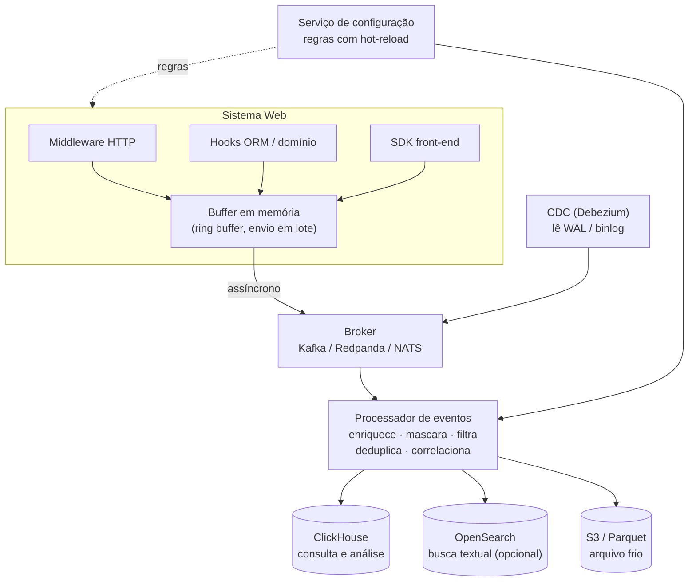

# Motor de Captura de Logs de Operações

> Arquitetura de um motor autônomo, configurável e de alta eficiência para captura de logs de operações em sistemas web.
>
> Documento técnico · novembro de 2026

---

## Sumário

1. [Visão geral](#1-visão-geral)
2. [Arquitetura](#2-arquitetura)
3. [Pontos de captura](#3-pontos-de-captura)
4. [Eficiência: o caminho rápido](#4-eficiência-o-caminho-rápido)
5. [Formato do evento](#5-formato-do-evento)
6. [Tipos de log capturados](#6-tipos-de-log-capturados)
7. [Escolha do banco de dados](#7-escolha-do-banco-de-dados)
8. [Uso do RocksDB](#8-uso-do-rocksdb)
9. [Estrutura no mesmo banco do sistema (PostgreSQL)](#9-estrutura-no-mesmo-banco-do-sistema-postgresql)
10. [Tela de configuração](#10-tela-de-configuração)
11. [Segurança, integridade e LGPD](#11-segurança-integridade-e-lgpd)
12. [Monitoramento do próprio motor](#12-monitoramento-do-próprio-motor)
13. [Evolução: do mesmo banco ao ClickHouse](#13-evolução-do-mesmo-banco-ao-clickhouse)
14. [Resumo das decisões](#14-resumo-das-decisões)

---

## 1. Visão geral

O motor captura as operações realizadas em um sistema web (quem fez o quê, quando, onde e com qual resultado) sem prejudicar o desempenho do sistema e sem exigir mudanças de código a cada nova regra de captura.

Três princípios definem o projeto:

| Princípio | Significado |
|---|---|
| **Desacoplado** | O sistema principal não depende do motor. Se o motor cair, o sistema continua funcionando (*fail-open*), exceto para eventos de auditoria marcados como obrigatórios. |
| **Assíncrono** | A captura nunca faz trabalho pesado dentro da requisição do usuário. Ela só enfileira o evento em memória, o que leva microssegundos. |
| **Guiado por configuração** | Regras declarativas definem o que capturar, o que mascarar e por quanto tempo guardar. Mudar uma regra não exige deploy. |

Uma distinção atravessa todo o projeto:

- **Auditoria** ("quem fez o quê"): não pode ser amostrada nem perdida.
- **Telemetria operacional** (requisições, latência, erros): pode ser amostrada e descartada sob carga.

---

## 2. Arquitetura



Essa é a arquitetura completa, para alto volume. Para sistemas menores, a seção 9 descreve uma versão simplificada que usa o mesmo banco do sistema, sem broker e sem ClickHouse.

---

## 3. Pontos de captura

| Ponto | O que captura | Intrusão no código | Contexto de usuário |
|---|---|---|---|
| **Middleware HTTP / API Gateway** | Rota, método, status, latência, IP, usuário, payload (filtrado) | Mínima, uma linha de registro | Completo |
| **Hooks do ORM / eventos de domínio** | "Usuário X alterou o campo Y do pedido Z de A para B" | Baixa a média | Completo |
| **CDC (Change Data Capture)** | Toda alteração no banco, com estado antes e depois | Zero, lê o log de transações | Precisa correlacionar |
| **SDK no front-end** | Navegação, cliques em ações críticas, erros de JavaScript | Baixa | Completo |

### CDC: o ponto mais autônomo

O Debezium lê o WAL do PostgreSQL ou o binlog do MySQL sem tocar no código e sem gerar carga de consultas. É o único ponto que captura alterações feitas **fora da aplicação** (scripts, DBA, outros sistemas).

A limitação é que o banco não sabe *quem* fez a alteração. Para resolver, a aplicação marca a transação:

```sql
SET LOCAL app.user_id  = '123';
SET LOCAL app.trace_id = '4bf92f35...';
```

O processador então junta o evento do CDC com o evento HTTP pelo `trace_id` ou pelo `txid`.

---

## 4. Eficiência: o caminho rápido

A chamada feita dentro da requisição só coloca o evento num canal com capacidade fixa. Uma rotina separada agrupa e envia os lotes. Exemplo em Go:

```go
type Capturer struct {
    ch chan Event // buffer com capacidade fixa, ex.: 65.536
}

// Chamado dentro da requisição: custo de nanossegundos, nunca bloqueia
func (c *Capturer) Emit(e Event) {
    select {
    case c.ch <- e:
    default:
        droppedCounter.Inc() // buffer cheio: descarta ou grava em spool no disco
    }
}

// Goroutine separada: agrupa em lotes e envia
func (c *Capturer) run() {
    batch := make([]Event, 0, 1000)
    tick := time.NewTicker(200 * time.Millisecond)
    for {
        select {
        case e := <-c.ch:
            if batch = append(batch, e); len(batch) == cap(batch) {
                c.flush(batch)
                batch = batch[:0]
            }
        case <-tick.C:
            if len(batch) > 0 {
                c.flush(batch)
                batch = batch[:0]
            }
        }
    }
}
```

Técnicas que garantem a eficiência:

- **Envio em lote:** mil eventos por envio, em vez de mil envios.
- **Serialização compacta:** Protobuf ou MessagePack em vez de JSON, com compressão zstd ou lz4.
- **Spool local em disco:** se o destino ficar fora do ar, os eventos não se perdem.
- **Amostragem configurável** para eventos de alto volume e baixo valor, como leituras e health checks.
- **Backpressure com métricas:** eventos descartados viram um alerta, nunca uma perda silenciosa.

---

## 5. Formato do evento

```json
{
  "event_id":   "0192f3a1-7c2e-7b3a-9f10-2d4c5e6f7a8b",
  "ts":         "2026-11-05T14:32:10.123Z",
  "trace_id":   "4bf92f3577b34da6a3ce929d0e0e4736",
  "tenant":     "empresa-x",
  "categoria":  "auditoria",
  "actor":      { "id": "u123", "tipo": "usuario", "ip": "10.0.0.5" },
  "action":     "pedido.atualizar",
  "resource":   { "tipo": "Pedido", "id": "98765" },
  "changes":    { "status": ["ABERTO", "FATURADO"] },
  "result":     "sucesso",
  "latency_ms": 42
}
```

- `event_id` usa **UUIDv7**, que é ordenável por tempo.
- `trace_id` segue o padrão **OpenTelemetry** e liga o clique no front-end, a chamada à API e a alteração no banco.
- `changes` guarda só os campos alterados, no formato `[valor_anterior, valor_novo]`.

---

## 6. Tipos de log capturados

O motor captura tudo o que passa pela aplicação e tudo o que altera o banco de dados. Logs de infraestrutura são trabalho de outras ferramentas, mas podem ser publicados no mesmo pipeline.

### Capturados

| Tipo de log | Exemplo | Ponto de captura |
|---|---|---|
| Operações de negócio (auditoria) | "Maria alterou o status do pedido 98765 de ABERTO para FATURADO" | Hooks do ORM / eventos de domínio |
| Acesso e autenticação | Login, logout, falha de login, troca de senha, MFA, acesso negado | Middleware / hook de autenticação |
| Requisições à API | Rota, método, status, latência, IP, usuário | Middleware HTTP |
| Erros e exceções | Respostas 500, exceções não tratadas, stack trace | Middleware + handler global de erros |
| Alterações de permissão e configuração | "João recebeu o perfil Administrador" | Eventos de domínio |
| Leitura de dados sensíveis | "Quem consultou o CPF do cliente X" | Middleware ou hook de leitura, só nas entidades marcadas |
| Exportações, downloads e impressões | "Relatório de clientes exportado em Excel" | Eventos de domínio |
| Rotinas automáticas | Jobs agendados, filas, integrações | Wrapper de jobs + interceptor do cliente HTTP |
| Ações no front-end | Navegação, cliques em ações críticas, erros de JavaScript | SDK no navegador |
| Alterações feitas fora da aplicação | Script de correção, DBA alterando dado direto | Somente CDC, sem o usuário da aplicação |
| Desempenho | Requisições lentas, tempo por operação | Middleware (básico); OpenTelemetry/APM (detalhado) |

### Não capturados pelo motor

| Tipo de log | Motivo | Ferramenta adequada |
|---|---|---|
| Sistema operacional, containers, rede, firewall | Fora da aplicação | Fluent Bit, Vector, syslog |
| Consultas feitas direto no banco | O CDC só enxerga dados alterados | pgAudit (PostgreSQL), audit plugin (MySQL) |
| Requisições bloqueadas antes da aplicação | Barradas no WAF, gateway ou balanceador | Logs do gateway/WAF |
| Ações em sistemas de terceiros | Não passam pela aplicação | Logs do fornecedor |
| Conteúdo integral de arquivos e payloads grandes | Limitado por custo e LGPD | Guardar referência e hash do arquivo |

### Impressão (tipo `IMPRESSAO`)

A ação de imprimir é um tipo de evento próprio, `IMPRESSAO`, distinto de `EXPORTACAO`. Ela é capturada por dois caminhos:

- **Documentos gerados no servidor (PDF):** resposta com `Content-Type: application/pdf` gera o nível `IMPRESSAO`. CSV e XLSX continuam `EXPORTACAO`. O evento registra a geração do PDF como impressão do documento, não o ato físico de imprimir no visualizador.
- **Impressão de tela pelo navegador:** o gancho `impressao-captura.js` escuta o evento `beforeprint` e envia um `POST` para `/MuralhaDigital/Impressao` (`ImpressaoServlet`), que registra o evento com nível `IMPRESSAO`. O gancho registra a intenção de imprimir, mesmo que o usuário cancele o diálogo.

Em ambos os caminhos, os campos de impressão ficam em `dados_extra`, junto com o restante do evento:

| Campo | Exemplo | Origem |
|---|---|---|
| `formato` | `PDF` ou `Impressao de tela` | Content-Type da resposta, ou o próprio gancho do navegador |
| `documento` | nome derivado da rota (funcionalidade) | Derivado da rota, sem cadastro manual |
| `telaOrigem` | `/muralha-digital/pages/.../index.jsp` | Caminho do cabeçalho `Referer`; no navegador, caminho da URL e título da página |

A captura é configurável pela tela de regras (`sis_log_regra`, nível `IMPRESSAO`) e pelo liga/desliga do tipo em `sis_log_tipo_evento`. O endpoint `/MuralhaDigital/Impressao` também está sujeito às regras de rota. A retenção de `IMPRESSAO` herda a política padrão. Os detalhes estão em [design-captura-impressao.md](design-captura-impressao.md) e na entrega [20261112-captura-impressao.md](../entregas/20261112-captura-impressao.md).

---

## 7. Escolha do banco de dados

### Regra geral: banco separado do sistema

| Problema | Por quê |
|---|---|
| Concorrência de carga | Log é escrita massiva e contínua. No mesmo banco, disputa I/O, locks e cache com as transações do negócio. |
| Padrão de acesso diferente | O banco transacional é otimizado para leituras e escritas pontuais. Log é *append-only* com consultas agregadas por período. |
| Volume | Logs crescem muito mais que os dados do negócio e inflam backup, vacuum e réplicas. |
| Segurança e integridade | Quem administra o banco do sistema conseguiria apagar a trilha de auditoria. |
| Acoplamento | Se o banco principal cai, os logs que explicariam a queda caem junto. |

### Opções

| Banco | Quando usar |
|---|---|
| **ClickHouse** | Primeira escolha. Colunar, comprime de 10 a 20 vezes, ingere milhões de linhas por segundo, `TTL` nativo. |
| **OpenSearch / Elasticsearch** | Quando o requisito principal é busca textual livre. |
| **TimescaleDB** | Equipe só domina PostgreSQL e o volume é moderado. |
| **S3 + Parquet** | Arquivo frio barato, consultável por ClickHouse, DuckDB ou Athena. |

Tabela de eventos no ClickHouse:

```sql
CREATE TABLE eventos (
    ts            DateTime64(3),
    tenant        LowCardinality(String),
    actor_id      String,
    action        LowCardinality(String),
    resource_type LowCardinality(String),
    resource_id   String,
    trace_id      String,
    changes       String CODEC(ZSTD(3)),
    result        LowCardinality(String)
) ENGINE = MergeTree
PARTITION BY toYYYYMM(ts)
ORDER BY (tenant, resource_type, resource_id, ts)
TTL ts + INTERVAL 5 YEAR;
```

### Quando faz sentido usar o mesmo banco

1. **Sistema pequeno**, com poucos milhares a alguns milhões de eventos por dia. Use um *schema* separado e tabelas particionadas (seção 9).
2. **Auditoria com garantia legal**, em que nenhum evento pode ser perdido. Use o padrão **Transactional Outbox**: o evento é gravado na mesma transação da operação de negócio. Se a operação foi confirmada, o log existe.

---

## 8. Uso do RocksDB

O RocksDB é um armazenamento chave-valor **embarcado** (biblioteca, não servidor), baseado em LSM-tree e otimizado para escrita intensiva.

### Onde se encaixa bem

| Uso | Por quê |
|---|---|
| **Spool local do agente** | Grava centenas de milhares de eventos por segundo, sobrevive a falhas, permite ler em ordem e apagar depois de enviados. |
| **Estado do processador** | Deduplicação (`event_id`), correlação CDC × HTTP por `trace_id`, último hash da cadeia. O Kafka Streams e o Flink usam o RocksDB para isso. |

### Por que não como banco principal

| Necessidade | Limitação do RocksDB |
|---|---|
| Consultas por combinações variadas de filtros | Só busca por chave/prefixo; índices secundários teriam de ser mantidos à mão |
| Agregações e relatórios | Não tem SQL nem agregação |
| Acesso por vários serviços | Só um processo abre o banco para escrita |
| Alta disponibilidade | Não tem replicação |

Exceção: histórico de um registro específico, com chave composta `tenant#tipo_recurso#id_recurso#timestamp#event_id` e busca por prefixo.

### Bibliotecas

- **Go:** prefira o **Pebble** (CockroachDB), em Go puro e compatível com o modelo do RocksDB, ou o **Badger**. O `grocksdb` exige cgo.
- **Rust:** crate `rocksdb`.
- **Java:** RocksJava.

---

## 9. Estrutura no mesmo banco do sistema (PostgreSQL)

Todas as tabelas ficam no *schema* `audit`.

| # | Tabela | Função | Obrigatória |
|---|---|---|---|
| 1 | `audit.evento` | Todos os eventos, particionada por mês | Sim |
| 2 | `audit.outbox` | Fila de passagem gravada na mesma transação do negócio | Sim |
| 3 | `audit.regra_captura` | Regras ativas de captura | Sim |
| 4 | `audit.regra_versao` | Versões publicadas das regras, com aprovação e reversão | Sim |
| 5 | `audit.agente` | Sinal de vida e métricas de cada agente | Sim |
| 6 | `audit.selo_integridade` | Fechamento periódico da cadeia de hashes | Opcional |

> **Evite** criar uma tabela de histórico para cada tabela do sistema (`pedido_hist`, `cliente_hist`...). Uma tabela genérica com as alterações em `jsonb` atende todas as entidades e não muda quando o sistema muda.

### 9.1 `audit.evento`

```sql
CREATE SCHEMA audit;

CREATE TABLE audit.evento (
    id            uuid        NOT NULL,        -- UUIDv7
    ts            timestamptz NOT NULL,
    tenant_id     text,
    trace_id      text,
    categoria     text        NOT NULL,        -- auditoria | operacional
    ator_id       text,
    ator_tipo     text        NOT NULL,        -- usuario | sistema | api
    ip            inet,
    acao          text        NOT NULL,        -- pedido.atualizar
    recurso_tipo  text        NOT NULL,        -- Pedido
    recurso_id    text,                        -- 98765
    resultado     text        NOT NULL,        -- sucesso | erro | negado
    latencia_ms   integer,
    alteracoes    jsonb,                       -- {"status": ["ABERTO", "FATURADO"]}
    contexto      jsonb,                       -- rota, user-agent, parâmetros
    hash          bytea       NOT NULL,
    hash_anterior bytea,
    PRIMARY KEY (id, ts)
) PARTITION BY RANGE (ts);

CREATE INDEX ON audit.evento USING brin (ts);
CREATE INDEX ON audit.evento (recurso_tipo, recurso_id, ts DESC);
CREATE INDEX ON audit.evento (ator_id, ts DESC);
CREATE INDEX ON audit.evento (trace_id);

-- Uma partição por mês (automatizar com pg_partman ou com o worker)
CREATE TABLE audit.evento_2026_11 PARTITION OF audit.evento
    FOR VALUES FROM ('2026-11-01') TO ('2026-12-01');
```

Use poucos índices: cada índice a mais deixa a gravação mais lenta.

### 9.2 `audit.outbox`

```sql
CREATE TABLE audit.outbox (
    id        bigint GENERATED ALWAYS AS IDENTITY PRIMARY KEY,
    criado_em timestamptz NOT NULL DEFAULT now(),
    payload   jsonb       NOT NULL
);
```

A outbox é leve (um índice, sem partições), então a inserção dentro da transação do negócio custa quase nada. Dois caminhos chegam até ela:

- **Eventos de auditoria:** inseridos na **mesma transação** da operação de negócio.
- **Eventos operacionais:** acumulados no buffer em memória e inseridos em lote, numa conexão separada, fora da transação.

Um processo separado (worker):

1. lê lotes com `SELECT ... FOR UPDATE SKIP LOCKED`;
2. calcula a cadeia de hashes;
3. insere em `audit.evento` e apaga da outbox, na mesma transação.

### 9.3 `audit.regra_captura` e `audit.regra_versao`

```sql
CREATE TABLE audit.regra_versao (
    versao        integer     PRIMARY KEY,
    status        text        NOT NULL,   -- rascunho | pendente | publicada | revertida
    conteudo      jsonb       NOT NULL,   -- snapshot completo das regras
    autor_id      text        NOT NULL,
    aprovador_id  text,
    criado_em     timestamptz NOT NULL DEFAULT now(),
    publicado_em  timestamptz,
    CHECK (aprovador_id IS NULL OR aprovador_id <> autor_id)
);

CREATE TABLE audit.regra_captura (
    id            serial      PRIMARY KEY,
    versao        integer     NOT NULL REFERENCES audit.regra_versao(versao),
    tipo          text        NOT NULL,   -- http | entidade | mascaramento | retencao | desempenho | alerta
    alvo          text        NOT NULL,   -- '/api/**' | 'Pedido' | 'cpf'
    parametros    jsonb       NOT NULL,   -- {"metodos": ["POST"], "amostragem": 0.05}
    travada       boolean     NOT NULL DEFAULT false,  -- regra mínima, não desativável
    ativo         boolean     NOT NULL DEFAULT true,
    atualizado_em timestamptz NOT NULL DEFAULT now()
);

-- Hot-reload: avisa os agentes quando as regras mudam
CREATE FUNCTION audit.notificar_regras() RETURNS trigger
LANGUAGE plpgsql AS $$
BEGIN
    PERFORM pg_notify('regras_alteradas', '');
    RETURN NULL;
END $$;

CREATE TRIGGER trg_regras_alteradas
    AFTER INSERT OR UPDATE OR DELETE ON audit.regra_captura
    FOR EACH STATEMENT EXECUTE FUNCTION audit.notificar_regras();
```

Os agentes escutam com `LISTEN regras_alteradas` e recarregam as regras na hora, sem polling.

### 9.4 `audit.agente`

```sql
CREATE TABLE audit.agente (
    id             text        PRIMARY KEY,  -- servico@host:pid
    servico        text        NOT NULL,
    versao_regras  integer,
    ultimo_sinal   timestamptz NOT NULL,
    metricas       jsonb                     -- eventos/s, descartes, spool, buffer
);
```

### 9.5 `audit.selo_integridade` (opcional)

```sql
CREATE TABLE audit.selo_integridade (
    tenant_id      text        NOT NULL,
    periodo_inicio timestamptz NOT NULL,
    periodo_fim    timestamptz NOT NULL,
    qtd_eventos    bigint      NOT NULL,
    ultimo_hash    bytea       NOT NULL,
    assinatura     bytea,                    -- assinatura digital do período
    criado_em      timestamptz NOT NULL DEFAULT now(),
    PRIMARY KEY (tenant_id, periodo_inicio)
);
```

### 9.6 Cadeia de hashes

```
hash = SHA-256( hash_anterior || JSON canônico do evento sem os campos de hash )
```

- Uma cadeia por `tenant_id` (ou uma cadeia global, se o sistema não for multi-tenant).
- O JSON canônico segue a RFC 8785 (chaves ordenadas, sem espaços), para que o hash seja reproduzível.
- Como a cadeia exige ordem serial, o worker usa `pg_advisory_xact_lock` por tenant ao calcular os hashes. Vários workers podem rodar em paralelo, cada um em tenants diferentes.
- Uma vez por dia, o worker grava um selo por tenant com o último hash e o assina com uma chave guardada **fora do banco**. Copiar o selo para fora (S3, e-mail, outro sistema) reforça a prova.

### 9.7 Permissões

```sql
-- Aplicação: só insere na outbox e lê as regras
REVOKE ALL ON ALL TABLES IN SCHEMA audit FROM app_user;
GRANT INSERT ON audit.outbox                      TO app_user;
GRANT SELECT ON audit.regra_captura               TO app_user;
GRANT SELECT, INSERT, UPDATE ON audit.agente      TO app_user;  -- upsert do sinal de vida

-- Worker: move da outbox para eventos e grava selos
GRANT SELECT, DELETE ON audit.outbox              TO audit_worker;
GRANT INSERT, SELECT ON audit.evento              TO audit_worker;
GRANT INSERT ON audit.selo_integridade            TO audit_worker;

-- API de configuração: gerencia regras
GRANT SELECT, INSERT, UPDATE ON audit.regra_captura, audit.regra_versao TO audit_admin;
GRANT SELECT ON audit.agente                      TO audit_admin;

-- Auditores: só leitura
GRANT SELECT ON audit.evento, audit.selo_integridade TO auditor;
```

Nenhum papel tem `UPDATE` ou `DELETE` em `audit.evento`.

### 9.8 Retenção

Apague dados antigos removendo a partição inteira:

```sql
DROP TABLE audit.evento_2021_11;
```

É instantâneo e não gera inchaço. Um `DELETE` por data apagaria milhões de linhas uma a uma, travando o banco e exigindo vacuum pesado.

### 9.9 Limite desse modelo

Em PostgreSQL bem configurado, essa estrutura atende até a faixa de alguns milhões de eventos por dia. Acima disso, `audit.evento` migra para o ClickHouse (seção 13).

---

## 10. Tela de configuração

A tela grava as regras em `audit.regra_versao` e `audit.regra_captura`. O banco dispara `NOTIFY` e os agentes recarregam as regras sem deploy nem reinício.

### Seções

| Seção | Parâmetros |
|---|---|
| **Painel geral** | Liga/desliga por categoria (HTTP, entidades, front-end, CDC); modo de operação (normal, degradado, diagnóstico por tempo limitado); saúde dos agentes (eventos/s, descartes, spool, atraso, versão das regras aplicada) |
| **Captura HTTP** | Rotas a incluir e excluir (padrões); métodos; amostragem por método ou rota; captura do corpo (sim/não, tamanho máximo) |
| **Entidades e campos** | Lista descoberta automaticamente (ORM ou `information_schema`); por entidade: criação, alteração, exclusão, leitura; antes/depois; campos rastreados |
| **Dados sensíveis** | Campos a mascarar; estratégia (hash, ocultar, parcial); sugestão automática por nome de campo e por padrão de conteúdo |
| **Retenção** | Prazo por categoria; quando mover para o arquivo frio |
| **Desempenho** | Tamanho do buffer, tamanho do lote, intervalo de envio; política com buffer cheio (descartar, spool, bloquear); limite do spool |
| **Alertas** | Sobre o motor (descartes, atraso, agente sem sinal); sobre comportamento suspeito (falhas de login em sequência, exclusão em massa, acesso fora do horário) |
| **Consulta de eventos** | Filtros por período, usuário, ação, recurso, resultado e trace_id; verificação da cadeia de hashes |

O tamanho do buffer em memória normalmente só muda quando o agente reinicia. Os demais parâmetros mudam na hora.

### Proteções obrigatórias

1. **A própria tela é auditada.** Toda alteração de regra gera um evento com autor, valor antigo e valor novo.
2. **Regras mínimas travadas** (`travada = true`): login, alteração de permissões e exclusões não podem ser desligados pela tela.
3. **Aprovação em duas etapas** para reduzir a captura ou o prazo de retenção: uma pessoa propõe e outra aprova.
4. **Versionamento com reversão** para a versão anterior com um clique.
5. **Simulação antes de publicar**: a regra nova é testada contra os últimos milhares de eventos e mostra o que passaria a ser capturado, descartado ou mascarado.
6. **Permissão de acesso própria**, separada dos administradores do sistema.

### Exemplo de regras (formato exportável)

```yaml
capture:
  http:
    include: ["/api/**"]
    exclude: ["/api/health", "/api/metrics"]
    methods: [POST, PUT, PATCH, DELETE]
    sample_rate: { GET: 0.05 }
    body: { max_bytes: 4096 }
  entities:
    Pedido:   { track: all, diff: true }
    Usuario:  { track: [email, perfil, ativo], diff: true }
    Produto:  { track: [preco], diff: true }
masking:
  fields: [senha, cpf, cartao, token]
  strategy: hash          # hash | redact | partial
retention:
  auditoria: 5y
  operacional: 90d
performance:
  buffer_size: 65536
  batch_size: 1000
  flush_interval_ms: 200
  on_full: spool          # drop | spool | block
  spool_max_mb: 512
```

---

## 11. Segurança, integridade e LGPD

- **Imutabilidade:** cadeia de hashes, selo diário assinado, nenhum `UPDATE`/`DELETE` em `audit.evento`, e armazenamento WORM (S3 Object Lock) para o arquivo frio.
- **Mascaramento na origem:** dados sensíveis são mascarados no SDK, antes de sair da aplicação.
- **Retenção por categoria**, com exclusão por partição.
- **Separação de papéis:** aplicação, worker, administrador do motor e auditor têm permissões distintas.
- **Auditoria da configuração:** nenhuma mudança de regra acontece sem registro.

---

## 12. Monitoramento do próprio motor

| Métrica | Alerta sugerido |
|---|---|
| Eventos por segundo | Queda brusca (agente parado) |
| Eventos descartados | Qualquer descarte de auditoria; operacional acima de X% |
| Tamanho da outbox / atraso do worker | Acima de N eventos ou T segundos |
| Tamanho do spool | Acima de 70% do limite |
| Último sinal do agente | Sem sinal há mais de 1 minuto |
| Verificação da cadeia de hashes | Qualquer quebra |

As métricas são expostas no formato Prometheus e resumidas no painel da tela de configuração.

---

## 13. Evolução: do mesmo banco ao ClickHouse

| Fase | Estrutura | Quando |
|---|---|---|
| 1 | PostgreSQL do sistema, schema `audit`, outbox + worker | Até alguns milhões de eventos por dia |
| 2 | Worker passa a gravar `audit.evento` no ClickHouse | Relatórios pesando no banco do sistema |
| 3 | Broker (Kafka/Redpanda) entre outbox e processador; CDC com Debezium | Vários sistemas, alto volume, alterações fora da aplicação |
| 4 | Arquivo frio em S3/Parquet; OpenSearch para busca textual | Retenção longa e investigações |

Como as colunas são praticamente as mesmas, a outbox, as regras e a tela de configuração continuam iguais entre as fases. Só muda o destino do worker.

---

## 14. Resumo das decisões

| Decisão | Recomendação |
|---|---|
| Captura | Middleware HTTP + hooks do ORM; CDC para alterações fora da aplicação |
| Caminho da requisição | Só enfileira em memória; envio assíncrono em lote; fail-open (exceto auditoria obrigatória) |
| Garantia de auditoria | Transactional Outbox + cadeia de hashes + selo diário |
| Configuração | Regras versionadas no banco, hot-reload por `LISTEN/NOTIFY`, tela com aprovação em duas etapas |
| Armazenamento (fase 1) | PostgreSQL do sistema, schema `audit`, particionamento mensal |
| Armazenamento (alto volume) | ClickHouse (quente) + S3/Parquet (frio) |
| Estado local e spool | RocksDB / Pebble |
| Padrão de contexto | OpenTelemetry (`trace_id`) |
