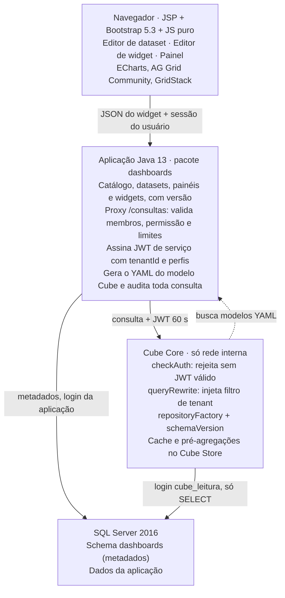

# Construtor de Dashboards — Arquitetura e Prompt de Execução (v3)

13/10/2026 · Gustavo Landal

Revisão v2: stack ajustada para **Java 13.0.1**, **SQL Server 2016**, **JSP + Bootstrap 5.3** (React opcional no futuro) e restrição de **somente componentes open source ou 100% gratuitos**.

Revisão v3: Metabase avaliado e descartado (incorporação sem iframe só nos planos pagos e sem modelagem visual de relacionamentos). Incluído o **modelador visual** — arrastar tabelas, ligar colunas com o mouse, relações sugeridas e sugestão automática de gráfico — e refeita a sessão DASH-2 com prompt de execução.

> **Atualização 14/10/2026 — Cube Core removido.** As consultas passaram a ser montadas e executadas pelo Java direto no SQL Server ([Plano 21](../planos-salvador/21-dashboards-consulta-sql-sem-cube.md)). As menções ao Cube neste documento são **históricas**; o fluxo vigente está em [`construtor-dashboards-arquitetura.md`](construtor-dashboards-arquitetura.md#fluxo-vigente-v3-sem-cube).

## Contexto e decisão

Decisão: camada semântica **Cube Core** (open source) como serviço interno, atrás da aplicação **Java 13**, com o construtor visual feito em **JavaScript puro (ES modules) + Bootstrap 5.3** dentro das páginas JSP. O navegador nunca fala com o Cube nem com o banco: toda consulta passa pelo Java, que aplica permissão, tenant e auditoria.

O contrato entre frontend e backend é um **JSON de widget** independente de framework. Isso permite trocar o editor por React no futuro sem tocar no backend nem no Cube.

### Componentes (todos gratuitos, sem edição paga)

| Camada | Componente | Licença | Observação |
| --- | --- | --- | --- |
| Semântica (medidas, dimensões, joins, cache) | Cube Core + Cube Store | Apache 2.0 | Driver `mssql` nativo; pré-agregações funcionam com SQL Server |
| Backend | Aplicação Java 13 existente (Servlet/JSP; Spring MVC se já houver) | — | Nada de Spring Boot 3, Spring Modulith ou bibliotecas que exijam Java 17+ |
| Driver de banco | Microsoft JDBC Driver for SQL Server (`mssql-jdbc`, build `jre11`) | MIT | Já roda em Java 13 |
| JWT | `jjwt` 0.11.x ou `nimbus-jose-jwt` | Apache 2.0 | Ambos compatíveis com Java 8+ |
| JSON / YAML | Jackson + SnakeYAML | Apache 2.0 | Geração do modelo Cube |
| HTTP Java → Cube | `java.net.http.HttpClient` | JDK | Nativo desde o Java 11, sem dependência |
| Exportação XLSX | Apache POI | Apache 2.0 | CSV sem biblioteca |
| Fronteira de módulo | ArchUnit (só em teste) | Apache 2.0 | Substitui o Spring Modulith |
| UI base | Bootstrap 5.3 | MIT | Já é o padrão da aplicação |
| Layout arrastável | GridStack.js | MIT | JavaScript puro, sem React nem jQuery |
| Modelador visual de relacionamentos | AntV X6 | MIT | Diagrama com portas por coluna, ligação por arrasto, minimapa, desfazer; distribuição UMD sem build |
| Alinhamento automático do diagrama | dagre | MIT | Organiza as tabelas da esquerda para a direita |
| Gráficos | Apache ECharts | Apache 2.0 | Versão JavaScript pura |
| Tabelas | AG Grid Community (versão JavaScript) | MIT | Pivot calculado no Cube; o pivot do AG Grid é Enterprise (pago), **não usar** |
| Arrastar campos para eixos | SortableJS | MIT | Zonas de soltar do editor de widget |
| Editor de filtros | Componente próprio em Bootstrap | — | Grupos E/OU; evita dependência de jQuery |
| PDF do painel | Impressão do navegador com CSS de impressão | — | Sem biblioteca; servidor fica livre de renderizador |

Excluídos pela regra de gratuidade: AG Grid Enterprise, Metabase Pro/Enterprise (Embedded Analytics JS e SDK React), Superset com embedding pago, jOOQ (o suporte a SQL Server é só na edição comercial), Cube Cloud, JointJS+ (a edição paga do JointJS).

Uso opcional sem custo: Metabase Open Source só para analistas internos, separado do construtor dos usuários finais.

Plano B, se o ambiente vetar Node: gerador de SQL próprio em Java com `PreparedStatement` parametrizado. É viável, mas exige escrever joins, cache e pivot à mão — estimar o dobro do esforço.

### Restrições de Java 13 para o código novo

Java 13 permite `var` e `HttpClient`, mas **não** permite como recurso final: `record`, text blocks (preview no 13), switch expressions (preview no 13), pattern matching de `instanceof`, sealed classes. O código novo usa só recursos finais do Java 13, compila com `--release 13` e não habilita preview.

### SQL Server 2016: o que muda

- **RLS existe** no 2016 (security policies + `SESSION_CONTEXT`). Usar como segunda barreira, além do `queryRewrite` do Cube.
- JSON é suportado (`OPENJSON`, `JSON_VALUE`, `ISJSON`) sobre `NVARCHAR(MAX)` — serve para layout e configuração de widget.
- Funções que **não** existem no 2016: `STRING_AGG`, `TRIM`, `CONCAT_WS`, `TRANSLATE` (todas do 2017). A gramática de campos calculados não pode oferecê-las.
- Réplica legível (Always On com secundária de leitura) exige edição Enterprise. Sem ela, o Cube lê o primário com login somente leitura, limites de concorrência (`CUBEJS_CONCURRENCY`) e pré-agregações para tirar carga do banco.
- Migrations: usar o mecanismo que a aplicação já usa; se não houver, scripts SQL versionados com tabela de controle própria.

## Visão geral

O navegador só fala com o Java; só o Cube lê o banco para análises.



Uma consulta percorre: o widget envia seu JSON ao Java; o Java valida e assina um JWT de serviço; o Cube compila o SQL (dialeto T-SQL) com os joins do modelo, aplica o filtro de tenant e lê o SQL Server com um login somente leitura; o resultado volta pelo mesmo caminho.

## Camada semântica: catálogo, datasets e segurança

O usuário monta datasets **sobre um catálogo curado**, nunca sobre o banco cru.

1. **Catálogo (administrador)** — tabelas ou views permitidas, rótulos em português, tipo de cada coluna e **relações permitidas** (`many_to_one`, `one_to_many`, `one_to_one`) com a condição de junção.
2. **Dataset (usuário avançado)** — tabela base + relacionadas (só as relações declaradas), campos, **medidas** (soma, contagem, contagem distinta, média, mín., máx.) e **campos calculados** de uma gramática fechada compatível com SQL Server 2016.
3. **Widget (qualquer usuário com permissão)** — dataset, medidas, dimensões, granularidade de data, filtros e tipo de visualização.

Como o Cube recebe os datasets dinâmicos:

- O Java **gera o YAML** (um `cube` por tabela do catálogo com `joins`; um `view` por dataset).
- O Cube carrega por `repositoryFactory`, chamando `GET /internal/cube/modelos` no Java.
- `schemaVersion` devolve o hash do catálogo + datasets do tenant; publicar um dataset muda o hash.
- Campos calculados nunca viram SQL concatenado: a expressão é validada no Java contra a gramática antes de virar YAML.
- Medidas `count_distinct_approx` não entram em pré-agregação com SQL Server; usar `count_distinct`.

Segurança, em camadas:

- JWT de serviço por requisição com `securityContext` = `{tenantId, usuarioId, perfis}`; o Cube rejeita chamada sem ele.
- `contextToAppId` separa compilação e cache por tenant; `queryRewrite` injeta o filtro de tenant em toda consulta.
- Login SQL Server `cube_leitura` com `db_datareader` restrito ao schema do catálogo (ou `GRANT SELECT` tabela a tabela), sem `INSERT/UPDATE/DELETE` e sem acesso ao schema `dashboards`.
- Se a instalação for uma por cliente, o filtro de tenant vira verificação de configuração, mas continua testado.
- Colunas sensíveis (CPF, placa, dados pessoais) marcadas no catálogo: fora do dataset ou só agregadas, conforme perfil (LGPD).

## Backend: pacote `dashboards` na aplicação Java 13

Um pacote `dashboards` com fachada pública (`DashboardsFacade`) e implementação interna; um teste ArchUnit impede que outros pacotes acessem as classes internas ou as tabelas.

Modelo de dados (schema `dashboards` no SQL Server; JSON em `NVARCHAR(MAX)` com `CHECK (ISJSON(coluna) = 1)`):

| Tabela | Conteúdo principal |
| --- | --- |
| `catalogo_tabela` | nome físico, rótulo, descrição, chave primária, ativo, sensível |
| `catalogo_coluna` | tabela, nome físico, rótulo, tipo, sensível, papel sugerido |
| `catalogo_relacao` | tabela origem, tabela destino, cardinalidade, pares de colunas da junção |
| `dataset` | nome, tabela base, dono, visibilidade, versão, status (rascunho/publicado), layout do modelador (JSON) |
| `dataset_tabela` | tabelas presentes no dataset, indicador de tabela base |
| `dataset_relacao` | tabela origem, tabela destino, pares de colunas, cardinalidade, origem (banco/catálogo/usuário) |
| `dataset_campo` | coluna ou expressão, agregação, formato, rótulo |
| `dataset_filtro_fixo` | condição aplicada sempre |
| `dashboard` | nome, descrição, dono, layout (JSON), filtros globais (JSON), versão |
| `widget` | dashboard, dataset, tipo, consulta (JSON no formato do Cube), opções visuais (JSON) |
| `compartilhamento` | recurso, perfil ou usuário, nível (ver/editar) |
| `historico_versao` | recurso, versão, snapshot JSON, autor, data |

Endpoints (servlets ou controllers, prefixo `/api/dashboards`, respostas JSON):

| Método e rota | Função |
| --- | --- |
| `GET/POST/PUT /catalogo/...` | manter catálogo (administrador) |
| `POST /catalogo/importar` | sugerir tabelas e relações a partir de `INFORMATION_SCHEMA` e `sys.foreign_keys` |
| `GET/POST/PUT/DELETE /datasets` | CRUD; `POST /datasets/{id}/publicar` regenera modelo e incrementa versão |
| `POST /datasets/{id}/pre-visualizar` | 50 primeiras linhas |
| `GET /catalogo/tabelas?busca=` e `/catalogo/tabelas/{id}/amostra` | lista do painel lateral e 5 linhas de exemplo no hover |
| `GET /datasets/{id}/sugestoes-relacao?tabela=` | relações sugeridas ao soltar uma tabela (banco, catálogo, nome) |
| `POST /datasets/{id}/relacoes/validar` | valida tipos, caminho único e permissão antes de gravar |
| `POST /datasets/{id}/relacoes/verificar-cardinalidade` | contagem de duplicidade com `TOP` e tempo máximo de 5 s |
| `PUT /datasets/{id}/modelador` | grava tabelas, relações e layout do canvas numa transação |
| `POST /catalogo/relacoes/promover` | administrador promove relação de usuário ao catálogo |
| `GET /datasets/{id}/meta` | medidas e dimensões disponíveis, filtradas por permissão |
| `GET/POST/PUT/DELETE /paineis` e `/paineis/{id}/widgets` | CRUD de dashboards e widgets |
| `POST /consultas` | valida, assina JWT, chama `/cubejs-api/v1/load`, devolve dados |
| `POST /consultas/exportar` | CSV/XLSX (Apache POI), com limite de linhas |
| `GET /internal/cube/modelos` e `/internal/cube/versao` | só rede interna, autenticado por segredo de serviço |

Regras do proxy (`POST /consultas`): rejeita membro fora do dataset ou sem permissão; limite de linhas (padrão 10.000) e tempo (padrão 30 s); trata `Continue wait` do Cube com nova tentativa curta; audita usuário, dataset, filtros e linhas retornadas. Autenticação reaproveita a sessão HTTP existente da aplicação; proteção CSRF nos `POST`.

Permissões novas: `DASHBOARD_VER`, `DASHBOARD_EDITAR`, `DATASET_EDITAR`, `CATALOGO_ADMIN`, `DADO_SENSIVEL_VER`.

## Frontend: JSP + Bootstrap 5.3 + JavaScript puro

Cada tela é uma JSP que entrega o esqueleto Bootstrap e carrega um módulo JavaScript (`<script type="module">`). Sem etapa de build: bibliotecas copiadas para `webapp/static/vendor/` com versão fixada (nada de CDN, para funcionar em intranet).

| Tela (JSP) | O que o usuário faz | Componentes |
| --- | --- | --- |
| `catalogo.jsp` (admin) | importa tabelas, ajusta rótulos, marca sensíveis, confirma relações | tabela Bootstrap, modal de relação |
| `dataset-editor.jsp` | arrasta tabelas, liga colunas com o mouse, escolhe campos, cria medidas e calculados, vê prévia | modelador AntV X6 (seção abaixo), editor de expressão, AG Grid para prévia |
| `widget-editor.jsp` | arrasta medidas e dimensões para eixos, filtros, ordenação, top N, tipo | SortableJS, editor de filtros próprio, prévia ECharts/AG Grid |
| `painel.jsp` | posiciona e redimensiona widgets, filtros globais, salva, compartilha, exporta | GridStack.js, barra de filtros, menu do widget |

Organização do JavaScript (`static/js/dashboards/`):

- `api.js` — chamadas `fetch` com token CSRF; único ponto que fala com o backend.
- `estado.js` — store mínimo (objeto + assinantes) com o JSON do painel/widget em edição.
- `widgets/` — um módulo por tipo (`barras.js`, `linhas.js`, `kpi.js`, `tabela.js`, `pivot.js`...), todos com a mesma interface `render(elemento, especificacao, dados)`.
- `editor-filtros.js`, `editor-widget.js`, `painel.js` — telas.

Tipos de widget: barras e colunas (agrupadas e empilhadas), linhas, área, pizza e rosca, dispersão, combinado barra + linha, funil, gauge, heatmap (ECharts); tabela detalhada e tabela dinâmica (AG Grid Community, pivot vindo do Cube via `pivotConfig`); KPI (HTML + Bootstrap); texto.

Interações do painel: filtros globais, filtro cruzado por clique, drill-down por hierarquia do dataset, atualização manual ou automática (mínimo 1 minuto), exportação CSV/XLSX/PNG por widget e PDF do painel pela impressão do navegador.

JSON do widget (contrato que um futuro editor React reutilizaria sem mudança):

```json
{
  "tipo": "barras",
  "datasetId": "b3f1...",
  "consulta": {
    "measures": ["recursos.quantidade"],
    "dimensions": ["recursos.situacao"],
    "timeDimensions": [{"dimension": "recursos.dataProtocolo", "granularity": "month", "dateRange": "last 12 months"}],
    "filters": [],
    "order": {"recursos.quantidade": "desc"},
    "limit": 20
  },
  "visual": {"empilhado": false, "rotulos": true, "paleta": "padrao"}
}
```

Regras de interface: estado nunca comunicado só por cor; cada gráfico tem botão "ver como tabela"; preferências salvas pela API, não em `localStorage`.

React no futuro: entraria como "ilha" montada num `<div>` da JSP, só no editor de widget, consumindo o mesmo `api.js`/JSON. Visualização dos painéis continua em JavaScript puro.

## Modelador visual de relacionamentos

Objetivo: o usuário monta o dataset como se desenhasse num quadro — arrasta tabelas, liga colunas com o mouse e vê o resultado na hora — sem formulários de junção nem SQL.

### Layout da tela `dataset-editor.jsp`

```text
+--------------------+-------------------------------------------+------------------+
| TABELAS            |  CANVAS (AntV X6)                         | CAMPOS DO        |
| [buscar...]        |                                           | DATASET          |
|                    |   +-----------+        +-------------+    |                  |
| > Recursos         |   | Recursos  |  N:1   | Situacao    |    | [x] Situação     |
| > Situacao         |   | id (PK)   |------->| id (PK)     |    | [x] Qtde (soma)  |
| > Orgao            |   | situacao_id        | descricao   |    | [ ] Data         |
| > Municipio        |   | data      |        +-------------+    |                  |
|                    |   +-----------+  - - - sugestão - - ->    | + Medida         |
|                    |                         +-----------+     | + Calculado      |
|                    |  [minimapa]  [zoom]     | Orgao     |     |                  |
|                    |  [alinhar] [desfazer]   +-----------+     |                  |
+--------------------+-------------------------------------------+------------------+
| PRÉVIA: 50 primeiras linhas do dataset (AG Grid), atualiza a cada mudança         |
+------------------------------------------------------------------------------------+
```

### Comportamentos

| Ação do usuário | O que acontece |
| --- | --- |
| Arrasta tabela da lista para o canvas | Cria o cartão com nome, colunas, tipo e ícone de chave; a primeira tabela vira a **base** (marcada) |
| Solta uma tabela nova | O sistema desenha em **tracejado** as relações sugeridas com as tabelas já presentes |
| Clica numa sugestão tracejada | Confirma a relação; a linha fica contínua |
| Puxa uma linha de uma coluna até outra | Validação imediata no navegador (destaca alvos compatíveis em verde enquanto arrasta) e, ao soltar, validação no servidor |
| Solta numa coluna válida | Abre popover com a cardinalidade sugerida (N:1, 1:N, 1:1), botão "verificar nos dados" e confirmar |
| Clica numa linha existente | Popover para trocar cardinalidade, ver as colunas ligadas ou remover |
| Passa o mouse sobre uma tabela | Mostra 5 linhas de exemplo (carregadas sob demanda) |
| Marca uma coluna no cartão ou no painel de campos | Campo entra no dataset; se for de outra tabela, o caminho de junção até a base é destacado |
| `Ctrl+Z` / `Ctrl+Y`, roda do mouse, botão "alinhar" | Desfazer/refazer, zoom, organização automática com dagre |
| Remove uma tabela | Remove também suas relações e campos, com confirmação mostrando o que será perdido |

### Regras de validação ao ligar colunas

1. Mesma tabela não se liga a si mesma nesta versão (autorrelacionamento fica como débito).
2. Tipos precisam ser compatíveis:

| Origem | Destinos aceitos |
| --- | --- |
| `int`, `bigint`, `smallint`, `tinyint` | qualquer inteiro |
| `decimal`/`numeric` com escala 0 | inteiros e `decimal` escala 0 |
| `varchar`, `nvarchar`, `char`, `nchar` | qualquer texto (avisar se a collation for diferente) |
| `uniqueidentifier` | `uniqueidentifier` |
| `date` | `date`; `datetime`/`datetime2` com aviso de que a hora será considerada |
| `float`, `real`, `text`, `ntext`, `image`, `varbinary`, `xml` | nenhum (recusar com explicação) |

3. **Caminho único:** se já existe um caminho entre as duas tabelas, a nova ligação é recusada com a mensagem "Essas tabelas já estão ligadas por X → Y. Remova a ligação atual para usar esta." (o Cube precisa de caminho de junção sem ambiguidade).
4. Toda tabela do canvas precisa estar ligada à base, direta ou indiretamente; tabela solta fica com borda de alerta e o dataset não pode ser publicado.
5. Toda tabela do catálogo precisa de chave primária declarada; sem ela o Cube não evita a duplicação de somas em junções 1:N.
6. A validação do navegador é só conforto; a regra vale no servidor (`POST /datasets/{id}/relacoes/validar`).

### Sugestão de relações

| Origem da sugestão | Confiança | Exibição |
| --- | --- | --- |
| Chave estrangeira real (`sys.foreign_keys`) | alta | tracejado, com selo "do banco" |
| Relação já usada no catálogo | alta | tracejado, com selo "do catálogo" |
| Nome coincidente (`cliente_id` ↔ `cliente.id`, `id_cliente` ↔ `cliente.id`) com tipos compatíveis | média | tracejado claro, com selo "sugerida" |

### Cardinalidade

- Coluna de destino é PK ou tem índice único → sugere **N:1**.
- Coluna de origem é PK ou única → sugere **1:N**.
- As duas são únicas → sugere **1:1**.
- "Verificar nos dados" executa no servidor uma contagem de duplicidade com `SELECT TOP` e tempo máximo de 5 s, e mostra o resultado ("encontrados 12 valores repetidos em situacao.id — isto não é N:1").

### Relações do usuário x relações do catálogo

- Relações desenhadas pelo usuário valem só no dataset dele (`dataset_relacao`).
- O administrador vê as relações mais usadas e pode **promovê-las ao catálogo** com um clique, para que apareçam como sugestão para todos.
- O usuário só vê e arrasta tabelas que o catálogo libera para o perfil dele; a segurança da seção anterior não muda.

### Sugestão automática de gráfico

Ao marcar campos, o editor de widget já abre com o gráfico mais provável; o usuário pode trocar.

| Campos escolhidos | Gráfico sugerido |
| --- | --- |
| 1 medida, sem dimensão | KPI |
| 1 data + 1 a 3 medidas | linhas |
| 1 categoria (até 12 valores) + 1 medida | barras horizontais ordenadas |
| 1 categoria (até 6 valores) + 1 medida representando parte do todo | rosca |
| 2 categorias + 1 medida | barras empilhadas, ou tabela dinâmica se houver mais de 12 valores |
| 2 medidas numéricas + 1 categoria | dispersão |
| Muitos campos sem medida | tabela detalhada |

### Acessibilidade

Todo o modelador tem alternativa por teclado e formulário: botão "Adicionar relação" abre um diálogo com seleção de tabela e coluna de origem e destino, que passa pelas mesmas validações. Linhas e estados nunca dependem só de cor (tracejado, selo de texto e ícone).

### Persistência

- Posição dos cartões, zoom e tabela base: `dataset.layout_modelador` (JSON).
- Relações do dataset: `dataset_relacao` (origem, destino, pares de colunas, cardinalidade, origem da relação: banco/catálogo/usuário).
- Cada publicação gera um snapshot em `historico_versao`, permitindo comparar e voltar versões.

## Performance e cache

1. **Cache de resultado do Cube** — `refreshKey` baseado em `MAX(atualizado_em)` da tabela base.
2. **Pré-agregações** no Cube Store (gratuito no Cube Core) para datasets mais usados; com SQL Server a estratégia de construção é a simples, sem configuração extra. Essencial aqui porque não há réplica de leitura.
3. **Banco** — índices nas colunas de junção e data do catálogo; views indexadas ou tabelas de resumo para relatórios pesados, cadastradas no catálogo como tabelas comuns.

Limites: até 20 widgets por painel, linhas e tempo por consulta, `CUBEJS_CONCURRENCY` baixo (começar com 4) para não disputar com a operação.

## Plano de sessões

1. **DASH-1 — Fundação ponta a ponta:** Cube com driver `mssql`, catálogo, geração de YAML, `repositoryFactory`, proxy `/consultas` com JWT e isolamento, um widget de barras em `painel.jsp` com dado real.
2. **DASH-2 — Modelador visual de dataset:** canvas AntV X6, arrastar tabelas, ligar colunas com validação, relações sugeridas, cardinalidade, prévia ao vivo, publicação com versão. (Campos calculados ficam para a DASH-2B.)
3. **DASH-2B — Medidas e campos calculados:** gramática fechada compatível com SQL Server 2016, editor de expressão com autocompletar, promoção de relações ao catálogo.
4. **DASH-3 — Editor de widget e tipos:** SortableJS, sugestão automática de gráfico, editor de filtros, todos os gráficos ECharts, KPI, tabela detalhada. Ponto de decisão: seguir em JS puro ou fazer o editor como ilha React.
5. **DASH-4 — Painel:** GridStack, filtros globais, filtro cruzado, drill-down, compartilhamento, histórico.
6. **DASH-5 — Tabela dinâmica e exportação:** pivot via Cube, subtotais, CSV/XLSX, impressão em PDF.
7. **DASH-6 — Performance:** pré-agregações, `refreshKey`, log de consultas lentas, teste de carga.

Questões em aberto:

- [ ] O JDK 13.0.1 em produção é um build OpenJDK gratuito ou Oracle JDK? Oracle JDK 13 em produção exige assinatura paga.
- [ ] Qual framework web a aplicação usa (Servlet puro, Spring MVC, Struts)? Define onde ficam os endpoints.
- [ ] Onde o Cube vai rodar: servidor Linux com Docker (recomendado) ou Node direto no Windows?
- [ ] Uma instalação por cliente ou várias empresas na mesma base? Define o filtro de tenant.
- [ ] Edição do SQL Server 2016 (Standard/Enterprise) e se há plano de atualização, já que o suporte estendido terminou.
- [ ] Quais colunas são sensíveis no catálogo inicial?

## Prompt de execução — sessão DASH-1

Cole no Claude Code na raiz do repositório. Salve também como `docs/PROMPT-SESSAO-DASH-1.md`.

````markdown
# SESSÃO DASH-1 — Fundação do construtor de dashboards (ponta a ponta)

## Antes de qualquer código
1. Leia CLAUDE.md (se existir) e docs/construtor-dashboards-arquitetura.md.
2. Confirme a stack lendo pom.xml/build.gradle, web.xml e a estrutura de webapp:
   Java 13.0.1, JSP + Bootstrap 5.3, SQL Server 2016. Identifique o framework web
   (Servlet puro, Spring MVC, outro) e o mecanismo de migration existente.
   Se encontrar algo diferente, PARE e me reporte.
3. Liste em 10 linhas o que vai criar e onde. Aguarde meu OK.

## Regras de stack (invioláveis)
- Somente componentes open source ou 100% gratuitos. Nenhuma edição paga, trial
  ou licença comercial (AG Grid Enterprise, jOOQ comercial, Cube Cloud: proibidos).
- Código compila com --release 13, sem --enable-preview. Proibido: record, text
  blocks, switch expressions, pattern matching de instanceof, sealed classes.
- Nenhuma dependência que exija Java 17+ (Spring Boot 3, Spring 6, Hibernate 6...).
- SQL compatível com SQL Server 2016: proibido STRING_AGG, TRIM, CONCAT_WS, TRANSLATE.
- Frontend sem React, sem jQuery novo, sem etapa de build: JSP + Bootstrap 5.3 +
  ES modules. Bibliotecas em webapp/static/vendor/ com versão fixada, sem CDN.

## Objetivo
Um widget de barras, salvo no banco, renderiza dado real do SQL Server passando por:
painel.jsp (JS) -> Java (/api/dashboards/consultas) -> Cube (/cubejs-api/v1/load) -> SQL Server.
Nenhum outro tipo de widget nesta sessão.

## Escopo
### Infraestrutura
- Serviço `cube` (imagem oficial cubejs/cube, versão estável fixada, nunca `latest`),
  CUBEJS_DB_TYPE=mssql, só rede interna, sem porta publicada para fora do servidor.
- Login SQL Server `cube_leitura` com SELECT apenas nas tabelas do catálogo,
  sem acesso ao schema dashboards.
- CUBEJS_API_SECRET compartilhado com a aplicação Java; ausente = falha na
  inicialização dos dois (fail-fast, sem valor padrão).
- CUBEJS_CONCURRENCY=4.
- cube.js com checkAuth, contextToAppId (por tenantId), queryRewrite (filtro de
  tenant), repositoryFactory + schemaVersion (GET /internal/cube/modelos).

### Backend — pacote `dashboards`
- Scripts de criação do schema dashboards: catalogo_tabela, catalogo_coluna,
  catalogo_relacao, dataset, dataset_campo, dashboard, widget. Colunas JSON em
  NVARCHAR(MAX) com CHECK (ISJSON(...) = 1). Auditoria de criação/alteração.
- CatalogoService: CRUD + importar (INFORMATION_SCHEMA + sys.foreign_keys,
  devolve sugestão; não grava sem confirmação).
- GeradorModeloCube (SnakeYAML): catálogo + datasets publicados -> YAML.
  Saída determinística (mesma entrada, mesmo YAML, mesmo hash).
- /internal/cube/modelos e /internal/cube/versao: só rede interna, segredo de serviço.
- POST /api/dashboards/consultas: valida membros contra o dataset e as permissões,
  assina JWT de 60 s (jjwt ou nimbus) com {tenantId, usuarioId, perfis}, chama o
  Cube com java.net.http.HttpClient, trata "Continue wait", limite de linhas e
  timeout, audita. Usa a sessão e o CSRF já existentes na aplicação.
- Fachada DashboardsFacade; teste ArchUnit impede acesso externo às classes internas.
- Permissões DASHBOARD_VER, DASHBOARD_EDITAR, DATASET_EDITAR, CATALOGO_ADMIN em
  toda rota nova.

### Frontend
- painel.jsp em /analises/paineis?id=..., layout Bootstrap 5.3.
- static/js/dashboards/api.js (fetch + CSRF) e widgets/barras.js (ECharts),
  interface render(elemento, especificacao, dados); estados carregando, vazio, erro.
- Botão "ver como tabela" no widget.

### Dados de exemplo
- Seed com 2 tenants, 1 tabela de catálogo com 1 relação, 1 dataset publicado,
  1 painel com 1 widget de barras por tenant.

## Testes obrigatórios (integração contra SQL Server e Cube reais, sem mock)
1. Usuário do tenant A recebe só linhas do tenant A (afirme NÃO vazio antes de comparar).
2. Usuário do tenant A pedindo membro de dataset do tenant B: 403.
3. Chamada ao Cube sem JWT ou com JWT expirado: rejeitada.
4. Publicar dataset muda o hash de /internal/cube/versao; republicar sem mudança mantém.
5. GeradorModeloCube: snapshot do YAML do seed (regressão).
6. Consulta acima do limite é truncada e sinalizada.
7. ArchUnit: nenhum pacote fora de dashboards acessa classes internas.
8. widgets/barras.js: renderiza dados, estado vazio e estado de erro.

## Proibições
- SQL concatenado com entrada do usuário, em qualquer camada.
- Cube exposto fora do servidor ou conectado com login de escrita/sysadmin.
- Valor padrão para segredo ausente.
- Teste ignorado (@Disabled/@Ignore); comparar dois resultados possivelmente vazios.
- Remover, mover ou renomear arquivo fora do escopo sem me perguntar.
- Implementar itens das sessões DASH-2 em diante.

## Marcadores
[LACUNA: ...] informação faltando — pare naquele ponto, siga o resto, reporte.
[DEBITO: ... -> sessão-alvo] dificuldade adiada (não pode ser item do DoD).

## Definition of Done (cole a saída real de cada comando no relatório)
- Build da aplicação com JDK 13 (saída mostrando a versão do javac).
- Cube saudável e respondendo a /readyz.
- Testes unitários + integração, duas execuções seguidas, zero ignorados.
- Abrir painel.jsp do seed e ver o gráfico com dado real (print no relatório).
- docs/relatorios/SESSAO-DASH-1-relatorio.md: matriz requisito -> arquivo -> teste,
  saída dos comandos, lacunas, débitos, decisões.
- commit + push incluindo docs/PROMPT-SESSAO-DASH-1.md.
````

## Prompt de execução — sessão DASH-2

Pré-requisito: DASH-1 concluída, com relatório e DoD verdes. Salve como `docs/PROMPT-SESSAO-DASH-2.md`.

````markdown
# SESSÃO DASH-2 — Modelador visual de dataset

## Antes de qualquer código
1. Leia CLAUDE.md, docs/construtor-dashboards-arquitetura.md (seção "Modelador visual
   de relacionamentos") e docs/relatorios/SESSAO-DASH-1-relatorio.md.
2. Confirme que a DASH-1 está verde: rode os testes e cole a saída.
3. Verifique a versão estável do AntV X6 e do dagre, a licença MIT de ambos, se há
   build UMD utilizável sem etapa de build e se os plugins (minimapa, histórico,
   seleção, teclado, linhas-guia) vêm no pacote principal ou separados. Reporte antes
   de copiar para webapp/static/vendor/.
4. Liste em 10 linhas o que vai criar e onde. Aguarde meu OK.

## Regras de stack (invioláveis, herdadas da DASH-1)
- Somente open source ou 100% gratuito. JointJS+ e qualquer edição paga: proibidos.
- Java: --release 13, sem preview, sem record/text blocks/switch expressions.
- SQL compatível com SQL Server 2016.
- Frontend: JSP + Bootstrap 5.3 + ES modules, sem React, sem jQuery novo, sem build,
  sem CDN.

## Objetivo
Em dataset-editor.jsp o usuário arrasta tabelas do catálogo para um canvas, liga
colunas com o mouse, confirma relações sugeridas, escolhe campos e vê a prévia
atualizar; ao publicar, o Cube passa a responder consultas desse dataset.

## Escopo
### Backend
- Tabela dataset_relacao e coluna dataset.layout_modelador (NVARCHAR(MAX) + ISJSON).
- GET /catalogo/tabelas?busca= e /catalogo/tabelas/{id}/amostra (TOP 5, só colunas
  não sensíveis para o perfil).
- GET /datasets/{id}/sugestoes-relacao?tabela= com três origens: sys.foreign_keys,
  catálogo, nome coincidente com tipos compatíveis. Cada sugestão traz a origem e
  a confiança.
- POST /datasets/{id}/relacoes/validar com as regras da seção do documento:
  sem autorrelacionamento, matriz de tipos, caminho único, tabela permitida ao perfil.
  Mensagens de erro em português, prontas para exibir.
- POST /datasets/{id}/relacoes/verificar-cardinalidade: consulta de duplicidade
  parametrizada com TOP e timeout de 5 s.
- PUT /datasets/{id}/modelador: grava tabelas, relações e layout numa transação;
  rejeita o conjunto inteiro se qualquer regra falhar.
- Publicação: bloqueia dataset com tabela solta ou tabela sem PK; gera YAML com os
  joins do dataset; muda o hash de /internal/cube/versao; grava historico_versao.

### Frontend (static/js/dashboards/modelador/)
- canvas.js: AntV X6 com cartões de tabela (porta por coluna), minimapa, zoom,
  desfazer/refazer, alinhar com dagre.
- painel-tabelas.js: lista com busca, arrastar para o canvas.
- ligacoes.js: ao arrastar, destaca portas compatíveis; ao soltar, chama validar e
  abre popover de cardinalidade (sugestão + "verificar nos dados").
- sugestoes.js: desenha sugestões tracejadas com selo de origem; clique confirma.
- campos.js: marcação de campos no cartão e no painel direito; destaca o caminho
  de junção.
- previa.js: AG Grid com 50 linhas, atualizada com debounce de 600 ms.
- dialogo-relacao.js: alternativa por teclado/formulário com as mesmas validações.
- Estados nunca só por cor: tracejado, selo de texto e ícone.

## Testes obrigatórios (integração contra SQL Server e Cube reais, sem mock)
1. Sugestões: tabela com FK real retorna sugestão "banco"; nome coincidente com tipo
   incompatível NÃO é sugerido. Afirme listas não vazias antes de comparar.
2. Validar: int x varchar recusado; float recusado; segundo caminho entre as mesmas
   tabelas recusado com a mensagem do documento.
3. Cardinalidade: coluna com valores repetidos é detectada; coluna PK confirma N:1.
4. PUT /modelador com uma relação inválida no meio não grava nada (atomicidade).
5. Publicar com tabela solta ou sem PK: recusado. Publicar válido: hash muda e uma
   consulta ao Cube com campo da tabela relacionada retorna linhas (não vazio).
6. Soma em junção 1:N não duplica valores (comparar com SELECT agregado direto).
7. Usuário sem permissão para uma tabela não a vê na lista nem consegue ligá-la (403).
8. Frontend: ligação válida abre popover; inválida mostra mensagem; desfazer remove
   a ligação; diálogo por teclado cria a mesma relação que o arrasto.

## Proibições
- SQL concatenado com nomes vindos do navegador: nomes de tabela e coluna sempre
  resolvidos pelo id do catálogo no servidor.
- Confiar só na validação do navegador.
- Gravar relações parcialmente.
- Teste ignorado; comparar dois resultados possivelmente vazios.
- Implementar campos calculados (DASH-2B) ou editor de widget (DASH-3).
- Remover, mover ou renomear arquivo fora do escopo sem me perguntar.

## Marcadores
[LACUNA: ...] informação faltando — pare naquele ponto, siga o resto, reporte.
[DEBITO: ... -> sessão-alvo] dificuldade adiada (não pode ser item do DoD).

## Definition of Done (cole a saída real de cada comando no relatório)
- Build com JDK 13 (saída mostrando a versão do javac).
- Cube saudável em /readyz.
- Testes unitários + integração, duas execuções seguidas, zero ignorados.
- Gravação de tela ou sequência de prints: arrastar 3 tabelas, aceitar uma sugestão,
  ligar uma coluna à mão, tentar uma ligação inválida, publicar e consultar.
- docs/relatorios/SESSAO-DASH-2-relatorio.md: matriz requisito -> arquivo -> teste,
  saída dos comandos, lacunas, débitos, decisões.
- commit + push incluindo docs/PROMPT-SESSAO-DASH-2.md.
````
