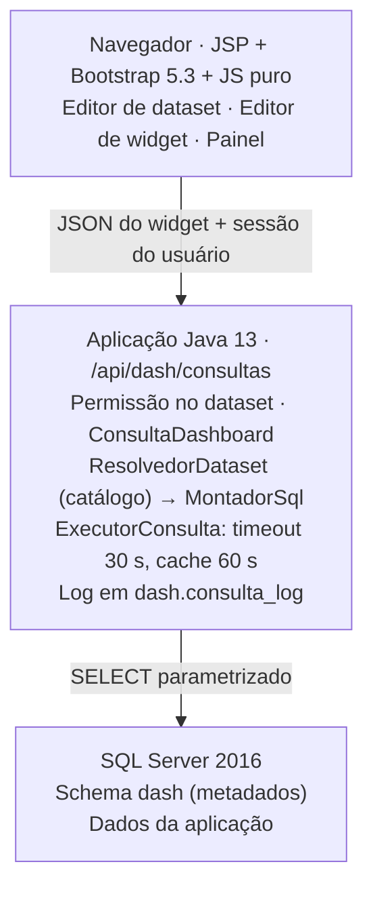
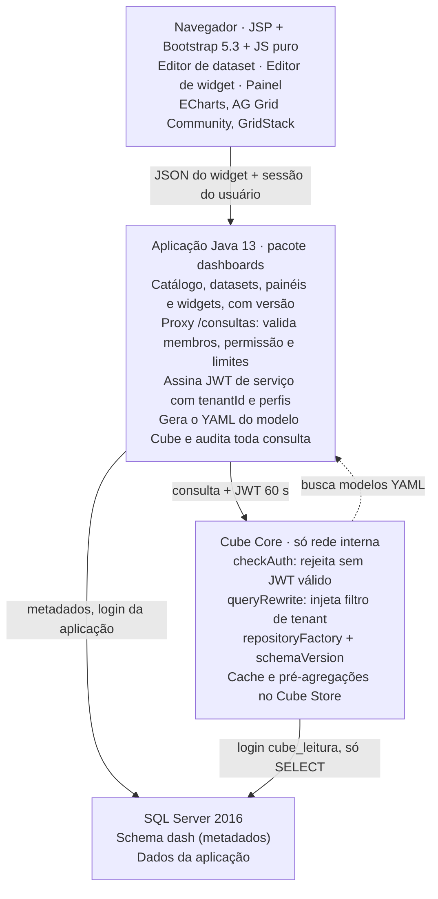

# Construtor de Dashboards — Arquitetura e Prompt de Execução (v2)

13/10/2026 · Gustavo Landal

Revisão v2: stack ajustada para **Java 13.0.1**, **SQL Server 2016**, **JSP + Bootstrap 5.3** (React opcional no futuro) e restrição de **somente componentes open source ou 100% gratuitos**.

> **Revisão v3 (14/10/2026) — Cube Core substituído.** Foi adotado o "Plano B" descrito abaixo: o Java monta e executa o SQL direto no SQL Server, sem Cube, JWT nem Docker. O contrato JSON do widget não mudou. Os arquivos do Cube (`cube/`, `docker-compose.cube.yml`, `GeradorModeloCube`, `JwtService`, `DashInternoServlet`) foram removidos do projeto. Motivo, diagnóstico e decisão: [Plano 21](../planos-salvador/21-dashboards-consulta-sql-sem-cube.md). As menções ao Cube nas seções seguintes e nos prompts das sessões DASH-1 a DASH-6 são **históricas**; o fluxo vigente está em [Visão geral](#visão-geral).

## Contexto e decisão

Decisão: camada semântica **Cube Core** (open source) como serviço interno, atrás da aplicação **Java 13**, com o construtor visual feito em **JavaScript puro (ES modules) + Bootstrap 5.3** dentro das páginas JSP. O navegador nunca fala com o Cube nem com o banco: toda consulta passa pelo Java, que aplica permissão, tenant e auditoria.

O contrato entre frontend e backend é um **JSON de widget** independente de framework. Isso permite trocar o editor por React no futuro sem tocar no backend nem no Cube.

### Componentes (todos gratuitos, sem edição paga)

| Camada | Componente | Licença | Observação |
| --- | --- | --- | --- |
| Semântica (medidas, dimensões, joins, cache) | Cube Core + Cube Store | Apache 2.0 | Driver `mssql` nativo; pré-agregações funcionam com SQL Server |
| Backend | Aplicação Java 13 existente (Servlet/JSP; Spring MVC se já houver) | — | Nada de Spring Boot 3, Spring Modulith ou bibliotecas que exijam Java 17+ |
| Driver de banco | Microsoft JDBC Driver for SQL Server (`mssql-jdbc 9.2.1.jre8`) | MIT | Já presente no pom.xml; roda em Java 13 |
| JWT | `javax.crypto` (HMAC-SHA256 nativo do JDK) | JDK | Nenhuma dependência externa |
| JSON | Gson 2.8.8 (já presente no pom.xml) | Apache 2.0 | Serialização JSON; modelo Cube gerado via StringBuilder |
| HTTP Java → Cube | `java.net.http.HttpClient` | JDK | Nativo desde o Java 11, sem dependência |
| Exportação XLSX | Apache POI | Apache 2.0 | CSV sem biblioteca |
| Fronteira de módulo | Convenção de pacotes + revisão | — | Sem dependência; ArchUnit descartado para não alterar pom.xml |
| UI base | Bootstrap 5.3 | MIT | Já é o padrão da aplicação |
| Layout arrastável | GridStack.js | MIT | JavaScript puro, sem React nem jQuery |
| Gráficos | Apache ECharts | Apache 2.0 | Versão JavaScript pura |
| Tabelas | AG Grid Community (versão JavaScript) | MIT | Pivot calculado no Cube; o pivot do AG Grid é Enterprise (pago), **não usar** |
| Arrastar campos para eixos | SortableJS | MIT | Zonas de soltar do editor de widget |
| Editor de filtros | Componente próprio em Bootstrap | — | Grupos E/OU; evita dependência de jQuery |
| PDF do painel | Impressão do navegador com CSS de impressão | — | Sem biblioteca; servidor fica livre de renderizador |

Excluídos pela regra de gratuidade: AG Grid Enterprise, Metabase/Superset com embedding pago, jOOQ (o suporte a SQL Server é só na edição comercial), Cube Cloud.

Plano B, se o ambiente vetar Node: gerador de SQL próprio em Java com `PreparedStatement` parametrizado. É viável, mas exige escrever joins, cache e pivot à mão — estimar o dobro do esforço.

### Restrições de Java 13 para o código novo

Java 13 permite `var` e `HttpClient`, mas **não** permite como recurso final: `record`, text blocks (preview no 13), switch expressions (preview no 13), pattern matching de `instanceof`, sealed classes. O código novo usa só recursos finais do Java 13, compila com `--release 13` e não habilita preview.

### SQL Server 2016: o que muda

- **RLS existe** no 2016 (security policies + `SESSION_CONTEXT`). Usar como segunda barreira, além do `queryRewrite` do Cube.
- JSON é suportado (`OPENJSON`, `JSON_VALUE`, `ISJSON`) sobre `NVARCHAR(MAX)` — serve para layout e configuração de widget.
- Funções que **não** existem no 2016: `STRING_AGG`, `TRIM`, `CONCAT_WS`, `TRANSLATE` (todas do 2017). A gramática de campos calculados não pode oferecê-las.
- Réplica legível (Always On com secundária de leitura) exige edição Enterprise. Sem ela, o Cube lê o primário com login somente leitura, limites de concorrência (`CUBEJS_CONCURRENCY`) e pré-agregações para tirar carga do banco.
- Migrations: usar o mecanismo que a aplicação já usa; se não houver, scripts SQL versionados com tabela de controle própria.

## Visão geral

### Fluxo vigente (v3, sem Cube)

O navegador só fala com o Java; o Java lê o banco.



Uma consulta percorre: o widget envia seu JSON ao Java; o Java verifica a permissão no dataset, resolve cada campo pelo catálogo (`dash.dataset_campo` → `dash.catalogo_coluna`), escolhe os joins mínimos a partir de `dash.dataset_relacao` e `dash.catalogo_relacao`, monta um `SELECT` com identificadores só do catálogo e valores como parâmetros, e executa. Quando as medidas são da tabela base e os joins são N:1, a base é agregada numa subconsulta antes do join (pré-agregação), o que no SQL Server 2016 reduz de minutos para segundos.

### Fluxo original (v2, histórico)



Uma consulta percorre: o widget envia seu JSON ao Java; o Java valida e assina um JWT de serviço; o Cube compila o SQL (dialeto T-SQL) com os joins do modelo, aplica o filtro de tenant e lê o SQL Server com um login somente leitura; o resultado volta pelo mesmo caminho.

## Camada semântica: catálogo, datasets e segurança

O usuário monta datasets **sobre um catálogo curado**, nunca sobre o banco cru.

1. **Catálogo (administrador)** — tabelas ou views permitidas, rótulos em português, tipo de cada coluna e **relações permitidas** (`many_to_one`, `one_to_many`, `one_to_one`) com a condição de junção.
2. **Dataset (usuário avançado)** — tabela base + relacionadas (só as relações declaradas), campos, **medidas** (soma, contagem, contagem distinta, média, mín., máx.) e **campos calculados** de uma gramática fechada compatível com SQL Server 2016.
3. **Widget (qualquer usuário com permissão)** — dataset, medidas, dimensões, granularidade de data, filtros e tipo de visualização.

Como o Cube recebe os datasets dinâmicos:

- O Java **gera o YAML** (um `cube` por tabela do catálogo com `joins`; um `view` por dataset).
- O Cube carrega por `repositoryFactory`, chamando `GET /internal/cube/modelos` no Java.
- `schemaVersion` devolve o hash do catálogo + datasets do tenant; publicar um dataset muda o hash.
- Campos calculados nunca viram SQL concatenado: a expressão é validada no Java contra a gramática antes de virar YAML.
- Medidas `count_distinct_approx` não entram em pré-agregação com SQL Server; usar `count_distinct`.

Segurança, em camadas:

- JWT de serviço por requisição com `securityContext` = `{tenantId, usuarioId, perfis}`; o Cube rejeita chamada sem ele.
- `contextToAppId` separa compilação e cache por tenant; `queryRewrite` injeta o filtro de tenant em toda consulta.
- Login SQL Server `cube_leitura` com `db_datareader` restrito ao schema do catálogo (ou `GRANT SELECT` tabela a tabela), sem `INSERT/UPDATE/DELETE` e sem acesso ao schema `dash`.
- Se a instalação for uma por cliente, o filtro de tenant vira verificação de configuração, mas continua testado.
- Colunas sensíveis (CPF, placa, dados pessoais) marcadas no catálogo: fora do dataset ou só agregadas, conforme perfil (LGPD).

## Backend: pacote `dashboards` na aplicação Java 13

Um pacote `muralha.digital.dashboards` com servlets REST (`/api/dash/*`) e services de domínio. A fronteira é mantida por convenção de pacotes (sem ArchUnit nem DashboardsFacade — zero dependências adicionadas ao pom.xml).

Modelo de dados (schema `dash` no SQL Server; JSON em `NVARCHAR(MAX)` com `CHECK (ISJSON(coluna) = 1)`):

| Tabela | Conteúdo principal |
| --- | --- |
| `catalogo_tabela` | nome físico, rótulo, descrição, chave primária, ativo, sensível |
| `catalogo_coluna` | tabela, nome físico, rótulo, tipo, sensível, papel sugerido |
| `catalogo_relacao` | tabela origem, tabela destino, cardinalidade, pares de colunas da junção |
| `dataset` | nome, tabela base, dono, visibilidade, versão, status (rascunho/publicado) |
| `dataset_campo` | coluna ou expressão, agregação, formato, rótulo |
| `dashboard` | nome, descrição, dono, layout (JSON), filtros globais (JSON), versão |
| `widget` | dashboard, dataset, tipo, consulta (JSON no formato do Cube), opções visuais (JSON) |
| `compartilhamento` | recurso, perfil ou usuário, nível (ver/editar) |
| `historico_versao` | recurso, versão, snapshot JSON, autor, data |

Endpoints (servlets `@WebServlet`, prefixo `/api/dash`, respostas JSON via Gson):

| Método e rota | Função |
| --- | --- |
| `GET/POST/PUT /catalogo/...` | manter catálogo (administrador) |
| `POST /catalogo/importar` | sugerir tabelas e relações a partir de `INFORMATION_SCHEMA` e `sys.foreign_keys` |
| `GET/POST/PUT/DELETE /datasets` | CRUD; `POST /datasets/{id}/publicar` regenera modelo e incrementa versão |
| `POST /datasets/{id}/pre-visualizar` | 50 primeiras linhas |
| `GET /datasets/{id}/meta` | medidas e dimensões disponíveis, filtradas por permissão |
| `GET/POST/PUT/DELETE /paineis` e `/paineis/{id}/widgets` | CRUD de dashboards e widgets |
| `POST /consultas` | valida, assina JWT, chama `/cubejs-api/v1/load`, devolve dados |
| `POST /consultas/exportar` | CSV/XLSX (Apache POI), com limite de linhas |
| `GET /internal/cube/modelos` e `/internal/cube/versao` | só rede interna, autenticado por segredo de serviço |

Regras do proxy (`POST /consultas`): rejeita membro fora do dataset ou sem permissão; limite de linhas (padrão 10.000) e tempo (padrão 30 s); trata `Continue wait` do Cube com nova tentativa curta; audita usuário, dataset, filtros e linhas retornadas. Autenticação reaproveita a sessão HTTP existente da aplicação; proteção CSRF nos `POST`.

Permissões novas: `DASHBOARD_VER`, `DASHBOARD_EDITAR`, `DATASET_EDITAR`, `CATALOGO_ADMIN`, `DADO_SENSIVEL_VER`.

## Frontend: JSP + Bootstrap 5.3 + JavaScript puro

Cada tela é uma JSP que entrega o esqueleto Bootstrap e carrega um módulo JavaScript (`<script type="module">`). Sem etapa de build: bibliotecas copiadas para `webapp/static/vendor/` com versão fixada (nada de CDN, para funcionar em intranet).

| Tela (JSP) | O que o usuário faz | Componentes |
| --- | --- | --- |
| `analises/catalogo/index.jsp` | gerencia tabelas, colunas e relações do catálogo (admin) | 3 abas Bootstrap, offcanvas lateral para formulários, badges por schema/papel |
| `analises/datasets/index.jsp` | lista datasets, cria novo, importa catálogo | tabela Bootstrap, modal de relação |
| `analises/datasets/editor.jsp` | tabela base, relacionadas, campos, medidas, calculados, prévia | árvore (list-group), editor de expressão, wizard multi-step |
| `analises/datasets/modelador.jsp` | modelador visual ERD: arrastar tabelas, relações por drag entre portas, sugestões automáticas, campos, prévia | AntV X6 2.18.1, dagre 0.8.5, 4 módulos ES em `modelador/` |
| `analises/widgets/editor.jsp` | arrasta medidas e dimensões para eixos, filtros, ordenação, top N, tipo | SortableJS, editor de filtros próprio, prévia ECharts/AG Grid |
| `analises/paineis/index.jsp` + `lista.jsp` | posiciona e redimensiona widgets, filtros globais, salva, compartilha, exporta | GridStack.js, barra de filtros, menu do widget |

Organização do JavaScript (`static/js/dashboards/`):

- `api.js` — chamadas `fetch` com token CSRF; único ponto que fala com o backend.
- `estado.js` — store mínimo (objeto + assinantes) com o JSON do painel/widget em edição.
- `widgets/` — um módulo por tipo (`barras.js`, `linhas.js`, `kpi.js`, `tabela.js`, `pivot.js`...), todos com a mesma interface `render(elemento, especificacao, dados)`.
- `editor-filtros.js`, `editor-widget.js`, `painel.js` — telas.

Tipos de widget: barras e colunas (agrupadas e empilhadas), linhas, área, pizza e rosca, dispersão, combinado barra + linha, funil, gauge, heatmap (ECharts); tabela detalhada e tabela dinâmica (AG Grid Community, pivot vindo do Cube via `pivotConfig`); KPI (HTML + Bootstrap); texto.

Interações do painel: filtros globais, filtro cruzado por clique, drill-down por hierarquia do dataset, atualização manual ou automática (mínimo 1 minuto), exportação CSV/XLSX/PNG por widget e PDF do painel pela impressão do navegador.

JSON do widget (contrato que um futuro editor React reutilizaria sem mudança):

```json
{
  "tipo": "barras",
  "datasetId": "b3f1...",
  "consulta": {
    "measures": ["recursos.quantidade"],
    "dimensions": ["recursos.situacao"],
    "timeDimensions": [{"dimension": "recursos.dataProtocolo", "granularity": "month", "dateRange": "last 12 months"}],
    "filters": [],
    "order": {"recursos.quantidade": "desc"},
    "limit": 20
  },
  "visual": {"empilhado": false, "rotulos": true, "paleta": "padrao"}
}
```

Regras de interface: estado nunca comunicado só por cor; cada gráfico tem botão "ver como tabela"; preferências salvas pela API, não em `localStorage`.

React no futuro: entraria como "ilha" montada num `<div>` da JSP, só no editor de widget, consumindo o mesmo `api.js`/JSON. Visualização dos painéis continua em JavaScript puro.

## Performance e cache

1. **Cache de resultado do Cube** — `refreshKey` baseado em `MAX(atualizado_em)` da tabela base.
2. **Pré-agregações** no Cube Store (gratuito no Cube Core) para datasets mais usados; com SQL Server a estratégia de construção é a simples, sem configuração extra. Essencial aqui porque não há réplica de leitura.
3. **Banco** — índices nas colunas de junção e data do catálogo; views indexadas ou tabelas de resumo para relatórios pesados, cadastradas no catálogo como tabelas comuns.

Limites: até 20 widgets por painel, linhas e tempo por consulta, `CUBEJS_CONCURRENCY` baixo (começar com 4) para não disputar com a operação.

## Plano de sessões

1. **DASH-1 — Fundação ponta a ponta:** Cube com driver `mssql`, catálogo, geração de YAML, `repositoryFactory`, proxy `/consultas` com JWT e isolamento, um widget de barras em `painel.jsp` com dado real.
2. **DASH-2 — Editor de dataset:** árvore de relações, campos, medidas, gramática de calculados compatível com SQL Server 2016, prévia, publicação com versão.
3. **DASH-3 — Editor de widget e tipos:** SortableJS, editor de filtros, todos os gráficos ECharts, KPI, tabela detalhada. Ponto de decisão: seguir em JS puro ou fazer o editor como ilha React.
4. **DASH-4 — Painel:** GridStack, filtros globais, filtro cruzado, drill-down, compartilhamento, histórico.
5. **DASH-5 — Tabela dinâmica e exportação:** pivot via Cube, subtotais, CSV/XLSX, impressão em PDF.
6. **DASH-6 — Performance:** pré-agregações, `refreshKey`, log de consultas lentas, teste de carga.

Questões em aberto:

- [x] ~~O JDK 13.0.1 em produção é um build OpenJDK gratuito ou Oracle JDK?~~ → OpenJDK 13.0.1 em `.setup-gtw`.
- [x] ~~Qual framework web a aplicação usa?~~ → Servlet puro (`@WebServlet`), sem Spring/Struts.
- [x] ~~Onde o Cube vai rodar?~~ → Docker Compose local (`docker-compose.cube.yml`).
- [ ] Uma instalação por cliente ou várias empresas na mesma base? Define o filtro de tenant.
- [ ] Edição do SQL Server 2016 (Standard/Enterprise) e se há plano de atualização, já que o suporte estendido terminou.
- [ ] Quais colunas são sensíveis no catálogo inicial?

## Prompt de execução — sessão DASH-1

Cole no Claude Code na raiz do repositório. Salve também como `docs/PROMPT-SESSAO-DASH-1.md`.

````markdown
# SESSÃO DASH-1 — Fundação do construtor de dashboards (ponta a ponta)

## Antes de qualquer código
1. Leia CLAUDE.md (se existir) e docs/construtor-dashboards-arquitetura.md.
2. Confirme a stack lendo pom.xml/build.gradle, web.xml e a estrutura de webapp:
   Java 13.0.1, JSP + Bootstrap 5.3, SQL Server 2016. Identifique o framework web
   (Servlet puro, Spring MVC, outro) e o mecanismo de migration existente.
   Se encontrar algo diferente, PARE e me reporte.
3. Liste em 10 linhas o que vai criar e onde. Aguarde meu OK.

## Regras de stack (invioláveis)
- Somente componentes open source ou 100% gratuitos. Nenhuma edição paga, trial
  ou licença comercial (AG Grid Enterprise, jOOQ comercial, Cube Cloud: proibidos).
- Código compila com --release 13, sem --enable-preview. Proibido: record, text
  blocks, switch expressions, pattern matching de instanceof, sealed classes.
- Nenhuma dependência que exija Java 17+ (Spring Boot 3, Spring 6, Hibernate 6...).
- SQL compatível com SQL Server 2016: proibido STRING_AGG, TRIM, CONCAT_WS, TRANSLATE.
- Frontend sem React, sem jQuery novo, sem etapa de build: JSP + Bootstrap 5.3 +
  ES modules. Bibliotecas em webapp/static/vendor/ com versão fixada, sem CDN.

## Objetivo
Um widget de barras, salvo no banco, renderiza dado real do SQL Server passando por:
painel.jsp (JS) -> Java (/api/dash/consultas) -> Cube (/cubejs-api/v1/load) -> SQL Server.
Nenhum outro tipo de widget nesta sessão.

## Escopo
### Infraestrutura
- Serviço `cube` (imagem oficial cubejs/cube, versão estável fixada, nunca `latest`),
  CUBEJS_DB_TYPE=mssql, só rede interna, sem porta publicada para fora do servidor.
- Login SQL Server `cube_leitura` com SELECT apenas nas tabelas do catálogo,
  sem acesso ao schema dash.
- CUBEJS_API_SECRET compartilhado com a aplicação Java; ausente = falha na
  inicialização dos dois (fail-fast, sem valor padrão).
- CUBEJS_CONCURRENCY=4.
- cube.js com checkAuth, contextToAppId (por tenantId), queryRewrite (filtro de
  tenant), repositoryFactory + schemaVersion (GET /internal/cube/modelos).

### Backend — pacote `dashboards`
- Scripts de criação do schema dash: catalogo_tabela, catalogo_coluna,
  catalogo_relacao, dataset, dataset_campo, dashboard, widget. Colunas JSON em
  NVARCHAR(MAX) com CHECK (ISJSON(...) = 1). Auditoria de criação/alteração.
- CatalogoService: CRUD + importar (INFORMATION_SCHEMA + sys.foreign_keys,
  devolve sugestão; não grava sem confirmação).
- GeradorModeloCube (StringBuilder): catálogo + datasets publicados -> YAML.
  Saída determinística (mesma entrada, mesmo YAML, mesmo hash). Sem SnakeYAML.
- /internal/cube/modelos e /internal/cube/versao: só rede interna, segredo de serviço.
- POST /api/dash/consultas: valida membros contra o dataset e as permissões,
  assina JWT de 60 s (javax.crypto HMAC nativo) com {tenantId, usuarioId, perfis}, chama o
  Cube com java.net.http.HttpClient, trata "Continue wait", limite de linhas e
  timeout, audita. Usa a sessão e o CSRF já existentes na aplicação.
- Fronteira por pacote; sem fachada nem ArchUnit (zero deps novas).
- Permissões DASHBOARD_VER, DASHBOARD_EDITAR, DATASET_EDITAR, CATALOGO_ADMIN em
  toda rota nova.

### Frontend
- painel.jsp em /analises/paineis?id=..., layout Bootstrap 5.3.
- static/js/dashboards/api.js (fetch + CSRF) e widgets/barras.js (ECharts),
  interface render(elemento, especificacao, dados); estados carregando, vazio, erro.
- Botão "ver como tabela" no widget.

### Dados de exemplo
- Seed com 2 tenants, 1 tabela de catálogo com 1 relação, 1 dataset publicado,
  1 painel com 1 widget de barras por tenant.

## Testes obrigatórios (integração contra SQL Server e Cube reais, sem mock)
1. Usuário do tenant A recebe só linhas do tenant A (afirme NÃO vazio antes de comparar).
2. Usuário do tenant A pedindo membro de dataset do tenant B: 403.
3. Chamada ao Cube sem JWT ou com JWT expirado: rejeitada.
4. Publicar dataset muda o hash de /internal/cube/versao; republicar sem mudança mantém.
5. GeradorModeloCube: snapshot do YAML do seed (regressão).
6. Consulta acima do limite é truncada e sinalizada.
7. Fronteira de pacote: nenhum servlet fora de `dashboards` importa classes internas.
8. widgets/barras.js: renderiza dados, estado vazio e estado de erro.

## Proibições
- SQL concatenado com entrada do usuário, em qualquer camada.
- Cube exposto fora do servidor ou conectado com login de escrita/sysadmin.
- Valor padrão para segredo ausente.
- Teste ignorado (@Disabled/@Ignore); comparar dois resultados possivelmente vazios.
- Remover, mover ou renomear arquivo fora do escopo sem me perguntar.
- Implementar itens das sessões DASH-2 em diante.

## Marcadores
[LACUNA: ...] informação faltando — pare naquele ponto, siga o resto, reporte.
[DEBITO: ... -> sessão-alvo] dificuldade adiada (não pode ser item do DoD).

## Definition of Done (cole a saída real de cada comando no relatório)
- Build da aplicação com JDK 13 (saída mostrando a versão do javac).
- Cube saudável e respondendo a /readyz.
- Testes unitários + integração, duas execuções seguidas, zero ignorados.
- Abrir painel.jsp do seed e ver o gráfico com dado real (print no relatório).
- docs/relatorios/SESSAO-DASH-1-relatorio.md: matriz requisito -> arquivo -> teste,
  saída dos comandos, lacunas, débitos, decisões.
- commit + push incluindo docs/PROMPT-SESSAO-DASH-1.md.
````
