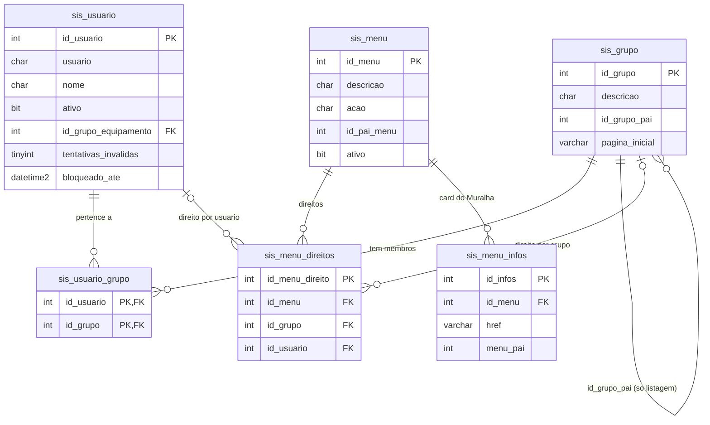
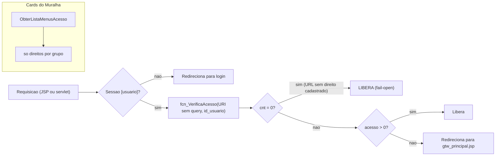
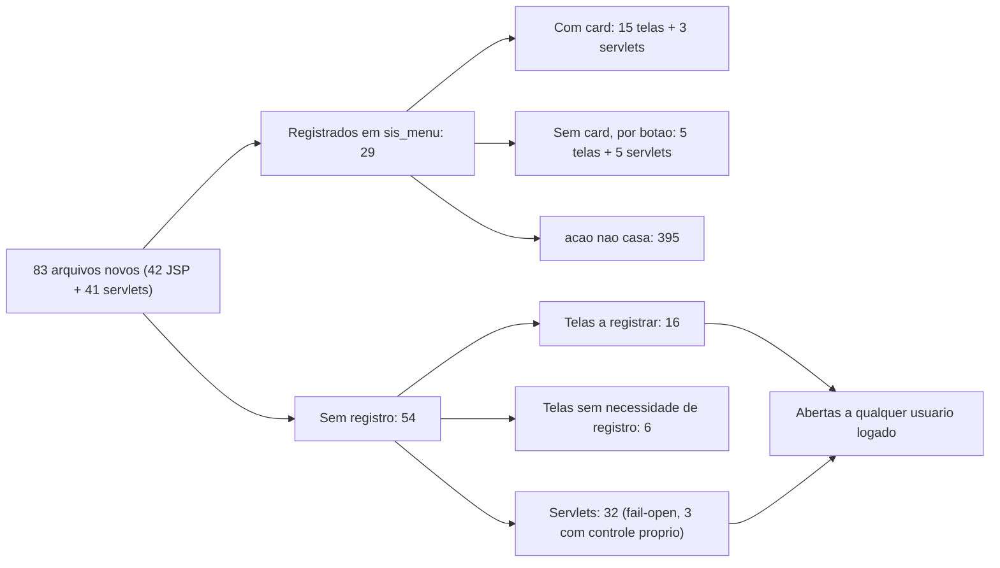

# Guia de correções e implementações — Análise de Dados, KPIs, Gestão de Lotes e Plataforma de Análises

> Levantamento de 2026-10-19 no código do repositório e no banco `GTW_MURALHA_DEV` (somente consultas `SELECT`). **Nenhuma correção deste guia foi executada.** Ele serve de roteiro: cada item traz o problema, a evidência verificada, a proposta, os arquivos afetados e o critério de aceite.

## Origem

Os problemas vêm de dois levantamentos já versionados:

- [Estrutura de dados por tela](../banco-de-dados/estrutura-dados-por-tela.md): telas de Análise de Dados (exceto Perfil Comportamental e Correlacionamentos), Indicadores de Performance (KPIs) e Gestão de Lotes.
- [Camada de dados da plataforma de Análises](../analise/camada-dados-views-datasets.md): views, datasets e tabelas de origem do Superset.

Também foram verificados, para este guia, o modelo de usuários, grupos e direitos (§1) e as telas de gerenciamento de usuários (§2).

## Como usar

1. Siga a ordem das fases (§5). Itens de segurança (`SEG-*`) vêm antes dos funcionais (`FUN-*`) e de desempenho (`DES-*`).
2. Toda mudança de banco é um script em [`../banco-de-dados/migracoes/`](../banco-de-dados/migracoes/) (`AAAAMMDD_descricao.sql`, idempotente, com rollback comentado), registrado no [README das migrações](../banco-de-dados/migracoes/README.md). O DEV só é alterado com autorização.
3. Código novo segue [`../requisitos/06-padroes-de-codigo.md`](../requisitos/06-padroes-de-codigo.md) §1.1 (sessão + permissão), SQL parametrizado, recursos fechados e UTF-8; telas seguem [`../requisitos/05-padrao-visual.md`](../requisitos/05-padrao-visual.md).
4. Ao concluir um item, registre a entrega em `docs/entregas/` com a seção "## Origem" apontando para este guia e para o plano correspondente em `docs/planos-salvador/`, quando houver.

---

## 1. Modelo de usuários, grupos e poderes

### 1.1 Respostas diretas

| Pergunta | Resposta verificada |
|---|---|
| Usuários têm ligação com grupos? | **Sim.** A tabela associativa `dbo.sis_usuario_grupo` (`id_usuario`, `id_grupo`, PK composta) liga `dbo.sis_usuario` a `dbo.sis_grupo`, com FKs para as duas. É uma relação N:N: um usuário pode estar em vários grupos. |
| Situação na base DEV | 42 usuários (26 ativos), 35 grupos e 203 vínculos. 40 usuários têm grupo e 30 estão em mais de um. Sem grupo: `antony` (id 1173, ativo) e `ServidorCaptura` (id 1010, inativo). |
| Os poderes são por usuário ou por grupo? | **O modelo aceita os dois**, mas **na prática são por grupo.** `dbo.sis_menu_direitos` tem `id_grupo` e `id_usuario`, ambos opcionais e com FK. Das 392 linhas, 388 são só por grupo, nenhuma é só por usuário e 4 têm grupo e usuário preenchidos (todas do menu 229 com o usuário 1). |
| Os grupos herdam poderes do grupo pai? | **Não.** `sis_grupo.id_grupo_pai` (25 grupos têm pai) só é usado para listar os grupos e usuários "abaixo" de quem está logado (`Grupo.buscaGruposAbaixo` e `Usuario.buscaUsuariosAbaixo`). A verificação de acesso não considera a hierarquia. |

### 1.2 Como o acesso é verificado

- **Páginas JSP:** os cabeçalhos (`cabecalho_bootstrap_simples.jsp`, `cabecalho_bootstrap_sem_menu.jsp`, `muralha_abertura_bootstrap.jsp`) chamam `Acesso.verificaAcesso()`.
- **Servlets novos:** chamam `new Acesso(req, resp, true).verificaAcesso(false)`.
- **Comparação:** os dois casos comparam `request.getRequestURI()` com `sis_menu.acao` em `dbo.fcn_VerificaAcesso(@acao, @id_usuario)`.

O que a função calcula:
- `cnt` é a quantidade de linhas de direito cadastradas para a URL.
- `acesso` é a quantidade dessas linhas que alcançam o usuário. Para direitos de grupo, a função percorre os membros do grupo; quando o grupo não tem membros, usa o `id_usuario` da linha.

**A decisão é *fail-open*:** [`Acesso.java:161`](../../src/main/java/com/consilux/model/Acesso.java) devolve `(cnt == 0) || (acesso > 0)`. Uma URL sem direito cadastrado fica liberada para qualquer usuário logado, e o mesmo vale se a consulta der erro, porque a exceção é engolida.

**Os cards e o controle de acesso não leem a mesma coisa:**
- Os cards do Muralha (`UsuarioServlet.ObterListaMenusAcesso`, [`UsuarioServlet.java:605`](../../src/main/java/muralha/digital/acessos/UsuarioServlet.java)) só consideram direitos **por grupo**: o join é `sis_usuario_grupo → sis_menu_direitos.id_grupo`.
- A `fcn_VerificaAcesso` também aceita direito **por usuário**.
- Por isso, um direito individual libera a URL, mas o card não aparece.

**Quando o direito tem grupo e usuário na mesma linha**, a função usa `COALESCE(sug.id_usuario, smd.id_usuario)`. Se o grupo tem membros, o usuário da linha é ignorado. É o caso da linha 1075 (grupo 41 com usuário 1): o usuário 1 não é membro do grupo 41 e só tem acesso pelos outros grupos.

### 1.3 Diagramas

### 1.4 Direitos das telas deste guia (DEV, 2026-10-19)

| Menu | Tela | `sis_menu.acao` | Grupos com direito |
|---|---|---|---|
| 366–369, 373, 374, 384, 387 | Log de Auditoria, SLA de Latência, Assertividade, SLA Pré-proc., Time-lapse, Disponibilidade, Integridade, Logs Técnicos | caminho da JSP | 41 Anel de Segurança, 42 Anel de Segurança – Supervisores |
| 370 | Gestão de Lotes | `/muralha-digital/pages/processamento/lotes/index.jsp` | 41, 42 |
| 371 | Dashboard KPIs | `/muralha-digital/pages/dashboard/kpis/index.jsp` | 41, 42 |
| 372 | Configuração de KPIs | `/muralha-digital/pages/admin/kpis/index.jsp` | 41, 42 |
| 392, 393, 394 | Tipos de Alerta, Relatórios Gerenciais, Pré-Processamento | URI do servlet | só 42 |
| 395 | Análises | `/MuralhaDigital/SsoAnalise?acao=abrir` | 41, 42 |
| 396 | Análises – Abrir no Superset | não existe (migração pendente) | — |
| 63 | Cadastro de Usuários | `/usuario/usuario.jsp` | 6 Supervisores, 11 Administradores |

O grupo **11 Administradores não tem direito a nenhuma dessas telas, exceto Cadastro de Usuários.** O usuário 1 acessa porque também é membro do grupo 42.

---

## 2. Telas de gerenciamento de usuários

| Tela | Onde | O que gerencia | Limitações verificadas |
|---|---|---|---|
| **Cadastro de Usuários** (sis_menu 63) | `/usuario/usuario.jsp`: widget GWT legado (`CADASTRO_USUARIO_PLACE_HOLDER`) servido por [`UsuarioServiceImpl`](../../src/main/java/com/consilux/ui/server/UsuarioServiceImpl.java) | Dados do usuário, **grupos do usuário** e **permissões individuais** (`sis_menu_direitos.id_usuario`). Para salvar ([`Usuario.java:1443-1474`](../../src/main/java/com/consilux/model/Usuario.java)), a tela apaga todos os grupos e permissões individuais do usuário e grava de novo, em transação, com evento `CREATE_USER`/`UPDATE_USER`. | Visual legado, fora do padrão Bootstrap. Lista só os usuários e grupos "abaixo" do usuário logado na hierarquia `id_grupo_pai`. Direito: grupos 6 e 11. |
| **Configuração de Chamados › Perfis** (sis_menu 382) | `/muralha-digital/pages/chamados/configuracao.jsp` ([`ChamadoConfigDao.java:357`](../../src/main/java/muralha/digital/chamado/ChamadoConfigDao.java)) | Inclui e remove membros dos grupos 107 Solicitante, 108 Gestor do contrato e 109 Equipe técnica | Só esses três grupos. Direito: grupo 11. |
| Desbloqueio de usuário | `UsuarioServlet?acao=desbloquear` | Zera o bloqueio por tentativas inválidas | Ação de servlet, não é tela própria. |

**Não existe tela para:**
- **cadastrar grupos:** `Grupo.incluiGrupo`, `alteraGrupo` e `removeGrupo` existem em [`Grupo.java`](../../src/main/java/com/consilux/model/Grupo.java), mas nada os chama;
- **dar direitos a um grupo:** o único lugar do código que grava em `sis_menu_direitos` é `PermissaoMenu.inserir`, chamado só pelo Cadastro de Usuários, e sempre com `id_usuario`.

Hoje, os direitos por grupo (que são 99% dos direitos) só mudam por script de migração. Ver o item [IMP-01](#imp-01-tela-de-gestão-de-grupos-e-direitos).

---

## 3. Resumo dos itens

| ID | Prioridade | Tela / área | Problema | Migração? |
|---|---|---|---|---|
| [SEG-01](#seg-01-verificação-de-acesso-fail-open-nos-servlets-novos) | Alta | Servlets novos | Fail-open: as URIs dos servlets não estão em `sis_menu` | Sim |
| [SEG-02](#seg-02-acao-com-query-string-não-casa-com-a-uri) | Alta | Análises (395) e mais 14 menus | `acao` com `?…` nunca casa com a URI | Sim |
| [SEG-03](#seg-03-gestão-de-lotes-e-kpis-sem-permissão-por-ação) | Alta | Gestão de Lotes, KPIs | Só sessão; sem permissão por ação | Sim |
| [SEG-04](#seg-04-sql-livre-na-configuração-de-kpis) | Alta | Configuração de KPIs | SQL livre executado; validação só por `startsWith("SELECT")` | Sim |
| [SEG-05](#seg-05-xss-armazenado) | Alta | Log de Auditoria, Relatórios Gerenciais, KPIs | HTML montado sem escape | Não |
| [SEG-06](#seg-06-rls-do-superset-quebrada) | Alta | Plataforma de Análises | RLS do Operador aponta para view e coluna inexistentes | Sim |
| [SEG-07](#seg-07-direitos-dos-administradores-e-da-configuração-de-kpis) | Média | Direitos | Grupo 11 sem direito às telas; Config. de KPIs aberta ao grupo 41 | Sim |
| [SEG-08](#seg-08-botão-abrir-no-superset) | Média | Análises | Migração do menu 396 pendente | Sim (já escrita) |
| [SEG-09](#seg-09-hash-de-senha-em-log-e-na-resposta-do-login) | Média | Login | Hash da senha em log de debug e na resposta | Não |
| [SEG-10](#seg-10-tipos-de-alerta-acaolistar-sem-permissão) | Baixa | Tipos de Alerta | `acao=listar` sem checar permissão | Não |
| [FUN-01](#fun-01-relatoriogerencialjob-consulta-tabela-inexistente) | Alta | Relatórios Gerenciais | Job lê `muralha.sis_log_auditoria` (não existe) | Não |
| [FUN-02](#fun-02-relatoriopreprocmensaljob-usa-colunas-inexistentes) | Alta | Relatórios Gerenciais | Job usa colunas inexistentes de `vtr_status_analise` | Talvez |
| [FUN-03](#fun-03-gestão-de-lotes-incompleta) | Alta | Gestão de Lotes | Não inclui infrações; envio sem itens; sem integração DETRAN | Sim |
| [FUN-04](#fun-04-kpis-sem-snapshot) | Média | KPIs | KPIs 5, 7, 8, 9 e 11 sem histórico | A investigar |
| [FUN-05](#fun-05-cargas-da-camada-analise-paradas) | Média | Plataforma de Análises | Cargas paradas desde 2026-10-17; agendamento não encontrado | Não |
| [FUN-06](#fun-06-v_preprocessamento-incompleta) | Média | Plataforma de Análises | Colunas nulas e métrica divergente | Sim |
| [FUN-07](#fun-07-sla-de-latência-com-limite-fixo-no-front) | Média | SLA de Latência | Limite fixo no JS, média × P95, sem context path | Não |
| [FUN-08](#fun-08-disponibilidade-ignora-equipamentos-parados) | Média | Disponibilidade | Equipamento sem passagem há 7 dias nunca é "offline" | Talvez |
| [FUN-09](#fun-09-integridade-sem-hash-de-origem) | Média | Integridade das Imagens | Sem hash de origem: tudo `SEM_CONFERENCIA` | Depende de integração |
| [FUN-10](#fun-10-log-de-auditoria-exportação-e-filtro) | Baixa | Log de Auditoria | Exportação só da página; filtro por `LIKE` no texto | Não |
| [FUN-11](#fun-11-inconsistências-menores) | Baixa | Várias | Filtro de imagem teste, status inexistente, textos | Não |
| [DES-01](#des-01-consultas-pesadas-sem-materialização) | Média | Pré-Processamento, KPIs, Superset | Varreduras de ≈8 mi linhas a cada 60 s | Sim |
| [IMP-01](#imp-01-tela-de-gestão-de-grupos-e-direitos) | Média | Usuários | Não há tela de grupos e direitos por grupo | Não (usa tabelas existentes) |
| [SEG-11](#seg-11-telas-e-servlets-novos-sem-registro) | Alta | Módulos novos (todos) | 22 telas e 32 servlets novos sem registro em `sis_menu` (ver §7) | Sim |

---

## 4. Itens

### SEG-01 Verificação de acesso fail-open nos servlets novos
- **Problema:** os servlets `/MuralhaDigital/Lote`, `/MuralhaDigital/Kpi`, `/MuralhaDigital/SsoAnalise` e outros chamam `verificaAcesso`. Como suas URIs não estão em `sis_menu`, `cnt = 0` e o acesso é liberado. Há 78 menus com `acao` preenchida e sem nenhum direito.
- **Evidência:** [`Acesso.java:161`](../../src/main/java/com/consilux/model/Acesso.java) e [`Acesso.java:179`](../../src/main/java/com/consilux/model/Acesso.java) (usa `getRequestURI()`); [`LoteServlet.java:31`](../../src/main/java/muralha/digital/lote/LoteServlet.java); [`KpiServlet.java:32`](../../src/main/java/muralha/digital/kpi/KpiServlet.java).
- **Proposta:**
  - **Não** mudar o comportamento global de `Acesso`: fechar o *fail-open* bloquearia telas legadas sem direito cadastrado.
  - Criar uma verificação **estrita** e opcional, por exemplo `Acesso.possuiDireito(String acaoMenu, Usuario u)`, que nega quando `cnt = 0`. O modelo é `SsoAnaliseServlet.podeAbrirSuperset`.
  - Nos servlets novos, verificar contra a `acao` do menu da tela (por exemplo, `LoteServlet` contra a JSP do menu 370), e não contra a URI do próprio servlet.
  - Registrar logs de negação no `AuditoriaService`.
- **Arquivos:** `com/consilux/model/Acesso.java` (novo método), servlets de `muralha/digital/{lote,kpi,analise,preprocessamento,relatorio,alerta/operacional}`.
- **Aceite:**
  - um usuário logado sem o grupo 41/42 recebe 403 em `/MuralhaDigital/Lote?acao=listar`;
  - um usuário do grupo 42 continua acessando;
  - as telas legadas continuam como estão.

### SEG-02 `acao` com query string não casa com a URI
- **Problema:** `Acesso` compara só a URI, sem a query. Há 15 menus com `?` em `sis_menu.acao`, como o 395 `/MuralhaDigital/SsoAnalise?acao=abrir`. Para eles `cnt = 0` e o acesso fica liberado para qualquer usuário logado.
- **Evidência:** consulta em `dbo.sis_menu` (`acao LIKE '%?%'` = 15); [`SsoAnaliseServlet.java:60`](../../src/main/java/muralha/digital/analise/SsoAnaliseServlet.java).
- **Proposta:**
  - Migração que muda `sis_menu.acao` do 395 para `/MuralhaDigital/SsoAnalise`. O card usa `sis_menu_infos.href` e continua com `?acao=abrir`.
  - Listar os outros 14 menus e decidir caso a caso: corrigir a `acao` ou, se a query distingue telas, usar a verificação estrita do SEG-01 com a chave exata.
- **Aceite:** um usuário sem o grupo 41/42 é redirecionado ao abrir `/MuralhaDigital/SsoAnalise?acao=abrir`.

### SEG-03 Gestão de Lotes e KPIs sem permissão por ação
- **Problema:** todas as ações de `LoteServlet` (`listar`, `itens`, `criar`, `adicionarInfracoes`, `enviar`, `cancelar`) e de `KpiServlet` (incluindo gravar a configuração) exigem só sessão, por causa do SEG-01.
- **Evidência:** [`LoteServlet.java:31`](../../src/main/java/muralha/digital/lote/LoteServlet.java), [`LoteServlet.java:101`](../../src/main/java/muralha/digital/lote/LoteServlet.java), [`KpiServlet.java:164`](../../src/main/java/muralha/digital/kpi/KpiServlet.java).
- **Proposta:**
  - Leitura de lotes: direito do menu 370.
  - Escrita (`criar`, `adicionarInfracoes`, `enviar`, `cancelar`): mesmo direito, ou um direito próprio sem card (por exemplo "Gestão de Lotes – Enviar"), no padrão do menu 396.
  - KPIs: leitura com o 371 e escrita (`POST`) com o 372.
- **Aceite:** o `POST` de configuração de KPI com um usuário sem o direito 372 devolve 403 e é registrado na auditoria.

### SEG-04 SQL livre na Configuração de KPIs
- **Problema:** o `query_sql` digitado na tela é gravado e depois executado pelo painel e pelo `KpiSnapshotJob`. A única validação é `sql.toUpperCase().startsWith("SELECT")`, que aceita `SELECT 1; DELETE …`, `SELECT … INTO` e funções com efeito colateral.
- **Evidência:** [`KpiServlet.java:125`](../../src/main/java/muralha/digital/kpi/KpiServlet.java), [`KpiServlet.java:175`](../../src/main/java/muralha/digital/kpi/KpiServlet.java).
- **Proposta:**
  - Restringir o menu 372 ao grupo 11 (SEG-07).
  - Rejeitar `;`, `INTO`, `EXEC`, `INSERT`, `UPDATE`, `DELETE`, `MERGE`, `DROP`, `ALTER`, `CREATE`, `GRANT`, `xp_` e `sp_`.
  - Executar com `setQueryTimeout` e, idealmente, com um login de banco somente leitura (pedir ao DBA; não está nesta base).
  - Registrar na auditoria o SQL anterior e o novo (`parametro_historico` já é usado).
- **Aceite:** gravar `SELECT 1; DELETE FROM x` é recusado com mensagem; um `SELECT` válido continua funcionando.

### SEG-05 XSS armazenado
- **Problema:** textos vindos do banco são inseridos no HTML sem escape:
  - Log de Auditoria: `descricao` e usuário;
  - Relatórios Gerenciais: conteúdo dos relatórios;
  - KPIs: nome, descrição e unidade digitados na Configuração.
- **Evidência:**
  - `innerHTML` em [`relatorios/gerencial/index.jsp`](../../src/main/webapp/muralha-digital/pages/relatorios/gerencial/index.jsp) (3 ocorrências), [`dashboard/kpis/index.jsp`](../../src/main/webapp/muralha-digital/pages/dashboard/kpis/index.jsp) e [`admin/kpis/index.jsp`](../../src/main/webapp/muralha-digital/pages/admin/kpis/index.jsp);
  - montagem de linhas em [`auditoria/consulta-log.jsp`](../../src/main/webapp/muralha-digital/pages/auditoria/consulta-log.jsp).
- **Proposta:** usar `textContent` ou um `escaparHtml()` comum em todo valor vindo do servidor, e revisar os templates de linha de tabela.
- **Aceite:** um KPI com nome `` aparece como texto.

### SEG-06 RLS do Superset quebrada
- **Problema:** a regra do papel Operador usa `area_monitorada_id` e a view `analise.v_usuario_area_monitorada`. A view não existe e a coluna não está nas tabelas filtradas. Além disso, a regra só se aplica aos 13 datasets declarativos (sem gráficos). Os 16 datasets `gtw_*`, que alimentam todos os gráficos, não têm RLS, então o Operador vê todos os dados.
- **Evidência:** [`analise/superset/governanca/rls.yaml`](../../analise/superset/governanca/rls.yaml); [camada de dados §6](../analise/camada-dados-views-datasets.md).
- **Proposta:**
  1. Migração criando `analise.v_usuario_area_monitorada` (usuário → áreas monitoradas → locais).
  2. Expor `id_local` (ou a área) nos datasets `gtw_*` e aplicar a regra a eles no `provisionar.py`.
  3. Decidir com a operação se o Operador deve mesmo ser filtrado por área.
- **Aceite:** um usuário Operador vinculado a uma área vê nos gráficos só os locais dessa área.

### SEG-07 Direitos dos administradores e da Configuração de KPIs
- **Problema:**
  - O grupo 11 Administradores não tem direito às telas deste guia (§1.4); o usuário 1 só acessa porque está no grupo 42.
  - A Configuração de KPIs (372), que permite SQL livre, está liberada para o grupo 41 (operadores).
  - Tipos de Alerta, Relatórios Gerenciais e Pré-Processamento (392–394) só estão liberados para o grupo 42.
- **Proposta:**
  - Migração que dá ao grupo 11 os menus 366–374, 384, 387 e 392–395.
  - Retirar o grupo 41 do 372, mediante decisão do responsável.
  - Revisar o acesso do grupo 41 aos menus 392–394.
- **Aceite:** um usuário só do grupo 11 vê os cards e abre as telas; um usuário só do grupo 41 não abre a Configuração de KPIs.

### SEG-08 Botão "Abrir no Superset"
- **Situação:** o script [`20261019_analise_permissao_abrir_superset.sql`](../banco-de-dados/migracoes/20261019_analise_permissao_abrir_superset.sql) está escrito e não foi executado. Até ser aplicado, o botão fica oculto para todos.
- **Proposta:** executar no DEV com autorização, junto com o SEG-07, porque o script também dá o menu 395 ao grupo 11.

### SEG-09 Hash de senha em log e na resposta do login
- **Problema:** o `doPost` registra `senhaMD5` em `logger.debug`, e a resposta do login devolve `senhaMD5`.
- **Evidência:** [`UsuarioServlet.java:85`](../../src/main/java/muralha/digital/acessos/UsuarioServlet.java) e [`UsuarioServlet.java:218`](../../src/main/java/muralha/digital/acessos/UsuarioServlet.java).
- **Proposta:**
  - Remover a senha do log.
  - Verificar se o front-end usa o campo devolvido antes de removê-lo da resposta: é código legado, e a correção é pontual.

### SEG-10 Tipos de Alerta: `acao=listar` sem permissão
- **Problema:** `listar` dispensa a verificação de acesso, porque o popup de notificação usa essa ação.
- **Evidência:** [`TipoAlertaConfigServlet.java:54`](../../src/main/java/muralha/digital/alerta/operacional/TipoAlertaConfigServlet.java).
- **Proposta:** manter a dispensa, mas devolver só os campos que o popup usa (sem os parâmetros de configuração), ou criar uma ação específica do popup.

### FUN-01 RelatorioGerencialJob consulta tabela inexistente
- **Problema:** o job consulta `muralha.sis_log_auditoria` com a coluna `data`. A tabela real é `dbo.sis_log_auditoria`, com `dt_operacao`. Por isso `muralha.relatorio_periodico` tem 0 linhas e a tela fica vazia.
- **Evidência:** [`RelatorioGerencialJob.java:174`](../../src/main/java/muralha/digital/relatorio/RelatorioGerencialJob.java).
- **Proposta:**
  - Corrigir o schema e a coluna.
  - Revisar as outras consultas do job contra `sys.columns`.
  - Registrar erro de execução no log técnico.
- **Aceite:** depois da execução manual do job no DEV, existe uma linha em `relatorio_periodico` e a tela a exibe.

### FUN-02 RelatorioPreProcMensalJob usa colunas inexistentes
- **Problema:** o job usa `data_analise`, `resultado_ia`, `revisado`, `motivo_descarte` e `id_usuario` de `muralha.vtr_status_analise`. A tabela só tem `id_veiculo_tempo_real` e `status_analise`.
- **Evidência:** [`RelatorioPreProcMensalJob.java`](../../src/main/java/muralha/digital/relatorio/RelatorioPreProcMensalJob.java), consultas nas linhas 84, 112, 151, 180, 205, 230, 284 e 305.
- **Proposta:**
  - Usar os dados que existem: `muralha.infracao_analise` (analista, data e resultado) e o status em `vtr_status_analise`.
  - Ou, se o relatório exigir os campos, criar as colunas por migração e alimentá-las em `InfracaoAnaliseDAO`.
  - A decisão depende do conteúdo exigido pelo plano do relatório mensal.
- **Aceite:** o job roda sem `SQLException` e grava o relatório do mês.

### FUN-03 Gestão de Lotes incompleta
- **Problema:**
  - Nenhuma tela chama `adicionarInfracoes`, então `lote_infracao_item` está vazia e todo lote fica sem itens.
  - `enviar` aceita lote vazio e só muda o status para ENVIADO: não há integração com o DETRAN nem código que grave CONFIRMADO.
  - `cancelar` não registra auditoria.
  - `lote_infracao_item.id_infracao` não tem FK.
- **Evidência:** [`LoteServlet.java:132`](../../src/main/java/muralha/digital/lote/LoteServlet.java), [`LoteServlet.java:152`](../../src/main/java/muralha/digital/lote/LoteServlet.java), [`LoteServlet.java:167`](../../src/main/java/muralha/digital/lote/LoteServlet.java); [tela](../../src/main/webapp/muralha-digital/pages/processamento/lotes/index.jsp).
- **Proposta:**
  1. Na tela, um modal para selecionar infrações aprovadas (filtro por período e equipamento) e chamar `adicionarInfracoes`.
  2. Bloquear `enviar` com zero itens.
  3. Auditoria em `cancelar`.
  4. Migração com FK ou validação de existência.
  5. A integração com o DETRAN é uma implementação à parte, que depende do layout e do canal definidos pelo contratante. Até lá, rotular o botão como "Marcar como enviado".
- **Aceite:** é possível criar um lote, incluir infrações, ver os itens e enviar; um lote vazio não é enviado.

### FUN-04 KPIs sem snapshot
- **Problema:** os KPIs 5, 7, 8, 9 e 11 não têm linhas em `muralha.kpi_historico`; os KPIs 1–4, 6, 10 e 12 têm. Causa não verificada.
- **Proposta:**
  - Executar o `query_sql` de cada um no DEV (só leitura) e ver os logs do `KpiSnapshotJob`. Hipóteses: erro de SQL, retorno nulo ou KPI inativo.
  - Registrar falha por KPI no log técnico.
- **Aceite:** cada KPI ativo tem snapshot a cada execução do job, ou o motivo da falha fica registrado.

### FUN-05 Cargas da camada `analise` paradas
- **Problema:** o `analise.carga_log` não registra execução depois de 2026-10-17 22:39, e o agendamento de `refresh-materialized.sh` não foi encontrado.
- **Proposta:** definir o agendamento (job Quartz no GTW chamando as `spu_carga_*`, ou cron/serviço no stack Docker) e documentá-lo no [guia do administrador](../analise/guia-administrador.md).

### FUN-06 `v_preprocessamento` incompleta
- **Problema:**
  - `divergencias` e `retrabalho` vêm sempre nulas.
  - `produtividade` repete `recebidos`.
  - A métrica `aproveitamento_global` calcula (recebidos − descartados)/recebidos, enquanto a coluna da view usa disponibilizados/recebidos.
- **Proposta:** definir as regras com o responsável pelo indicador e alterar a view por migração e a métrica no YAML.

### FUN-07 SLA de Latência com limite fixo no front
- **Problema:**
  - `THRESHOLD = 4000` está fixo no JS e os cards decidem pela média; o job usa o P95 e a chave `sla_latencia_threshold_ms`.
  - O JS chama `/MuralhaDigital/…` sem o context path.
- **Proposta:**
  - Devolver o limite e o P95 em `acao=atual` e usar esses valores nos cards.
  - Prefixar as chamadas com `${pageContext.request.contextPath}`.

### FUN-08 Disponibilidade ignora equipamentos parados
- **Problema:** o `DisponibilidadeJob` só verifica locais com passagem nos últimos 7 dias. Equipamento parado há mais tempo nunca aparece como offline, e a tabela não tem retenção.
- **Proposta:** usar como base os locais vigentes (`dbo.local_vigente`) e definir a retenção (por exemplo, 90 dias) com limpeza no próprio job.

### FUN-09 Integridade sem hash de origem
- **Problema:** as ≈200 mil linhas de `vtr_imagem_integridade` estão `SEM_CONFERENCIA`. `vtr_imagem_hash_origem` tem 0 linhas e `INTEGRIDADE_ORIGEM_HASH` = `AUSENTE`.
- **Proposta:** depende de o sistema de captura enviar o hash de origem. Enquanto isso não ocorre, a tela deve explicar o estado "sem conferência".

### FUN-10 Log de Auditoria: exportação e filtro
- **Problema:** as exportações saem só da página atual (50 linhas), e o filtro "Equipamento" faz `LIKE` do nome dentro de `descricao`.
- **Proposta:**
  - Exportar no servidor com os mesmos filtros (CSV/XLSX), no padrão do Sistema de Chamados.
  - Gravar `id_local` estruturado na auditoria quando houver.

### FUN-11 Inconsistências menores
- O filtro de imagem de teste é diferente entre os datasets:
  - `gtw_infracoes_dia` e `gtw_infracoes` usam `id_enquadramento <> 1`;
  - `gtw_infracoes_geo` usa o texto `'Imagem teste'`.
  - Unificar depois de confirmar a descrição do enquadramento 1.
- **Assertividade:** o status `PRIMEIRA_ANALISE` não existe nos dados, e "Revisão Manual" inclui passagens sem status. O texto do alerta cita "TR §5.2.2.3", que não existe no repositório: remover a referência ou apontar para um documento real.
- **SLA Pré-processamento:** exibir o nome do equipamento em vez do `id_local`.
- **Time-lapse:** `muralha.timelapse_cache` só registra uso; ou passa a ser lida como cache, ou deve ser renomeada ou documentada como log.
- **Relatório semanal de SLA (Superset):** o texto cita o painel de disponibilidade, mas o YAML só referencia `sla-latencia`.

### DES-01 Consultas pesadas sem materialização
- **Problema:**
  - **Pré-Processamento:** `pendentes` e `backlog72h` ignoram o período e percorrem ≈8,19 mi linhas de `veiculo_tempo_real` a cada 60 s por aba aberta.
  - **Painel de KPIs:** executa as 12 consultas em série a cada minuto.
  - **Superset:** `v_disponibilidade_dia`, `gtw_trafego_dia` e `gtw_faixa_velocidade` leem `veiculo_tempo_real` e `veiculo_sumarizado` (≈4,15 mi) diretamente.
- **Proposta:**
  - O painel de KPIs passa a ler o último snapshot de `kpi_historico` em vez de executar as consultas.
  - Pré-processamento: filtrar pelo período e criar índice (`data`, `id_local`) se o plano de execução indicar.
  - Superset: materializar por dia, como `mat_infracoes_dia`.
- **Aceite:** a tela de Pré-Processamento responde em menos de 2 s no DEV, e o painel de KPIs não executa `query_sql` a cada carga.

### IMP-01 Tela de gestão de grupos e direitos
- **Necessidade:**
  - não há tela para criar e editar grupos, nem para dar e retirar direitos de um grupo, que é o modelo usado em 99% dos direitos;
  - o Cadastro de Usuários é GWT legado e só trata direitos individuais, que os cards do Muralha nem consideram.
- **Proposta:** nova tela Muralha em `muralha-digital/pages/acessos/` (Bootstrap 5.3) com servlet `/MuralhaDigital/GrupoAcesso`, restrita ao grupo 11 com verificação estrita (SEG-01). Ela teria três abas:
  1. **Grupos:** CRUD de `sis_grupo`, reaproveitando `Grupo.incluiGrupo`, `alteraGrupo` e `removeGrupo`.
  2. **Membros:** inclusão e remoção em `sis_usuario_grupo`, no padrão da aba Perfis dos Chamados.
  3. **Direitos:** árvore de `sis_menu` com checkboxes gravando `sis_menu_direitos.id_grupo`.
- **Regras:** toda alteração gravada no `AuditoriaService`; sem migração de estrutura, porque usa as tabelas existentes; um menu "Gestão de Acessos" (novo `sis_menu` com card, por script).
- **Aceite:** um administrador cria um grupo, inclui usuários, marca direitos e o card aparece para os membros sem script.

### SEG-11 Telas e servlets novos sem registro
- **Problema:** das telas e servlets criados depois da importação do projeto (2026-10-08), 22 JSPs e 32 servlets não estão em `sis_menu`. Pelo *fail-open* (§1.2), ficam abertos a qualquer usuário logado, inclusive telas que a Central de Ajuda descreve como "apenas administradores". O inventário completo está no §7.
- **Proposta:** uma migração que registra cada tela sensível como `sis_menu` (com ou sem card) e dá o direito aos grupos decididos (§7.5), mais a verificação estrita do SEG-01 nos servlets.
- **Aceite:** todas as linhas do §7.3 e do §7.4 com "Registrar" passam a ter menu e direitos, e um usuário fora dos grupos é barrado ao digitar o endereço.

---

## 5. Ordem sugerida

```mermaid
flowchart LR
    subgraph F1["Fase 1 - Seguranca"]
        S1["SEG-01 verificacao estrita"] --> S3["SEG-03 permissao por acao"]
        S2["SEG-02 acao do menu 395"]
        S7["SEG-07 e SEG-08 direitos (migracao)"]
        S4["SEG-04 SQL de KPI"]
        S5["SEG-05 XSS"]
        S9["SEG-09 e SEG-10"]
    end
    subgraph F2["Fase 2 - Funcional"]
        F01["FUN-01 e FUN-02 relatorios"]
        F03["FUN-03 lotes"]
        F04["FUN-04 KPIs"]
        F05["FUN-05 cargas analise"]
    end
    subgraph F3["Fase 3 - Analitico e desempenho"]
        S6["SEG-06 RLS Superset"]
        F06["FUN-06 v_preprocessamento"]
        D1["DES-01 materializacao"]
    end
    subgraph F4["Fase 4 - Gestao de acessos e ajustes"]
        I1["IMP-01 tela de grupos e direitos"]
        F07["FUN-07 a FUN-11"]
    end
    F1 --> F2 --> F3 --> F4
```

| Fase | Itens | Dependências |
|---|---|---|
| 1 | SEG-01 a SEG-05, SEG-07 a SEG-11 | Autorização para executar as migrações de direitos no DEV |
| 2 | FUN-01 a FUN-05 | FUN-02 depende da definição do conteúdo do relatório mensal; FUN-03 (integração DETRAN) depende do contratante |
| 3 | SEG-06, FUN-06, DES-01 | Definição do recorte por área do Operador e das regras dos indicadores |
| 4 | IMP-01, FUN-07 a FUN-11 | SEG-01 (a tela nova usa a verificação estrita) |

## 6. Migrações previstas

Todas estão por escrever, exceto a do SEG-08. Nenhuma foi executada.

| Item | Script sugerido | Conteúdo |
|---|---|---|
| SEG-02 | `AAAAMMDD_acesso_acao_menus_query.sql` | `UPDATE sis_menu SET acao` do 395 e dos demais menus decididos |
| SEG-03 | `AAAAMMDD_lotes_direito_envio.sql` | Menu sem card "Gestão de Lotes – Enviar" e direitos |
| SEG-07 | `AAAAMMDD_direitos_administradores_analise.sql` | Direitos do grupo 11 nos menus do §1.4; retirada do grupo 41 do 372 |
| SEG-08 | [`20261019_analise_permissao_abrir_superset.sql`](../banco-de-dados/migracoes/20261019_analise_permissao_abrir_superset.sql) | Já escrito |
| SEG-06 | `AAAAMMDD_analise_rls_area_monitorada.sql` | `analise.v_usuario_area_monitorada` e colunas de local nos datasets |
| FUN-02 | `AAAAMMDD_vtr_status_analise_colunas.sql` | Só se a decisão for criar as colunas |
| FUN-03 | `AAAAMMDD_lote_infracao_item_fk.sql` | FK ou índice de `id_infracao` |
| FUN-06 | `AAAAMMDD_analise_v_preprocessamento.sql` | Nova definição da view |
| DES-01 | `AAAAMMDD_analise_materializacoes_trafego.sql` | Tabelas `mat_*` e procedures de carga |
| IMP-01 | `AAAAMMDD_menu_gestao_acessos.sql` | Menu e card "Gestão de Acessos" para o grupo 11 |
| SEG-11 | `AAAAMMDD_registro_modulos_novos.sql` | Menus sem card das telas do §7.3 e §7.4 marcadas "Registrar", com os direitos do §7.5 |

---

## 7. Registro e atribuição dos módulos novos

> Verificação de 2026-10-19. Considerados "novos" os JSPs em `muralha-digital/pages/` e os servlets em `muralha.digital` criados depois do commit de importação `4985d5f` (2026-10-08): 42 JSPs e 41 servlets. Cada URL foi comparada com `sis_menu.acao` (sem a query), `sis_menu_infos` (card) e `sis_menu_direitos` (grupos). A tabela `sis_menu_url`, que o legado usa para associar URLs extras a um menu, está vazia.

### 7.1 Resumo

| Situação | Telas | Servlets |
|---|---|---|
| Registrada, com card e direitos | 15 | 3 (392–394, que também são o card da tela) |
| Registrada, sem card (aberta por botão) e com direitos | 5 | 5 (385, 386, 388, 390, 391) |
| Registrada, mas a `acao` não casa com a URI | — | 1 (395, ver SEG-02) |
| **Sem registro** | **22** (16 a registrar, 6 sem necessidade) | **32** (3 com controle próprio) |
| Prevista e não executada | menu 396 "Análises – Abrir no Superset" (SEG-08) | — |

### 7.2 Registradas

| Menu | Tela | Card (módulo) | Grupos | Observação |
|---|---|---|---|---|
| 366–369, 373, 374, 384, 387 | Log de Auditoria, SLA de Latência, Assertividade, SLA Pré-proc., Time-lapse, Disponibilidade, Integridade, Logs Técnicos | Análise de Dados | 41, 42 | Sem o grupo 11 (SEG-07) |
| 392, 393, 394 | Tipos de Alerta, Relatórios Gerenciais, Pré-Processamento | Análise de Dados (`acao` = servlet) | 42 | As JSPs para as quais os servlets encaminham não estão registradas (§7.3) |
| 395 | Análises | Análise de Dados | 41, 42 | `acao` com `?acao=abrir` (SEG-02) |
| 370 | Gestão de Lotes | Cadastro e Configuração | 41, 42 | Servlet `/MuralhaDigital/Lote` sem registro |
| 371 / 372 | Dashboard KPIs / Configuração de KPIs | Dashboards / sem card | 41, 42 | Configuração aberta ao grupo 41 (SEG-07) |
| 375 | Mapa de Incidentes Externos | Mapas | 41, 42 | — |
| 376 / 377 / 378 | Painéis de Análise / Catálogo de Datasets / Catálogo de Dados | Tela inicial / Cadastro e Configuração / sem card | 11, 41, 42 | — |
| 379–383 | Chamados, Detalhe, Relatórios, Configuração, card Sistema de Chamados | Sistema de Chamados | 11, 107, 108, 109 (Relatórios: 11, 108, 109; Configuração: 11) | Servlets com controle próprio por perfil |
| 385, 386, 388 | Integridade – consulta / configuração; Logs Técnicos – consulta | sem card (servlet) | 41, 42 / 42 / 41, 42 | — |
| 389 / 390 / 391 | Revisão de Placas / fila / Score de OCR | Consulta de Veículos / sem card | 41, 42 / 41, 42 / 42 | — |

### 7.3 Telas sem registro

| Tela | Caminho (`/muralha-digital/pages/…`) | Como é aberta | Recomendação |
|---|---|---|---|
| Retenção de Dados (LGPD) | `admin/retencao/index.jsp` | Só pelo endereço (Central de Ajuda §16.7) | **Registrar**: sem card, grupo 11 |
| CPF / Matrícula | `admin/cpf-matricula/index.jsp` | Só pelo endereço | **Registrar**: sem card, grupo 11 |
| Cadastro de Datasets (versão anterior) | `admin/datasets/index.jsp` | Só pelo endereço; a Ajuda diz "apenas administradores" | **Registrar**: sem card, grupo 11 |
| Dashboard Builder (versão anterior) | `dashboard/builder/index.jsp` | Só pelo endereço | **Registrar**: sem card, grupos 11, 41, 42 (os mesmos do 376); ou desativar |
| Exportação de Passagens | `relatorios/exportacao-passagens/index.jsp` | Só pelo endereço | **Registrar**: exportação em massa de passagens; grupos a decidir (42 e 11 sugeridos) |
| Passagens Anonimizadas | `consulta/passagens-anonimizadas/index.jsp` | Só pelo endereço | **Registrar**: grupos 41, 42 e 11 |
| Consolidação de Dados Multifonte | `inteligencia/consolidacao/index.jsp` | Só pelo endereço | **Registrar**: grupos 41, 42 e 11 |
| Dupla Análise – fila / analisar | `processamento/dupla-analise/fila.jsp`, `analisar.jsp` | Só pelo endereço; `analisar.jsp` não é referenciada por nenhum arquivo | **Registrar** as duas: grupos 41, 42 e 11 |
| Tipos de Alerta (JSP) | `tipos-alerta/index.jsp` | Pelo servlet do menu 392 | **Registrar** com os grupos do 392: aberta direto pelo endereço, a JSP não passa pela verificação do servlet |
| Relatórios Gerenciais (JSP) | `relatorios/gerencial/index.jsp` | Pelo servlet do menu 393 | **Registrar** com os grupos do 393 (mesmo motivo) |
| Pré-Processamento (JSP) | `monitoramento/pre-processamento/index.jsp` | Pelo servlet do menu 394 | **Registrar** com os grupos do 394 (mesmo motivo) |
| Painel (editor) / editor de widget | `analises/paineis/index.jsp`, `analises/widgets/editor.jsp` | Pela lista de painéis (376) | Registrar com os grupos do 376 |
| Editor / modelador de dataset | `analises/datasets/editor.jsp`, `modelador.jsp` | Pelo Catálogo de Datasets (377) | Registrar com os grupos do 377 |
| Análises (embedding) | `analise/embedding.jsp` | Encaminhada pelo `SsoAnaliseServlet` | Não precisa: sem o encaminhamento, a página não tem dados |
| Configurar MFA | `meu-perfil/configurar-mfa.jsp` | Só pelo endereço (a Ajuda informa) | Não restringir, porque vale para todo usuário; **criar atalho** (menu do usuário) |
| Manuais e Central de Ajuda | `analise/manual.jsp`, `analises/manual.jsp`, `chamados/manual.jsp`, `ajuda/index.jsp` | Botões "Manual" e "Ajuda" | Não precisa: conteúdo para todo usuário logado |

### 7.4 Servlets sem registro

Todos verificam a sessão. A permissão só é verificada quando a URI está registrada, o que não é o caso de nenhum deles.

| Servlet (URL) | Controle hoje | Recomendação |
|---|---|---|
| `Chamado`, `ChamadoRelatorio`, `ChamadoConfig` | Próprio, pelos perfis do Sistema de Chamados (`ChamadoConfig` exige administrador) | Manter |
| `/api/dash/catalogo` | Sessão; parte das ações exige administrador | Manter e aplicar a verificação estrita nas demais ações |
| `AnaliseGuestToken` | Só sessão; o `embedding.js` não chama | Restringir aos grupos do 395 ou remover se não for usado |
| `Lote`, `Kpi` | Só sessão | Verificação estrita contra 370, 371 e 372 (SEG-03) |
| `Retencao`, `UsuarioCpfMatricula`, `DashboardBuilder`, `Dataset`, `/api/dash/datasets` | Só sessão | Verificação estrita contra as telas do §7.3 (grupo 11) |
| `Exportacao`, `ConsultaAnonimizada`, `Consolidacao`, `InfracaoAnalise` | Só sessão | Verificação estrita contra as telas correspondentes |
| `Assertividade`, `Auditoria`, `Disponibilidade`, `SlaLatencia`, `SlaPreprocessamento`, `Timelapse`, `Gis`, `Incidente`, `MapaConfig`, `Obliteracao` | Só sessão | Verificação estrita contra o menu da tela que os consome (366–375) |
| `/api/dash/{consultas,paineis,widgets,exportar}` | Só sessão | Verificação estrita contra 376 e 377 |
| `MfaConfig`, `/api/dash/health` | Só sessão | Manter (próprio usuário / monitoramento) |

### 7.5 Atribuição a decidir

O responsável precisa definir:
1. **Grupo 11 Administradores:** incluir em todas as telas novas de Análise de Dados, KPIs e Gestão de Lotes (SEG-07)?
2. **Exportação de Passagens e Consolidação:** quais grupos podem exportar e consultar dados em massa?
3. **Dupla Análise:** fica com os grupos 41 e 42, ou ganha um grupo próprio de analistas?
4. **Dashboard Builder e Cadastro de Datasets (versões anteriores):** manter registrados para o grupo 11 ou desativar?
5. **Configuração de KPIs (372):** retirar o grupo 41?
